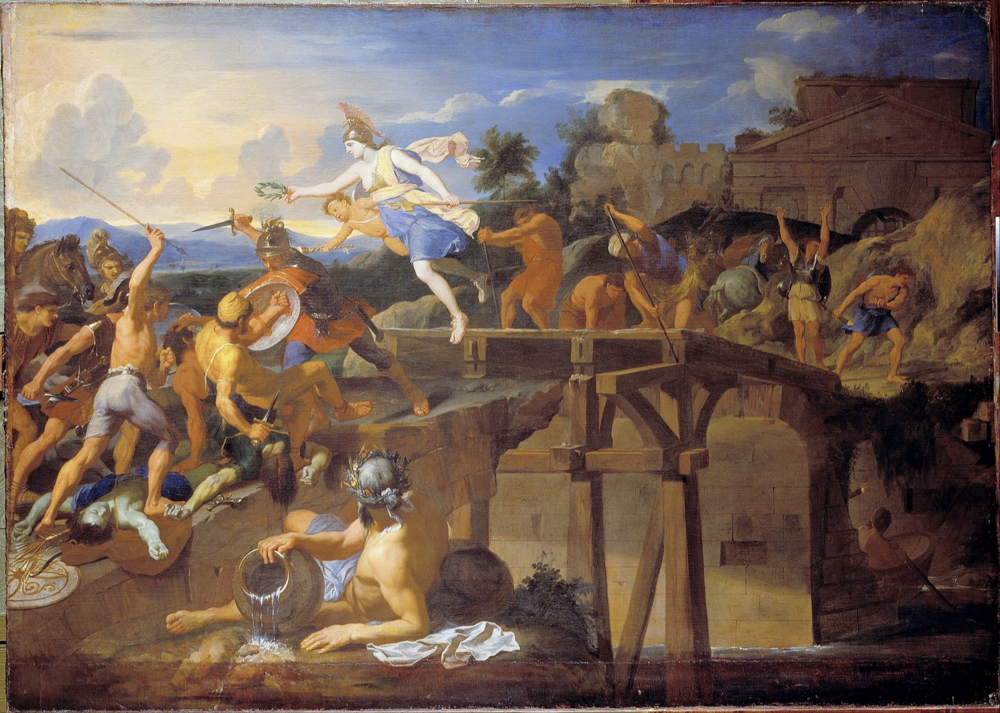
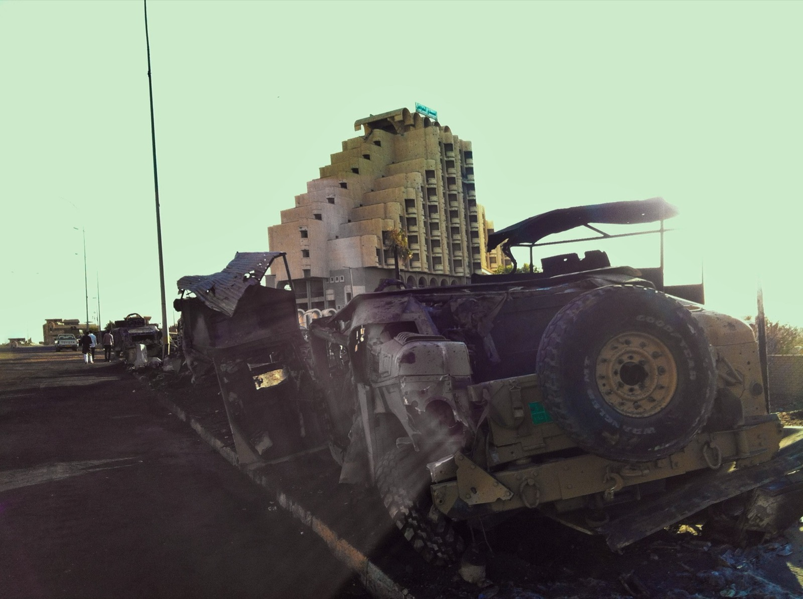
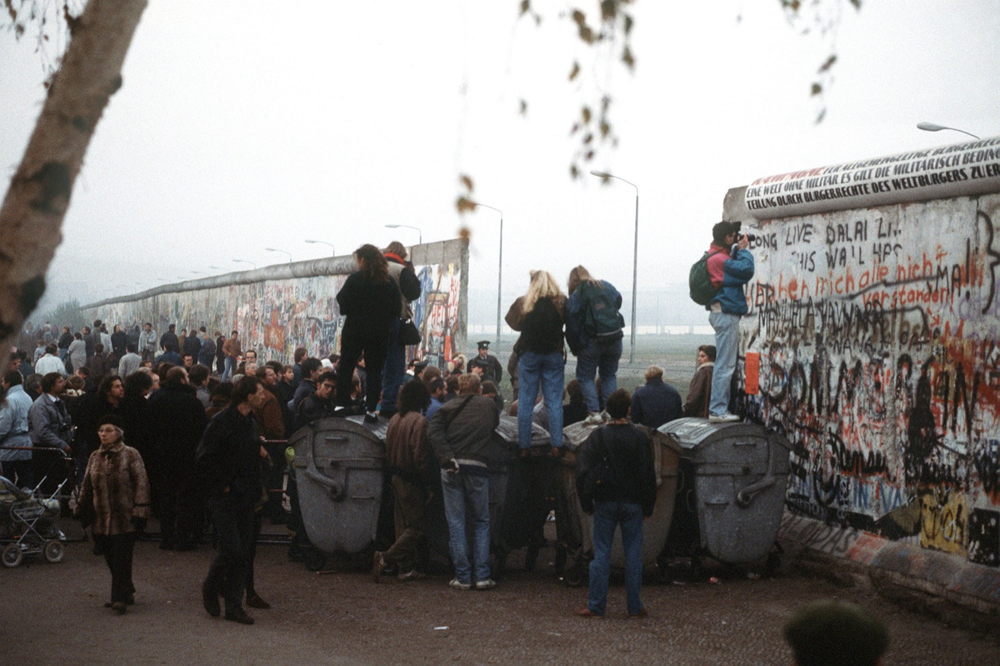
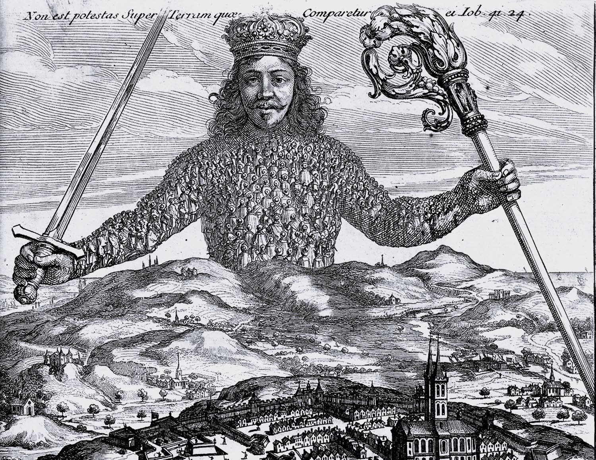

This is where the course begins. Before any theory, I want to show you why collective action matters: through my own story, from a school playground to a lifetime of seeing the same pattern in war, politics, the information commons and lobbying. Then I'll give you the one metaphor we'll use all the way through, set aside two common myths, and lay out where the course goes from here.

> [!summary] In this chapter
> - **From playground to planet**: the same pattern, from a bully in the playground to battles, regimes, the commons and lobbying.
> - **Symptom, organ, cause**: collective action is like a failing heart. Naming it isn't a diagnosis; the real questions are why it fails, and what would cure it.
> - **Two myths**: "it's modernity's fault" and "it's an ascent of civilisation". Both have some truth, and both are, overall, wrong.
> - **What you'll get**: two halves. Understand collective action; then address it.
> - **The arc of the course**: what collective action is, then the climb from small groups to the planet.
> - **Your case**: pick the issue you'll carry through the course.

[Slides from the live session](deck/index.html)

## 1. From playground to planet

### The playground

I want to start with a story about me, aged about seven or eight, in the school playground.

There was a bully. Every playground has one. And I remember thinking, very clearly: we could stop this. If we all stood up to him together, he couldn't do anything.

We didn't. Stand up on your own and you don't stop the bully. You just get teased more, or pushed to the ground. So nobody goes first, and the bully carries on.

> [!reflect] Reflect
> What was your own playground moment?

### Battles

As I got older, I saw this everywhere. In every battle, some people run and some stay. If everyone stays, the line holds. But each of us, alone, is safer running.

The Romans told the story of Horatius at the bridge. An army is about to cross into Rome, and the guards are running. Horatius shames a couple of them into standing with him, and they hold the bridge while it's torn down behind them.[^horatius]

*Horatius holds the bridge: the legend of one man shaming others into standing. Charles Le Brun, c. 1642–43. Public domain.*

And it's not just legend. In 2014, about 1,500 Islamic State fighters took Mosul, Iraq's second city, from an army many times their size. It wasn't that the soldiers were cowards. Each of them saw others leaving, took off their uniform, and went too. Once the line starts to go, nobody wants to be the last one standing.[^mosul]

*Mosul, 14 June 2014: the vehicles the army left behind. Omar Siddeeq Yousif, CC BY-SA 4.0.*

### Authoritarian regimes

I remember the Berlin Wall coming down. And in my teens I kept asking: why don't people resist authoritarian regimes? Why did so few stand up to the Nazis, or to Stalin? Why do these regimes last so long, even when they're terrible, and then, sometimes, collapse almost overnight?

*Potsdamer Platz, 14 November 1989: the Wall gives way. F. Lee Corkran, US Department of Defense. Public domain.*

The first half was put best by the German pastor Martin Niemöller, after the war:

> First they came for the socialists, and I did not speak out, because I was not a socialist.
> Then they came for the trade unionists, and I did not speak out, because I was not a trade unionist.
> Then they came for the Jews, and I did not speak out, because I was not a Jew.
> Then they came for me, and there was no one left to speak for me.[^niemoller]

We didn't stand up for the others. Each of us, alone, kept our head down.

The second half is the Wall. For decades, everyone waits. Then one day people see everyone else in the streets, and suddenly it's safe to go. A sudden coordination moment: the same people, the same regime, and overnight it's over.

### The commons

As an adult I did a lot of activism around who owns the information age: open source, open data, open knowledge. We'd all be better off with a shared commons of software and knowledge. But each company does better keeping its own code closed and using everyone else's. So mostly we didn't.

And of course the biggest commons of all is the planet. We'd all be better off if we all cut emissions, and none of us can afford to go first alone. That's environmentalism in one line.

### Lobbying

I saw it first hand in regulation too. Say a rule costs each of us £10 a year. Across the UK, that's £500 million.[^lobby] That's worth a fortune to the five companies who get it. But are you going to give up a night at the pub to write to your MP over £10? Do you even know it costs you £10?

The few are organised. The many aren't.

### Economics

I studied economics, and there's a whole body of research on this. It's good at explaining why we fail. But I increasingly felt it didn't have many solutions. And it left a real mystery: how have we, as a species, become so much more effective together over time? Because we have, from bands of a few dozen to a global society of eight billion.

### What to call it

Economists have a name for this: the collective action problem. You may have heard other names: the tragedy of the commons, the free-rider problem, a social dilemma, a race to the bottom, a multipolar trap, Moloch. They all describe the same kind of challenge.[^names]

In this course I prefer to just say **collective action**. Collective action can succeed as well as fail, so it isn't only a problem. If you like, it's another word for cooperation. How do we cooperate?

### The inquiry

That's been my inquiry for much of my life. If you care about the wellbeing of the planet, or even just you and your friends, like me in that playground, you care about this: our ability to act together. When it fails, when it succeeds, and how we make it succeed more.

And I suspect something similar has brought you here.

> [!reflect] Reflect
> Was there something like the playground in your childhood? What has brought you to this now?

## 2. Symptom, organ, cause

### A metaphor

So what's going on underneath? I want to give you a metaphor I'll use throughout this course. It helps us see where collective action sits in the bigger picture of what's going on in the world: the many crises we face, and what lies beneath them.

### They died of heart failure

Imagine someone has died, and the doctor says: "They died of heart failure."

Is that what they died of?

It's true. But no doctor stops there. The next question is always: *why* did the heart fail?

### Three levels

First, the **symptoms**: what you see. The patient comes into the surgery short of breath, ankles swollen, tired all the time.

Second, the **organ**. A good doctor looks past the symptoms: it's your heart. It isn't pumping properly. That's a real diagnosis, already a level down.

Third, the **cause**. Why is the heart failing? It could be blocked arteries, years of high blood pressure, a faulty valve, too much alcohol, a virus.[^heart] Different patients, different causes, the same failing heart.

And what you treat depends on the cause. If all you know is "heart failure", you don't yet know what to do.

### Collective action is the organ

The **symptoms** are what we see in the news. We can't slow the AI race. We can't get emissions down. The bully keeps winning.

The **organ** is collective action failure. We'd all be better off acting together, and none of us can afford to go first alone. Or worse: each of us does better breaking ranks, whatever the others do.[^definition]

The **causes** underneath vary: culture, institutions, technology, our psychology. Different problems, different mixes.[^incentives]

| Level | The heart | Collective action |
|---|---|---|
| Symptoms | Short of breath, swollen ankles, tired | The AI race, emissions, the bully wins |
| Organ | Heart failure | Collective action failure |
| Causes | Blocked arteries, high blood pressure, a faulty valve, alcohol, a virus | Culture, institutions, technology, psychology |

### "It's Moloch" names the organ

So when people say, "We can't govern AI because it's a multipolar trap," or "it's Moloch," they're right. But they've only named the organ. It's like saying the patient died of heart failure, and stopping.

The real questions are the next ones down. *Why* does collective action fail here? And what would it take for it to succeed?

### What would it take?

That's what this course is about. What would it take to cooperate on a planetary scale on climate? To handle the AI race, and powerful technology in general, in a way that's safe, and good, and wise?

To answer that, we'll often have to go below collective action itself.

## 3. Two misapprehensions

There are two common misapprehensions about collective action that are important to correct, and I want to address them up front. They're opposite mistakes.

### "It's modernity's fault"

The first: these problems come from modernity, or capitalism, or oppressive states. Get rid of those and we'd all cooperate, the way indigenous societies always did.

There's some truth in it: our institutions can make things much worse. But overall it's a misapprehension.

Animals face collective action problems all the time. When the lions come, do you stand together and defend the young, or do you run?

https://www.youtube.com/watch?v=LU8DDYz68kM&t=285s

*Battle at Kruger* (2004, 8:24 in full): watch from 4:45 to 7:15, as the herd comes back, closes in, and the calf gets free. For the set-up, 1:55–2:30 shows the lions taking the calf. Watch for the moment the herd decides.[^kruger]

*The herd closing in, 6:53. Frame from Battle at Kruger, David Budzinski and Jason Schlosberg, 2004. Fair use.*

Each buffalo, alone, is safer running. This time they come back together, and it works. Often it doesn't.

Indigenous societies face these problems too.[^indigenous] Many found very skilful ways to deal with them, and that's a success to learn from. But it's not proof the problem wasn't there.

And we're not just selfish, rational, "screw you" creatures either. Humans, and many animals, are predisposed to cooperate. We do care. That's why the failures hurt.

### "It's an ascent of civilisation"

The opposite mistake: history is progress. Before the state, life was nasty, brutish and short. Thank God for civilisation.[^hobbes]

This one also has some truth in it, and it's also, overall, a misapprehension.

The *scale* of our cooperation has grown enormously, from bands of a few dozen to nations of hundreds of millions. But you can make a strong case that the first great collective action failure was agriculture itself.[^agriculture] Gatherer-hunters were arguably healthier, had more free time, and were more equal. We might all have been better off staying that way, but nobody could stay out alone.

And much of the growth in cooperation was driven by violence and oppression. So cooperation comes in two forms. It can be **bottom-up**: democratic, egalitarian, people choosing to act together. Or it can be **coerced**: I draw you into my army and kill anyone who runs. That's the Leviathan: cooperation through a higher power and the threat of punishment.[^sanction]

*The Leviathan: a sovereign built from the bodies of his subjects. Abraham Bosse, frontispiece to Hobbes's Leviathan, 1651, cropped. British Library, public domain.*

### Stuck with scale

So this isn't an ascent story. I'm not saying bigger is better. I'm saying we're stuck with scale. We have the tools of gods with the minds of chimpanzees.[^wilson] That's the wisdom gap.

The question isn't whether we want planetary-scale cooperation. It's how we manage it, because we're already in it.

> [!reflect] Reflect
> Which did you half-believe before reading this: "it's modernity's fault", "it's an ascent", both, or neither?

## 4. What you'll get from this course

The course comes in two halves.

### Understand collective action

The first half is understanding collective action itself. You'll learn:

- **what it is**: a basic but rigorous understanding, with no heavy maths;
- **its different kinds**: they're not all the same problem, and they don't all have the same fix;
- **where it shows up in the world**: in our global situation right now, and in your own life, right down to who does the washing-up.

Some of you know a lot about this already. Some of you know Moloch but have never studied game theory. Either way, you'll also come away with stories, and my hope is that they stay with you long after the theory has drained away.

### Address it

The second half is addressing it: how do we solve collective action problems? To do that, we have to see what's underneath them, because not every collective action problem has the same cause, or the same cure, even if they have a lot in common.

So: first, identify it and understand its nature. Then, address it.

### My view

After two decades studying this, I have a view I'll share with you as we go. I call it the primacy of being thesis, or the cultural evolution thesis. In short: at least when it comes to what we can actually do, culture comes first. Technology matters. Institutions matter. And beneath culture there's an even deeper layer, our sense of who we are. But culture is where I think the leverage is.

I won't ask you to take that on trust. This course is about giving you enough context and knowledge to examine it for yourself, and to push back.

### Where you see it

Here are some places you'll see this pattern. The AI race. Climate. Nuclear weapons. Fisheries collapsing. Lobbying. The shared kitchen in your flat.

## 5. The arc of the course

The course comes in two parts.[^arc]

**Part 1: what is collective action?** The basics: what it is, the shapes it comes in, and the dimensions that make it easy or hard. The biggest is scale: what a shared kitchen sorts out over a cup of tea, ten million strangers can't.

**Part 2: scaling to the planet.** One climb: the scale at which we've learned to cooperate, and how we solved collective action problems at each step.

- **Small groups.** How villages make cooperation work: seeing, punishing, meeting again.
- **The manufactured tribe.** How we got to thousands of people who aren't kin: ritual, fictive kinship.
- **Strangers and states.** Millions: why we scaled at all, the first states, then Big Gods, law and money. And the bill: every circle of cooperation had an outside, often paid for in war.
- **Modernity's try.** Nations and the globe: the nation, trust in strangers, what has worked, from the ozone layer to arms control, and why today's arrangements can't hold.
- **The planetary jump.** Eight billion, with no outside. What would it take?

At each step we'll ask: what made the jump possible, who did the lifting, and who was left outside?

## 6. Pick your case

> [!exercise] Exercise: Your case
> Pick the issue you'll carry through the course. Who are the players, and what would they all be better off doing together?
>
> Take three minutes to write it down, then talk it over with someone if you can. It needs a definable set of players: "my anxiety" doesn't count, but the collective problem behind it might.

> [!key] Key ideas
> - **Collective action** is our ability to act together. We'd all be better off acting together, and none of us can afford to go first alone. Or worse: each of us does better breaking ranks, whatever the others do.
> - It has many names: the collective action problem, the tragedy of the commons, the free-rider problem, a social dilemma, a race to the bottom, a multipolar trap, Moloch. It can succeed as well as fail.
> - **Symptom, organ, cause.** The crises in the news are symptoms; collective action failure is the organ; the causes underneath (culture, institutions, technology, psychology) vary. Saying "it's Moloch" names the organ, not the cause, and what you treat depends on the cause.
> - **Not modernity's fault.** Animals and indigenous societies face collective action problems too, and we are also predisposed to cooperate.
> - **Not an ascent.** Cooperation has grown in scale, often through violence and coercion. It comes bottom-up or coerced. We're stuck with scale, so the question is how we manage it.

## What next?

If collective action is the organ, we need to know it well before we can ask what's making it fail. What exactly is it? What shapes does it come in, and what makes it easy or hard? In the playground, at the bridge, at the Wall: was it the same problem each time?

That's [Chapter 1: The basics](../1-basics/).

[^horatius]: Livy, *Ab Urbe Condita* 2.10, c. 508 BC, against Lars Porsenna's Etruscans. Legend, not history. Two companions, Spurius Lartius and Titus Herminius, stood with him at first.
[^mosul]: June 2014. About 1,500 attacking fighters (the Economist; other estimates 1,000–3,000). Iraqi forces in Mosul were about 30,000 soldiers plus 30,000 federal police on paper (NYT, 2016), far fewer in fact because of "ghost soldiers"; Reuters, "How Mosul fell" (14 Oct 2014), has a general saying a front line of 2,500 was closer to 500. Checked via [Wikipedia, "Fall of Mosul"](https://en.wikipedia.org/wiki/Fall_of_Mosul) and its sources.
[^niemoller]: Wording as given by the US Holocaust Memorial Museum. Versions vary: some start with the communists.
[^lobby]: About 50 million UK adults × £10. Illustrative, not a specific case. Olson, *The Logic of Collective Action* (1965): concentrated benefits, diffuse costs.
[^heart]: NHS, "Heart failure": symptoms and causes. Treatment follows the cause: a stent, blood pressure pills, a new valve, stopping drinking.
[^definition]: The first sentence is the assurance game (stag hunt): the playground. The second is the prisoner's dilemma: the battle line, the lobbyists. Chapter 1 separates them properly.
[^incentives]: For the engineers who'll say "isn't the incentive structure the cause?": the incentive trap *is* the failing heart. The cause is why the incentives are set up that way, and why some groups find a way out.
[^kruger]: *Battle at Kruger*: amateur video by David Budzinski and Jason Schlosberg, Transport Dam, Kruger National Park, September 2004; on YouTube since 2007, over 90 million views ([Wikipedia](https://en.wikipedia.org/wiki/Battle_at_Kruger)).
[^indigenous]: Where we have evidence. Selection bias matters: the societies we celebrate for managing commons well are partly the ones that survived.
[^hobbes]: Hobbes, *Leviathan* (1651): "solitary, poor, nasty, brutish, and short".
[^agriculture]: Contested; the evidence is mixed. Diamond, "The Worst Mistake in the History of the Human Race" (1987); Scott, *Against the Grain* (2017); Kemp, *Goliath's Curse* (2025).
[^sanction]: Sanctioning people who don't cooperate matters in bottom-up systems too (Ostrom's graduated sanctions, in the small-groups chapter). The point is that it isn't only a king giving orders.
[^names]: Olson, *The Logic of Collective Action* (1965); Hardin, "The Tragedy of the Commons" (1968); Alexander, "Meditations on Moloch" (2014). Chapter 1 sorts the shapes (dilemma, assurance, undersupply).
[^arc]: Chapter names may change as the later chapters are developed.
[^wilson]: A paraphrase of E. O. Wilson: "We have Palaeolithic emotions, medieval institutions and god-like technology" (2009).

---

[← Course home](../) · [Next: Chapter 1, The basics →](../1-basics/)
