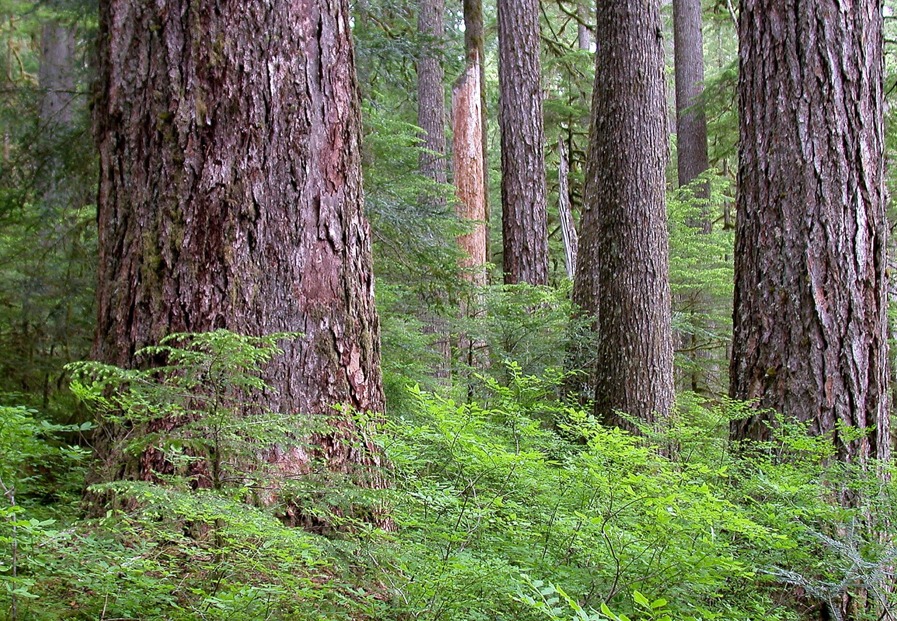
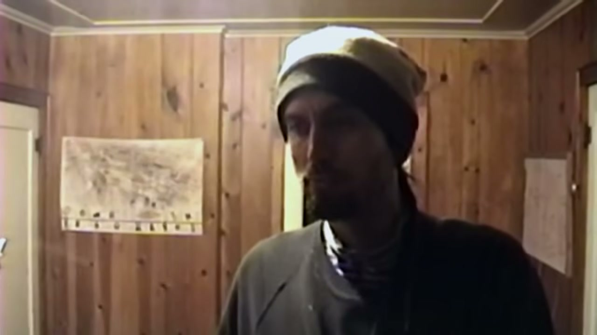
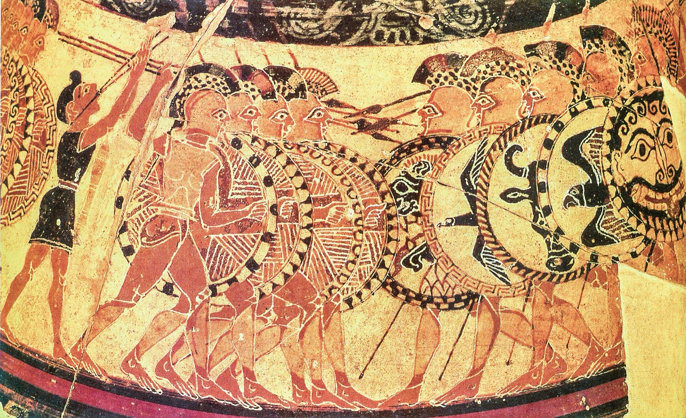
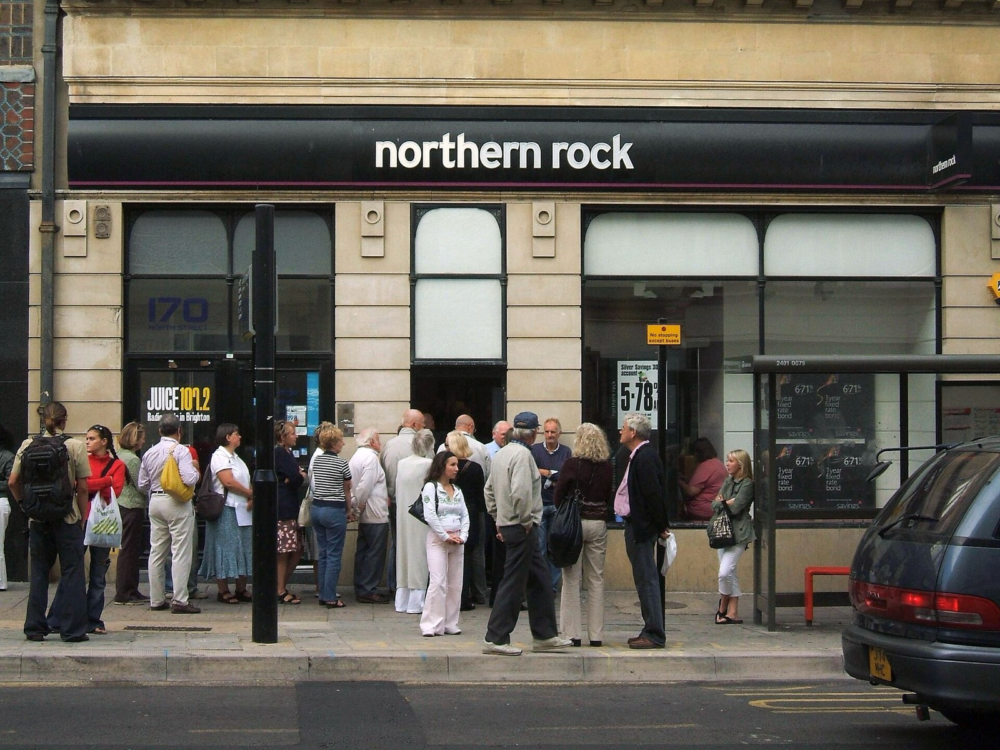
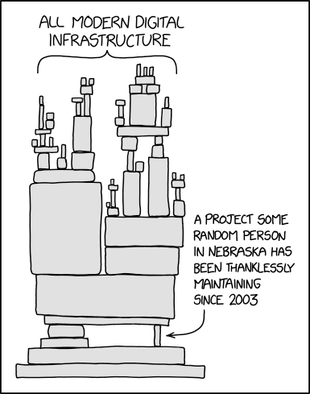
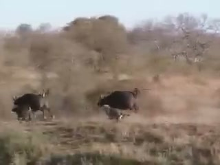
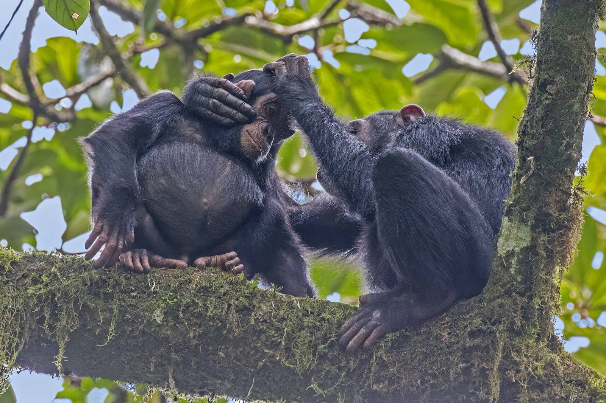
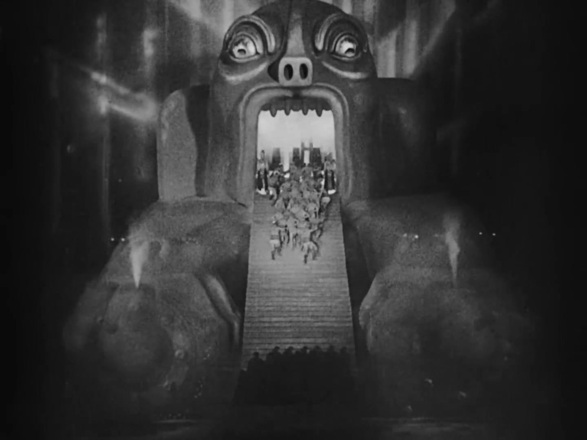
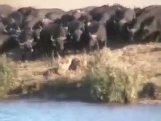
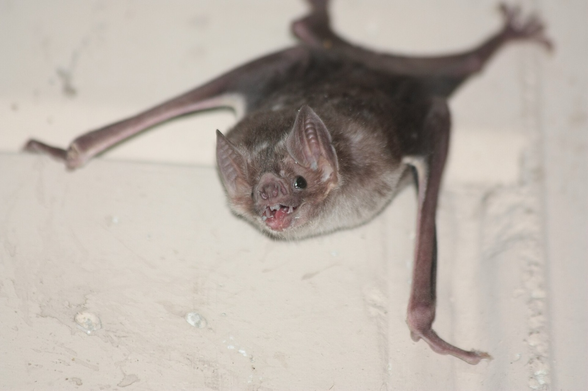

[Chapter 0](../0-intro/) set out what's at stake, from the playground to the AI race, and why it pays to diagnose before we prescribe: symptom, organ, cause. This chapter gives the basics we'll use for the rest of the course. It starts with one story and ends with two levers for changing things. Part 2, the climb from small groups to the planet, starts in the next chapter.

> [!summary] In this chapter
> 1. **One story**, the Earth Liberation Front, and the deal its members were offered.
> 2. **What collective action is**, in a sentence you can remember and a formal one.
> 3. **Three patterns**: the battle line, the stag hunt and chicken. You'll work out their payoffs yourself before we name them.
> 4. **Five dimensions** that make the same pattern easy in one place and hopeless in another.
> 5. **The cooperative ape**: what we're made of.
> 6. **Why scale bites**: the number of players is the master variable.
> 7. **Two levers**: change the game, or change the dimensions.
>
> Then a short exercise on a case of your own. About 20 minutes of reading, plus the clip and the exercises.

## 1. One story: If a Tree Falls

> [!reflect] Reflect: Would you talk?
> Years ago you and a few friends did something illegal for a cause you believed in. No one was hurt. Now you're arrested, facing a very long sentence. The prosecutor offers a deal: tell us who else was involved, and you'll get far less. You don't know what the others will do. What do you do?

I want one story to hold everything in this chapter: the film I suggested you watch. Don't worry if you haven't. I'll tell it.

### Years of trying

*If a Tree Falls* is about the Earth Liberation Front, the ELF.[^film] It starts in the 1990s, in and around Eugene, Oregon, with people trying to save old-growth forest: trees 700, even 1,000 years old.

*Old growth at Opal Creek, Willamette National Forest: the trees they were trying to save. US Forest Service, public domain.*

They tried the peaceful routes first: letters, pickets, blockades, tree-sits. At Warner Creek they blockaded a logging road for months, until the Forest Service tore it down and the logging went ahead.[^warner] Activists had spent years trying to close a horse slaughterhouse in Redmond, Oregon, and got nowhere.

So, after a lot of thought, some of them decided protest wasn't enough. If you can't stop the destruction by asking, make it too expensive. They'd destroy property, and only property: no one was to be hurt. In one night they burned down the slaughterhouse, and it never reopened: one night did what years of letter-writing hadn't. Over the next few years came ranger stations, timber company offices, a $12 million ski lodge at Vail.[^elf]

Not everyone held to the line, and some fires went wrong. But no one was hurt. The FBI called them one of the most dangerous groups in the country.

### Jake

The man who pushed them from talk to action was Jake Ferguson. "Are you guys through talking, or what? Let's do it."[^jake] He led the slaughterhouse burning. In a sense, he started it.

*Jake Ferguson, in archival footage: the man who pushed them from talk to action. Frame from If a Tree Falls, Marshall Curry and Sam Cullman, 2011. Fair use.*

After 2001 the group broke up. People went back to ordinary lives, Daniel McGowan, at the centre of the film, among them.

Then, years later, the investigators got on to Jake. They bluffed: they let him think they could tie him to the arsons. The prosecutor admits they probably couldn't have put him away. Jake thought about his son never seeing his dad, and made a deal. He wore a wire, went round his old friends, and got them talking about what they'd done.[^ferguson]

The man who started it was the man who ended it.

### The dominoes

In December 2005 most of them were arrested on the same morning, across the country. Facing arson charges, with terrorism to be added at sentencing, they were looking at life.[^charges]

https://www.youtube.com/watch?v=qwQoi0DoOKM&t=4050s

*If a Tree Falls, 01:07:30–01:10:15 (about 2¾ min). The prosecutor describes playing each defendant Jake's recordings of their own voices: "the dominoes began to fall". Then one of the women, a committed activist, describes the 5am knock and why she cooperated. It closes on the narrator: Daniel and three others held out. Watch for: what is she weighing up? Marshall Curry and Sam Cullman, 2011.*[^clip]

"Sometimes you aren't as strong as you think."

### Some held out

What struck me: these were people who'd given their lives to a global collective action problem, the destruction of the environment.

And when it came to it, they were in the most literal version of that problem. The prosecutors came to them one at a time. Talk, and you get a lighter sentence than you'd otherwise get. Stay silent while the others talk, and you go down for a very long time.[^sentences] Most of them talked.

But not all. McGowan didn't. Three others held out with him. They pleaded guilty to what they'd done, and refused to name anyone else.[^plea]

> [!reflect] Reflect: What made the four different?
> Look back at your answer to "would you talk?". Did the story change it? What do you think made those four hold out when the others didn't?

## 2. What is collective action?

So what were they caught in?

### Two definitions

The one to remember: **we'd all be better off acting together, but each of us does better going it alone, or can't afford to go first.**

The formal one, from the social dilemmas literature: situations where "individual rationality leads to collective irrationality".[^define] What makes sense for each of us, one by one, adds up to an outcome worse for all of us.

The ELF defendants were close to the harshest case: each of them did better talking, whatever the others did.[^elfpd]

### Rational, not bad

The uncomfortable point: the ones who talked weren't necessarily bad people, or weak people. On their own, talking was the rational thing to do. If the others talk, you'd better talk. If they stay silent, talking still gets you a better deal.

## 3. Three patterns

### Not one problem

Remember the heart from chapter 0. "Heart failure" is a real diagnosis, but there are different kinds, and they need different treatment. Collective action problems are the same. Before I name the kinds, work some out.

> [!exercise] Exercise: Work the payoffs
> Work the three cases below (or pick one) and answer for each: (1) What's your best move in each column? (2) Is there an outcome where nobody wants to change what they're doing (a resting point)? Is there more than one? (3) Is that the outcome you'd all want?
>
> **A. The hoplite line.** You're one man in a Greek battle line. Your shield covers your neighbour. Your chance of coming home alive (higher is better):
>
> | | The line holds | The line breaks |
> |---|---|---|
> | **You hold** | 95% | 80% (caught in the rout) |
> | **You run** | 98% (one gap won't break it) | 92% (you're already away) |
>
> **B. The playground.** A bully picks on a kid. Ten of you watch. If three or more stand up, he backs down. Score how it goes for you (higher is better):
>
> | | Enough others stand up | Too few stand up |
> |---|---|---|
> | **You stand up** | +3 (he backs down; you did right) | −5 (you're his next target) |
> | **You stay back** | +2 (he backs down anyway, but you hung back) | 0 |
>
> **C. The bins.** Two flatmates. Collection is tomorrow morning and the bins need taking out tonight. Score for you (higher is better):
>
> | | They take them out | They don't |
> |---|---|---|
> | **You take them out** | 3 (a bag each) | 1 (you did it all) |
> | **You don't** | 4 (done, no effort) | 0 (a fortnight of overflowing bins, and the foxes) |

> [!success]- Answers
> **A. Run** in both columns (98% > 95%, 92% > 80%). The only resting point is everyone running, though everyone holding (95%) beats everyone running (92%). A battle line.[^hoplitepay]
> **B. It depends what you expect.** If enough others stand, stand (+3 > +2); if too few, stay back (0 > −5). Two resting points: everyone stands, or nobody does. A stag hunt.[^bully]
> **C. Do the opposite of your flatmate.** If they take them out, you don't (4 > 3); if they don't, you do (1 > 0). Two resting points, each with one person doing it, and a standoff over who. Chicken.[^binspay]

The answers are the three patterns. Each has a standard name from game theory, so you can look it up, and a label to remember it by.[^names]

### The battle line (the prisoner's dilemma)

The hoplites, and the ELF. It's brutal: whatever the others do, you're better off breaking ranks.

*The line: hoplites advancing, detail of the Chigi vase, c. 640 BC. Villa Giulia, Rome. Public domain.*

Hoplites stood shoulder to shoulder, each man's shield covering his neighbour. If the line held, most survived. If it broke, the slaughter began: the losers lost about three times the share the winners did.[^hoplites] But each man, alone, was safer running. If the line holds, one gap probably won't break it. If it breaks, you'd better already be gone. Run in both columns. And if everyone reasons that way, the line breaks and everyone is worse off.

One resting point, and it's the bad one. The fix is to **enforce**: make running cost more than holding.

### The stag hunt (assurance)

The playground. Here nobody wants to defect. If I knew you'd stand up, I'd stand up. The problem is trust.

The idea goes back at least to David Hume; the name comes from Rousseau.[^stag] A group can hunt a stag together: a feast for everyone. Or each can slip off and catch a hare: small, but certain. The stag only works if everyone holds their post.

Two resting points, everyone in or everyone out, and the bad one is perfectly stable. My playground was a stag hunt, for the bystanders. Not for the kid being bullied: for the rest of us at the side. We'd all have stood up if we knew the others would.

A modern one: a bank run. In 2007 people queued round the block outside Northern Rock. The bank was in trouble, and the queue made it far worse: if everyone else is taking their money out, you'd better too.[^northernrock]

*A bank run: the queue outside Northern Rock, Brighton, September 2007. Dominic Alves, CC BY 2.0.*

The fix is to **reassure**: make sure each knows the others will go. A pact before break time. Or a pledge: "I'll do it, but only if a hundred other people will too".[^pledge]

### Chicken (with many players, the volunteer's dilemma)

The bins. Something needs doing, one person doing it is enough, and each would rather it was the other. If nobody does it, that's the worst outcome of all.

Two resting points again, but now each has one volunteer, and the fight is over who. The name comes from two drivers heading at each other: whoever swerves loses face, and if neither does, they crash.[^chicken] With many players it's the volunteer's dilemma. Someone collapses in a crowded street, and everyone is sure someone else will call the ambulance: the bystander effect.[^volunteer]

Or the open-source code much of the internet runs on. In 2014 a bug called Heartbleed was found in OpenSSL, which secures a huge share of the web. It turned out to have about one full-time developer and a couple of thousand dollars a year in donations.[^heartbleed] Everyone used it. Everyone assumed someone else was looking after it.

*The whole stack resting on one unpaid maintainer. Randall Munroe, xkcd 2347, "Dependency", CC BY-NC 2.5.*

Here reassurance backfires: if I know you'll do it, I wait. The fix is to **decide who acts**: name someone ("you in the red coat, call an ambulance"), take turns, or pay them. A bins rota.

### Two mirrors

Each of these shows up two ways.

**Taking.** A shared resource gets overused: fish, grazing, the atmosphere. The problem is restraint. This is the most famous collective action problem of all, the tragedy of the commons.[^commons] The cod off Newfoundland, fished for centuries, collapsed in a decade.

**Building.** A shared good doesn't get made: open-source code, research, standing up to the bully. The problem is contribution. Economists call these public goods. Mancur Olson argued that, other things equal, the bigger the group, the harder it is to get them made.[^olson]

Put it together and you get this picture:

| | **Battle line** (prisoner's dilemma) | **Stag hunt** (assurance) | **Chicken** (volunteer's dilemma) |
|---|---|---|---|
| **The shape** | you gain by slacking, whatever others do | hold if you know the others will | someone must; hope it's not you |
| **The fix** | enforce | reassure | decide who acts |
| **Taking** (restraint) | overfishing, carbon | a bank run | who gets the good spot: Alanya's fishing sites |
| **Building** (contribution) | free-riding: tax, unpaid dues | a strike, a protest, the playground stand | the maintainer, the bystander, the bins |

The cell people miss is taking × chicken; there's more on it under [Going further](#going-further).

You'll hear lots of other names: race to the bottom, arms race, multipolar trap, free-rider problem. Most of them land somewhere on this picture.[^labels] And the pattern is in the payoffs, which move. The same case can sit in two cells, and slide between them as the numbers change.

> [!poll] Poll: Where's the AI race?
> Battle line / Stag hunt / Chicken / Not sure.[^ai]

## 4. Five dimensions

Same game, played differently.

> [!reflect] Reflect: Kitchen and climate
> Two flatmates mostly keep a shared kitchen clean. Eight billion of us haven't kept the carbon out of the sky. Same kind of problem: clearing up after yourself costs you, and the benefit is shared. List three things that are different.

The type isn't the whole story. The same game can be easy in one place and hopeless in another. What changes is a handful of dimensions. Each is a question you can ask of any case:

1. How many players?
2. Will you meet again?
3. Can you see who defects?
4. Can you punish it?
5. Is anyone big enough to act alone?[^privileged]

Question zero is the type: battle line, stag hunt or chicken? Taking or building? Together that's the diagnostic. We'll use it all course.[^dims]

The kitchen passes all five: two players, you'll meet tomorrow, you can see whose mug it is, you can say something, and either of you can do it alone. The climate fails four of the five. The fifth, is anyone big enough, is at best two players, the US and China, and only together.

### The ELF, run through it

> [!reflect] Reflect: The ELF
> Before reading on: which of the five worked against the ELF defendants?

A dozen or so players: small, which should have helped. Would they meet again? The group had broken up years before. Could they see who defected? Only through the prosecutor's eyes, one at a time, which is exactly how the dominoes fell. Could they punish defection? Not from prison. Was anyone big enough to act alone? No.

Nearly every question fails. No wonder most of them talked.

And the four who held? Partly conviction: they believed in what they'd done. And partly the deal they got: they could own up to their own actions without naming anyone, which took them out of the dilemma.

## 5. The cooperative ape

What lies beneath? Psychology is one of the causes.

### What we climb with

Part 2 is a climb, from small groups to the planet. Before we start, what are we climbing with? One level down, into us.

### Both, everywhere

Cooperation and defection both occur throughout nature. Remember the buffalo in chapter 0: when the lions come, most herds scatter. Sometimes they come back. Cooperation in large groups is rare, and where it happens it rests on one of three things: kinship (an ant colony is one big family), returned favours, or enforcement. Among animals that aren't related, it stays small.[^nature]

*Herds scatter. Frame from Battle at Kruger, David Budzinski and Jason Schlosberg, 2004. Fair use.*

Our cousins go further. Chimpanzees help kin. They return favours: grooming, support in a fight, a share of the meat. They keep track of who did what, and they hunt together.[^chimps]

*Returned favours: chimpanzees grooming, Kibale National Park, Uganda. Charles J. Sharp, CC BY-SA 4.0.*

### Humans are the outlier

In chapter 0 I said we're predisposed to cooperate; here's what that means. We do all of that: help kin, return favours, keep track of reputations. And we have norms, and we punish people who break them, even at a cost to ourselves. What makes us the outlier is this: we cooperate with unrelated strangers, at scale. No other animal does that with strangers.

### Conditional cooperators

So which is it, selfish or cooperative? An experiment shows both.[^pgg]

Put people in a group. Each gets some money and can put any of it into a shared pot. The pot is doubled and split equally, whatever you put in. Everyone does best if all contribute. Each does best alone by contributing nothing.

> [!poll] Poll: Ten rounds
> What happens to contributions over ten rounds? Rise / Stay steady / Fall.

Most people start out contributing. Then they notice others free-riding, and round by round, contributions fall to near nothing. Now let people pay a little to punish free-riders. Contributions climb back up and stay there.

Most of us are conditional cooperators. We'll cooperate if others do. The structure decides which side of us shows.

> [!reflect] Reflect: Your own ten rounds
> Think of a group you're in where contributions dwindled: a shared kitchen, a WhatsApp group, a volunteer rota. What happened in round three?

That's what we climb with: an ape that cooperates with strangers, if the structure lets it. (We're also the imitative ape, which matters a lot; see [Going further](#going-further).)

## 6. Why scale bites

> [!reflect] Reflect: Strangers who cooperate
> Name a big group of strangers that cooperates well. What makes it work?

### Moloch names it

In chapter 0 I said that calling it "Moloch" names the organ, not the cause.[^moloch] Moloch is a great image: an ancient god demanding child sacrifice, standing in for a system where everyone sacrifices what they value to keep up with everyone else.

*Moloch as a machine: a still from Metropolis, Fritz Lang, 1927. Public domain in the US.*

My problem with Moloch is that it turns a design problem into fate, a god we can't escape. The essay's own way out is a bigger god: a superintelligent AI aligned with our values, "the Gardener".[^gardener] His way out of one god is another.

I'd say Moloch is a structure, not fate. And the structure has a shape we can name.

> [!reflect] Reflect: Moloch
> Does "Moloch" help or hurt as a frame?

### Kitchen to climate shows it

Take the shared kitchen, and one game, the battle line: clearing up after yourself. Play it at three sizes.[^kitchen]

Two flatmates and the dishes. You'll see each other tomorrow. You know whose mug it is. You can say something. It mostly works.

Eleven in a shared house. Whose mug? Nobody's sure. Someone puts up a rota, there's a house meeting, a passive-aggressive note on the fridge. It sort of works, with effort.

Ten million people and the air over a city, or the carbon in the sky. You'll never meet. You can't see who's burning what. You can't punish anyone. Your own share makes no visible difference. It doesn't work.

Same game. Same people, more or less. What changed was the number.

### The hinge states it

The number of players is the master variable. As it grows, two things happen. Each person's contribution matters less, and organising everyone costs more: that's Olson.[^olson] And the other dimensions fail one by one: you can't see defection, you can't punish it, you won't meet again. Cooperation in small groups leans heavily on those three (Axelrod, Ostrom), and scale takes them away.[^hinge]

So in big, anonymous, one-off situations, failure is the default. We usually say collective action *problems*, as if things normally work and these are exceptions. At scale I think it's the other way round. When we succeed, that's a breakthrough.

### Breakthroughs happen

So I like to talk about collective action *opportunities*. Where is the breakthrough waiting to happen, and what would it take?

And they do happen. The buffalo came back for the calf. Four of the ELF held out.

*The lift: the herd comes back. Frame from Battle at Kruger, David Budzinski and Jason Schlosberg, 2004. Fair use.*

My playground too. In the end a friend of mine did stand up and went to the head teacher, and I backed him. It didn't go brilliantly. But years later, some of the open data work I helped start went from fringe to standard.

None of that was fate. Each time, something changed the structure, or someone went first anyway.

## 7. Two levers

> [!exercise] Exercise: You're the general
> Back to the hoplite line. Running beats holding in both columns. You command the army. Change one thing so that your men hold. Then: did you change the numbers in the table, or something about the situation (who sees, who remembers, who punishes)?[^general]

### Change the game, or change the dimensions

If the structure is the problem, there are two places to push.[^payoffs]

**Change the game.** Change the payoffs, so the type changes. Make breaking ranks costly enough and a battle line becomes a stag hunt. A fine, a contract, a deposit you lose if you walk. Northern Rock: the guarantee changed the payoffs, so running stopped paying, and the bad outcome was gone.

**Change the dimensions.** Keep the game, but make defection visible, punishable, or repeated. Put up the rota, hold the house meeting, make sure you'll meet again.

Sparta pulled both. A man who ran came home to disgrace: the "tremblers" lost their rights as citizens. That changed the game. And Spartans trained, ate and fought beside the same men all their lives, in front of everyone they knew. That changed the dimensions: seen, remembered, punished.[^sparta] Which of that was culture, and which institutions, is a good question.

> "Come back with your shield, or on it."
>
> *A Spartan mother to her son, as Plutarch tells it, some seven centuries later. Almost certainly legend. But a culture that tells this story about itself is already doing the work.*

Part 2 is the climb: bands, villages, states, the globe. At each rung we'll ask which lever the big innovation pulled, and which of the five questions it answered.

## 8. Your case

> [!exercise] Exercise: Your case
> Take the case you chose in chapter 0, or any collective action problem you care about. (1) Which game is it, and is it taking or building? Don't agonise; it may be two. (2) Which of the five dimensions fails worst? (3) Which lever might move it: change the game, or change the dimensions? Write one line for each.

> [!key] Key ideas
> - A **collective action problem**: we'd all be better off acting together, but each of us does better going it alone, or can't afford to go first.
> - **Three patterns**, each with its fix: the **battle line** (prisoner's dilemma), fixed by enforcing; the **stag hunt** (assurance), fixed by reassuring; **chicken** (volunteer's dilemma), fixed by deciding who acts.
> - **Two mirrors**: taking (restraint, as in the commons) and building (contribution, as in public goods).
> - **Five dimensions** make the same game easy or hard: how many players, meeting again, seeing defection, punishing it, and whether anyone is big enough to act alone.
> - We're the **cooperative ape**: conditional cooperators, and the only animal that cooperates with unrelated strangers at scale.
> - **The number of players is the master variable.** As it grows, seeing, punishing and meeting again fail, and at scale failure is the default. Success is a breakthrough.
> - **Two levers**: change the game, or change the dimensions.

Two flatmates can keep a kitchen clean; ten million strangers can't keep the air clean. But for most of human history there were no states and no contracts, only bands and villages, and some of them kept their forests, pastures and fishing grounds going for centuries. How do the smallest groups make cooperation hold, and what can we borrow from them? That's where the climb begins, in [chapter 2, "The village toolkit"](../2-village-toolkit/).

---

## Going further

### The cell people miss: taking × chicken

The cell people miss on the picture is taking × chicken: who gets the good spot. In Alanya, in Turkey, fishers fought over the best fishing spots until they drew lots each year and rotated daily: deciding who acts, on a commons.[^alanya]

### Animals that cooperate

Vampire bats share blood with roost-mates who didn't feed that night, and give more to the ones who gave to them. Cleaner fish cheat their clients less when other clients are watching.[^animals]

*Reciprocity in a vampire bat, which shares blood with roost-mates who gave to it. Gerry Carter, CC BY-SA 4.0.*

*A cleaner wrasse, which cheats its clients less when other clients are watching. Bernard Dupont, CC BY-SA 2.0.*

### The imitative ape

We're also the imitative ape. Human children copy adults far more faithfully than young chimps do, even the pointless bits.[^imitate]

And imitation supercharges cooperation. If we can learn from each other, being in a group pays far more, because what one of us figures out, all of us can use. And the bigger the group, the more there is to learn from.[^henrich] I suspect that's a big part of how we became what we are. We'll come back to it when we get to culture.[^imagined]

### Play it

Nicky Case's *The Evolution of Trust* runs these games in your browser in about 30 minutes.[^trust]

### Game theory basics

For anyone who wants the formal version. Two players, each choosing to cooperate (C) or defect (D). Numbers are payoffs, higher is better, shown as (me, you).[^gt]

Two questions sort the three games. **Greed:** if you pull your weight, do I gain by slacking? **Fear:** if I pull my weight and you don't, am I worse off than if I'd slacked too? Greed and fear: the battle line. Fear only: the stag hunt. Greed only: chicken. Neither: no problem.[^greedfear]

**The battle line (prisoner's dilemma).** D is better for me whatever you do. The only equilibrium is (D, D), though (C, C) is better for both.

| | You C | You D |
|---|---|---|
| **Me C** | 3, 3 | 0, 5 |
| **Me D** | 5, 0 | 1, 1 |

**The stag hunt (assurance).** If you hunt the stag, so should I; if you don't, I shouldn't. Two equilibria: both stag, both hare. Which you get depends on what each expects the other to do.

| | You stag | You hare |
|---|---|---|
| **Me stag** | 4, 4 | 0, 3 |
| **Me hare** | 3, 0 | 3, 3 |

**Chicken (snowdrift; with many players, the volunteer's dilemma).** Someone has to act (A) or we both do worst; each prefers the other to do it. Two equilibria, each with one volunteer, and a fight over who.

| | You act | You wait |
|---|---|---|
| **Me act** | 3, 3 | 2, 4 |
| **Me wait** | 4, 2 | 0, 0 |

**Many players.** In a public-goods game, contributions are multiplied by m (1 < m < n) and shared equally. Each unit I put in returns me only m/n < 1, so the n-player version is a battle line. If the good only appears above a threshold (enough people at the protest), it becomes a stag hunt; if one volunteer is enough, it's the volunteer's dilemma.

**Equilibrium in one line:** a Nash equilibrium is an outcome where nobody can do better by changing only their own move. In the exercises, "a resting point".

**Not on the picture:** pure coordination (which side of the road to drive on). Everyone wants the same thing; you just need to agree which. It's the easy baseline, and focal points solve it (Schelling). Also off the picture: the tragedy of the anticommons (Heller 1998), where too many vetoes leave a resource unused, a hold-out problem.

### The labels

| Label | Where it sits |
|---|---|
| Tragedy of the commons; overfishing, overgrazing | Battle line, taking |
| Free-rider problem | Battle line, building (generic name) |
| Public goods problem | Battle line, building; stag hunt if there's a threshold |
| Race to the bottom (tax, regulation) | Many-player battle line between competing places |
| Arms race | Battle line; a stag hunt when each side would disarm if sure the other would (the security dilemma) |
| Multipolar trap, Moloch | Many-player battle line, with competition weeding out whoever holds back |
| Bank run | Stag hunt (two equilibria) |
| Revolutions, protest turnout | Stag hunt with a threshold (tipping points) |
| Bystander effect | Chicken: the volunteer's dilemma |
| Open-source maintenance | Chicken, or battle line, building |
| Brinkmanship, standoffs | Chicken, two players |
| Fishing-site rotation (Alanya) | Chicken, taking |
| Climate | Battle line for emissions; a stag hunt with a threshold for avoiding catastrophe |
| Social dilemma | Umbrella term for all of them |

The pattern depends on the payoffs, not the label. The same fishery can be a battle line with open access and a stag hunt in a small village with rules.

### Further reading

The three to start with:

- Peter Kollock, "Social Dilemmas: The Anatomy of Cooperation", *Annual Review of Sociology* (1998). Short, and uses exactly these three patterns.
- Avinash Dixit and Susan Skeath, *Games of Strategy* (Norton; later editions with David Reiley), the chapter on collective-action games. Clear diagrams, no heavy maths.
- Elinor Ostrom, *Governing the Commons* (1990), chapters 1–3. The essential counterweight to the tragedy of the commons.

Then:

- Mancur Olson, *The Logic of Collective Action* (1965). Why small groups organise and large ones don't.
- Brian Skyrms, *The Stag Hunt and the Evolution of Social Structure* (2004). The best single read on the stag hunt.
- Todd Sandler, *Global Collective Action* (2004); Scott Barrett, *Why Cooperate?* (2007). The global cases: climate, disease, security.
- Robert Axelrod, *The Evolution of Cooperation* (1984). Repetition, tit-for-tat, the trench truces.
- Samuel Bowles and Herbert Gintis, *A Cooperative Species* (2011). The evidence on human cooperation.
- Joseph Henrich, *The Secret of Our Success* (2015). The imitative ape.
- Scott Alexander, "Meditations on Moloch" (2014). The essay itself.
- Nicky Case, *The Evolution of Trust* (online, about 30 min). Play it.

Image credits: [assets/SOURCES.md](assets/SOURCES.md).

[^film]: *If a Tree Falls: A Story of the Earth Liberation Front*, Marshall Curry and Sam Cullman, 2011. Free official upload: https://www.youtube.com/watch?v=qwQoi0DoOKM.
[^warner]: In the film: the Warner Creek blockade, 00:12:38–00:14:50 (1995–96); the slaughterhouse, "tried and failed" after "years of letter-writing and picketing", 00:29:57.
[^elf]: The arsons ran 1996–2001. Cavel West horse slaughterhouse, Redmond, Oregon, July 1997 (the film's "Jake Ferguson and three others", 00:29:57); Vail, October 1998, the $12 million lodge (00:30:30). "No one was hurt" is said of these arsons: the film's defence side cites some 1,200 ELF and ALF incidents without injury (01:14:42), and the prosecution disputed that the arsons were safe. The press office mandated that fires harm no life (00:31:34); the University of Washington fire got out of control and the Jefferson Poplar target was a mistake (00:55:24); some members wanted to go further (00:55:56). The FBI line is at 00:01:00, as reported in the film.
[^jake]: Film, 00:16:26, a friend's recollection of Jake at Warner Creek, paraphrased. The film shows him pushing from talk to action and leading the slaughterhouse arson (00:29:57), not founding the group; the first actions, the ranger stations (00:17:13), don't name him. The ELF itself began in the UK in 1992.
[^ferguson]: Film, 00:59:48–01:03:00: investigators focused on Ferguson after a tip and a truck theft; he'd lied to an investigator, a felony; they bluffed about their evidence ("could we have really put him away… probably not", 01:01:24); they said the arsons carried a life sentence but he could walk if he informed; he came back 20 minutes later to discuss cooperating. The wire: 01:03:31–01:05:57.
[^charges]: The charges were arson and conspiracy; the terrorism enhancement came at sentencing. Not all were caught that morning: some had fled abroad.
[^clip]: Times from the film's subtitle file. The woman is Suzanne Savoie (on-screen caption at 00:39:21: "Suzanne Savoie / Daniel's Ex-Girlfriend"). She says she'd have been prepared to go away for five to ten years, but was facing dying alone in prison.
[^sentences]: Lighter than otherwise, not lighter than the holdouts: some cooperators who had done more arsons still got longer terms than McGowan.
[^plea]: In the film's words, Daniel and three others "held out, for different terms". They took non-cooperation pleas: they admitted their own arsons without giving information on others.
[^define]: Peter Kollock, "Social Dilemmas: The Anatomy of Cooperation", *Annual Review of Sociology* (1998): "Social dilemmas are situations in which individual rationality leads to collective irrationality." The memorable one covers all three patterns below: "better off going it alone" is the battle line and chicken, "can't afford to go first" is the stag hunt.
[^elfpd]: Strictly, it's not an exact prisoner's dilemma: if none of them talked, perhaps none would have been convicted, though the wire recordings were already strong evidence. Close enough for the story, hence "close to".
[^hoplitepay]: Illustrative numbers, mine, anchored on Krentz's averages (about 5% dead on the winning side, 14% on the losing; see the hoplites note below). Those who held to the end of a rout fared worse than average, those who ran early better. What would change it: shame or punishment for running (see the general exercise and Sparta). Caveat: if your gap might be the one that breaks the line, holding matters more, and it shades into a stag hunt.
[^bully]: Illustrative numbers. The fix is assurance: "I'll go if you go", a friend going first, a pact before break time. With a threshold of exactly three, it also has a volunteer flavour (who are the three?); it only becomes a battle line if standing up never pays, even when you'd tip it.
[^binspay]: Illustrative numbers. In the literature the two-player version is also called the snowdrift game (who digs out the car); the many-player form is the volunteer's dilemma. The fix is to decide who acts: a rota, taking turns, or one pays the other.
[^names]: Three patterns, crossed with taking and building, each with its fix. Kollock (1998) uses the same three: prisoner's dilemma, assurance, chicken.
[^hoplites]: Krentz, "Casualties in Hoplite Battles", *Greek, Roman and Byzantine Studies* (1985): about 14% dead on the losing side against about 5% on the winning side. Because each shield covered the neighbour, a phalanx is arguably part stag hunt (a threshold game).
[^stag]: Rousseau, *Discourse on the Origin of Inequality* (1755), Part II. Hume came close earlier, in the *Treatise* (1739–40): two neighbours can agree to drain a meadow, a thousand can't (Book 3, Part 2, §7); two men rowing a boat (§2). Hume is a precursor: the meadow is often read as a free-rider case, the rowers as coordination. Sen (1967) named the "assurance game". Skyrms, *The Stag Hunt* (2004).
[^northernrock]: Northern Rock, September 2007: the first UK bank run in over a century, which followed news of the Bank of England's emergency support. Deposit protection then covered only part of savings; the run stopped when the Chancellor guaranteed all deposits. The bank was nationalised in 2008 anyway: the queue made things worse, it didn't cause the trouble on its own. Theory: Diamond and Dybvig, *Journal of Political Economy* (1983): two equilibria, and deposit insurance removes the bad one.
[^pledge]: mySociety's PledgeBank ran exactly this: "I'll do X, but only if N other people will too". Assurance contracts are the formal version (Tabarrok 1998); Kickstarter's all-or-nothing funding is one.
[^chicken]: The game of chicken: two drivers head for each other, or for a cliff edge, as in *Rebel Without a Cause* (1955). Bertrand Russell (1959) used it for nuclear brinkmanship.
[^volunteer]: Diekmann, "Volunteer's Dilemma", *Journal of Conflict Resolution* (1985): the many-player form of chicken; the chance that nobody acts rises with group size. Bystander effect: Darley and Latané (1968). The famous Kitty Genovese story, "38 witnesses who did nothing", is largely wrong (Manning, Levine and Collins, *American Psychologist*, 2007).
[^heartbleed]: Heartbleed, April 2014. Steve Marquess of the OpenSSL Foundation said it had one full-time developer and took about $2,000 a year in donations. A double fit: chicken (one maintainer is enough) and a building battle line (everyone free-rides).
[^commons]: Hardin, "The Tragedy of the Commons", *Science* (1968). Economists Gordon (1954) and Scott (1955) got there first. Hardin's commons was really open access: Ostrom showed real commons often have rules that work. The Grand Banks cod moratorium came in 1992.
[^olson]: Mancur Olson, *The Logic of Collective Action* (1965): the classic on why large groups underprovide public goods (concentrated benefits, diffuse costs; the lobbying example in chapter 0). Qualified since: Marwell and Oliver (1993) on critical mass; Ostrom on large groups that organise. He comes back in chapter 2.
[^alanya]: Ostrom, *Governing the Commons* (1990), pp. 18–20 (the rotation) and p. 47 (the Alanya fishery "cannot be represented as a PD game"; it has the structure of an assignment game). Each September the fishers draw lots for the named spots, then rotate daily. Taylor (1987) has taking-side chicken too: a fishery that can take two boats but collapses with three.
[^labels]: The full table is under Going further. Strictly, the payoffs decide the pattern, not the setting: the same fishery can be a battle line or a stag hunt (Ostrom, Gardner and Walker, *Rules, Games, and Common-Pool Resources*, 1994). Sandler (1992) sorts public goods by how contributions add up: summed → battle line; weakest link → stag hunt; best shot → chicken (he calls it "coordination"). In large groups, providing a public good almost always becomes a battle line (Dixit, Skeath and Reiley, 4th ed., p. 430).
[^ai]: My view: arguably all three. A battle line between labs and states, a stag hunt if verification made pausing safe, and chicken for safety research.
[^privileged]: Olson's "privileged group": one player gains enough to provide the good alone, and the rest free-ride. Not a failure but a lopsided fix. If several are big enough and each would rather another paid, it's chicken (Olson p. 50, n. 70). More in chapter 2.
[^dims]: These are the five questions of the diagnostic. Each rung of part 2 closes by asking which one it restored.
[^nature]: Cooperation is everywhere in nature, and defection isn't "the default"; what's rare is large-scale cooperation with non-kin. Kinship: Hamilton (1964), the eusocial insects. Reciprocity: Trivers (1971). Enforcement: policing in insect colonies (Ratnieks), punishment in cleaner fish.
[^animals]: Vampire bats: Wilkinson, *Nature* (1984); Carter and Wilkinson (2013). Cleaner fish: Bshary and Grutter, *Nature* (2006), "image scoring".
[^chimps]: De Waal, *Chimpanzee Politics* (1982) and *Good Natured* (1996): reciprocity in grooming, support and food-sharing. Boesch on group hunting in the Taï forest.
[^pgg]: Fehr and Gächter, *American Economic Review* (2000): without punishment, contributions start around 40–60% and decay to around 10% over ten rounds; with punishment they rise. Fischbacher, Gächter and Fehr (2001): about half of people are conditional cooperators, about a third free-riders. Caveat: Herrmann, Thöni and Gächter, *Science* (2008): in some societies people punish the cooperators ("antisocial punishment"), so punishment isn't a universal fix. Which is the point: the structure, and the culture, decide. Chapter 2 picks this up.
[^trust]: https://ncase.me/trust/ (2017). Free, and it runs the repeated battle line with tit-for-tat and friends.
[^imitate]: Horner and Whiten (2005): children copy even the useless steps of a demonstration ("over-imitation"); chimps skip them.
[^henrich]: Henrich, *The Secret of Our Success* (2015): cumulative culture and the "collective brain"; bigger, better-connected groups keep and improve more know-how (the Tasmania case). Boyd and Richerson, *Not by Genes Alone* (2005).
[^imagined]: The bigger story, how we stretched kin loyalty to millions we'll never meet, is Benedict Anderson's "imagined communities" (1983) and comes in a later chapter.
[^moloch]: Scott Alexander, "Meditations on Moloch", *Slate Star Codex* (2014), after Allen Ginsberg's *Howl* (1956).
[^gardener]: Alexander's conclusion: the only way to beat Moloch is a "Gardener", a superintelligence with human values. That is his answer, not a caricature.
[^kitchen]: Eleven is illustrative: a big shared house. Clearing up after yourself is a battle line at two: if I clean my mess and you leave yours, the kitchen's still a mess and I've wasted my evening. Strictly, at two players with daily contact it's a repeated game, which is why it mostly works: that's the dimensions doing the work.
[^hinge]: Axelrod, *The Evolution of Cooperation* (1984): repetition works when the "shadow of the future" is long and players can recognise each other. Ostrom (1990): monitoring and graduated sanctions in small, bounded groups. Caveat: Olson's large-group pessimism is qualified; Marwell and Oliver, *The Critical Mass in Collective Action* (1993), show large groups can do better when a few big contributors start things off.
[^general]: Some answers: a penalty for running (change the game); fighting beside your neighbours and kin, in front of your town (change the dimensions: seen, remembered); training and drill (makes holding easier, so changes the payoffs a little).
[^sparta]: Spartan *tresantes*, "tremblers": men who ran lost citizen rights and were publicly shamed (Herodotus 7.231; Xenophon, *Constitution of the Lacedaemonians* 9). "With your shield or on it" is from Plutarch's *Sayings of Spartan Women*, late and probably legend. The common messes (*syssitia*) and lifelong training gave the repetition and visibility.
[^payoffs]: Only roughly: a moderate penalty turns a battle line into a stag hunt; a big one makes holding the line the best move outright. The fixes have patterns of their own, for chapter 2: kin (helping a relative helps your genes, which is why ant colonies are so cooperative); repetition (the folk theorem: memory, trust, reputation); and then scaling, which turns strangers into imagined kin.
[^gt]: Illustrative payoffs. Any numbers with the same ordering give the same game.
[^greedfear]: For any symmetric two-player game where cooperating together beats defecting together, greed and fear give exactly these four. Heckathorn (1996, pp. 258–259) derives the same four.

---

[← Chapter 0: Intro and motivation](../0-intro/) · [Course home](../) · [Next: Chapter 2, The village toolkit →](../2-village-toolkit/)
