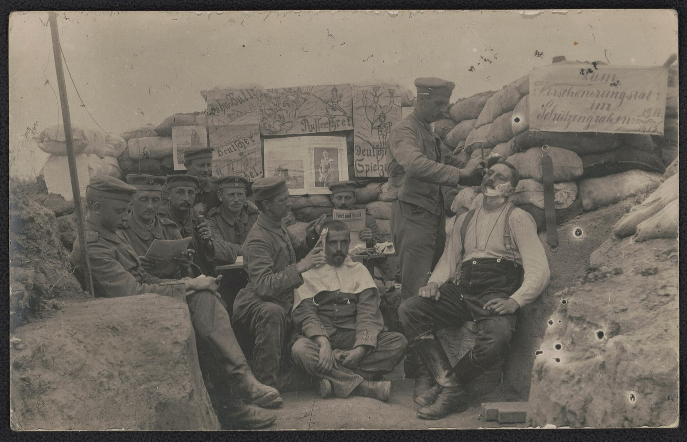
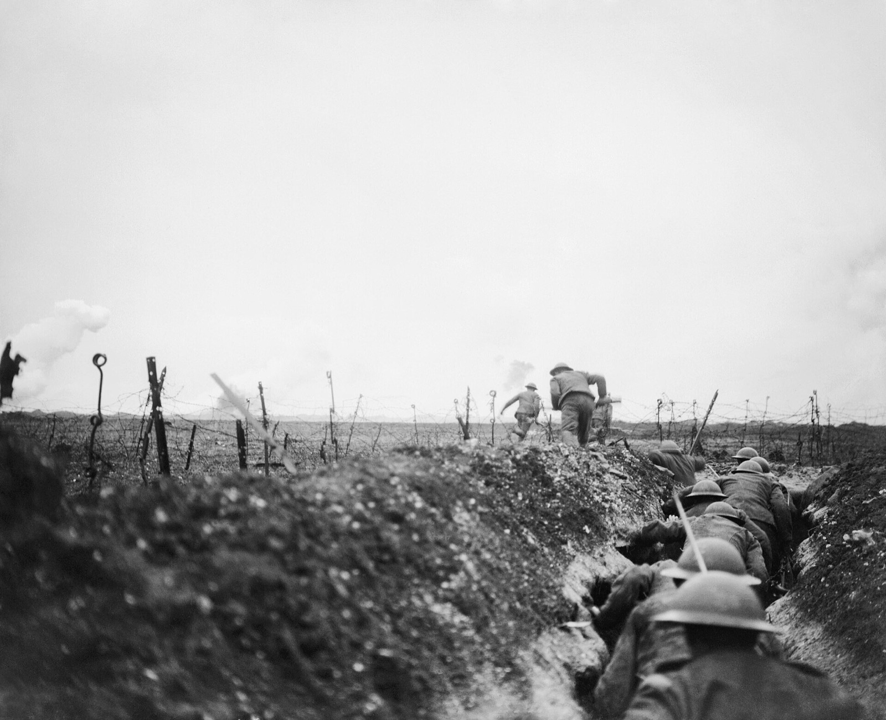
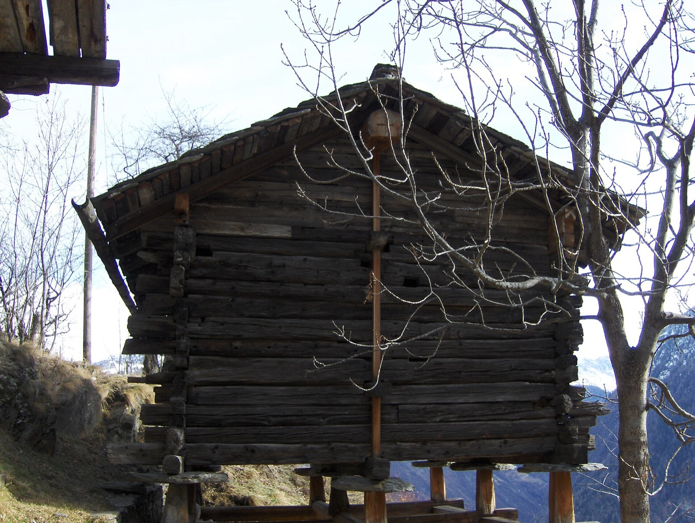
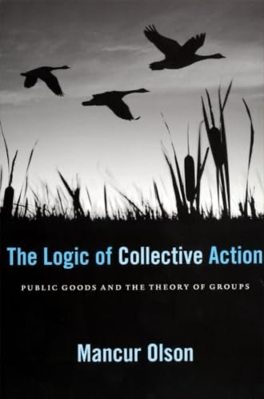

[Chapter 1](../1-basics/) gave us the basics: three patterns, five questions that make the same pattern easy or hard, the hinge (as the number of players grows, the other questions fail) and two levers for changing things. Now the climb begins. Part 2 goes up the scale of cooperation, from small groups to the planet, and this chapter is the first rung: the small group, and the toolkit it uses to make cooperation hold.

> [!summary] In this chapter
> 1. **We already know how**: where cooperation just works, and why.
> 2. **Meeting again**: the trench truces of the First World War, the shadow of the future, reputation, and why repetition makes cooperation possible, not easy.
> 3. **Seeing and punishing**: a Swiss village's grazing rule from 1517, Elinor Ostrom, and why rules hold when the people under them make them.
> 4. **Someone big enough**: Olson's privileged group, and the sequel to Heartbleed.
> 5. **The toolkit** on one card.
> 6. **The AI race**: a village where the tools don't work.
> 7. **Your case**: would a village tool stretch to it?
> 8. **Three questions** that close every rung.
>
> About 15 minutes of reading, plus the clips and the exercises.

## 1. We already know how

> [!reflect] Reflect: Where it just works
> Think of a group where cooperation just works for you: a family, a team, a choir, a flat. What holds it together?

Chapter 1 ended on a hard note: at scale, failure is the default. So let's start somewhere it isn't.

Most of the cooperation in your life happens without anyone thinking about it. Someone makes the tea. The choir turns up on Tuesday. The team covers for the one whose kid is ill. Nobody signed a treaty.

When people answer that question, the same few things come up. We'll see each other again. Everyone knows who does what. If someone takes the mickey, someone says something. And sometimes one person just does it, because they care most.

Those are the village toolkit. By the end of this chapter you'll have a name for each, and know which of chapter 1's five questions it answers.

## 2. Meeting again

> [!reflect] Reflect: The trenches
> 1915, the Western Front. Two armies in trenches a few hundred metres apart, ordered to kill each other. In many places, for weeks at a time, they mostly stopped. Why?

### Live and let live

Not the Christmas truce. That was one famous day. I mean something quieter, and much longer: live and let live.[^truce]

*A quiet day in a German trench, 1915: reading, a haircut, a shave. Library of Congress, public domain.*

Up and down the line, units facing each other worked out an unspoken deal. Don't shoot at breakfast. When the artillery did fire, it hit the same spot at the same time each evening, so everyone knew where not to be. One side shoots high; the other notices and shoots high back. And when a unit was relieved, it passed the deal on to the newcomers.[^trucedetail]

Nobody negotiated this. They were enemies, they couldn't openly talk, and fraternising could get you court-martialled. It still held.

https://www.youtube.com/watch?v=dMR_sddvM3I&t=286s

*"World War I – Live and Let Live" (documentary; source film unidentified), 4:46–6:23. Watch for the meal-time courtesy, and the warning note thrown over before a shell. 6:38–7:12 and 8:01–9:20 cover the March 1916 order against a "passive and lethargic attitude", and the raids.*

### The shadow of the future

Why? Because they'd meet again. Same men, same trench, tomorrow and the day after. Each day is a battle line: you're better off shooting whatever the other side does. But if you'll face the same people for months, shooting today means being shot at tomorrow. Holding fire pays.

Game theorists call this the shadow of the future. When it's long enough, cooperation can hold even between enemies, with no one to enforce it. The formal result is the folk theorem: in a game repeated without a known end, cooperation can be stable.[^folk]

It's the first tool: **meeting again**. It answers chapter 1's question 2, and it pulls the lever of the dimensions. The payoffs of any one day are the same. What changed is that there's always another day.

### Killed from above

So what ended it? Not the soldiers. High command.

The generals saw the quiet as a threat to fighting spirit, and broke it from above. Above all they ordered trench raids: you couldn't fake a raid, and it brought retaliation, so the cycle of shooting started again.[^raids] Bottom-up cooperation, ended by top-down orders.

*A British raiding party leaves its trench near Arras, March 1917. J. W. Brooke, Imperial War Museum Q5101, public domain.*

### Reputation: word of mouth

Reputation stretches the tool. You may never deal with me again, but someone who's heard about me will.

Every shared house has the flatmate everyone talks about: the one who never replaces the milk. You may never have caught him at it. You've heard. Gossip lets the whole house remember, and see, what one of us saw.[^reputation]

### Possible, not easy

Meeting again makes cooperation *possible*. It doesn't make it easy.

The simple strategy that does well is tit-for-tat: cooperate first, then do whatever the other did last time.[^axelrod] But what happens when there are mistakes: a shot that goes astray, a message that never arrives?

> [!poll] Poll: With a little noise
> Which strategy does best when there are occasional mistakes? Always cooperate / Tit-for-tat / Tit-for-tat that forgives / Always defect.

Two tit-for-tat players can lock into a feud: you punish my mistake, I punish your punishment, forever. In Nicky Case's game *The Evolution of Trust*, the winner forgives a little: it only hits back after two cheats in a row.[^trust]

So repetition can be broken three ways. By mistakes, which need forgiveness. By an order from above, as in the trenches. And by a finish line: if the game is about to end, there's no tomorrow to protect.

## 3. Seeing and punishing

> [!reflect] Reflect: The alp
> A shared summer pasture high in the Alps. Every family in the village sends cows up in summer. Each family gains from one more cow; the grass is shared. What rule would you make, one that every neighbour could check?

*Cattle on a Valais alp (Alp Niva, Val d'Hérens), 1923. Rudolf Zinggeler, Swiss National Library, public domain.*

### Törbel, 1517

Törbel is a village in the Swiss Alps. For centuries its families have shared the high summer pasture, the alp, along with the forests.

*Törbel, Valais, on its slope below the high pasture. Daniel Reust, 2025, CC BY-SA 4.0.*

In 1517 the villagers made a rule: no one may send more cows to the alp than they can feed through the winter on their own hay.[^torbel]

It's a brilliant rule. It caps the commons by something private and visible. Your hay is in your barn, and your neighbours can see your barn. You can't hide an extra winter's hay, so you can't hide an extra cow.

*A hay barn (Stadel) in Törbel. Your hay is in plain sight, so your neighbours can count your cows. Andi Wyss, 2007, public domain.*

It was still in force when an anthropologist studied the village in the 1970s, four and a half centuries later.

### Seeing

That's the second tool: **seeing**, question 3. Make defection visible, and most of it stops, because most of us are conditional cooperators.

The trick in Törbel is turning something hard to see, how much of the grass you're taking, into something easy to see: cows, hay, a barn.

### Punishing, and who does it

Then **punishing**, question 4. Chapter 1's experiment: let people pay to punish free-riders, and contributions climb back up.

But chapter 1 also had a caveat. In some places, people punish the *cooperators*.[^antisocial] Punishment isn't magic. So when does it work?

Elinor Ostrom spent her career on that question. She studied communities that had managed shared resources for centuries: Swiss alps, Japanese forests, Spanish irrigation, the Alanya fishers from chapter 1.[^ostrom] Two things stand out.

*Elinor Ostrom at the Nobel press conference, Stockholm, December 2009. Prolineserver, CC BY-SA 3.0.*

https://www.youtube.com/watch?v=x5kv_ALkLFc&t=1175s

*Ostrom's Nobel lecture, 8 December 2009, 19:35–20:28: her design principles, from monitoring to graduated sanctions. 26:30–27:15 ends on "we should not be recommending panaceas".*

**Sanctions are graduated.** The first slip costs you little: a word, a small fine. Repeat it and it costs more. Most people break a rule once by accident, or once to test it. A small first sanction tells you you've been seen, without turning a neighbour into an enemy. It's forgiveness, built into the rules.[^graduated]

**The people under the rules make them, and enforce them.** The villagers wrote Törbel's rules; the villagers watch the alp. Rules hold when the people they bind made them and see them as fair.

That's why fixes imposed from outside often fail. The expert's version: a clever rule, designed elsewhere, enforced by an outsider. Ostrom found cases where nationalising a forest or a fishery made things worse: the old local rules stopped counting, and the new owner couldn't watch.[^imposed] A lesson for anyone who likes designing mechanisms. I'm one.

### Your kitchen

> [!exercise] Exercise: Törbel's rule for your kitchen
> Your shared kitchen, eleven people. Mess is the grass: shared, and hard to pin on anyone. Write a Törbel-style rule: something everyone can check, enforced by the house.

> [!success]- Answers
> One answer: make the thing you can't see, mess, into something you can: a rota with names and days on the fridge. "Your day, your sink." Graduated: a reminder on the group chat first, then a word, then it's raised at the house meeting. Made by the house, not the landlord.

*Mess is the grass: shared, and hard to pin on anyone. Mysid, 2004, public domain.*

## 4. Someone big enough

### The flatmate who buys the bin bags

Every house has one. Bin bags run out, nobody buys them, and eventually one person, the one who minds most, just buys them. Everybody else free-rides, and that's fine.

### Olson's privileged group

Chapter 1's hinge said small groups organise more easily than big ones: each share matters more, and there are fewer people to organise. That's Mancur Olson.[^olson] He had one more case: the **privileged group**. In some groups one member gains so much from the shared good that they'll pay for all of it alone.[^privileged]

*Mancur Olson, "The Logic of Collective Action" (1965), Harvard paperback cover. Fair use.*

That's the third tool: **someone big enough**, question 5. Notice the lever is different. Meeting again, seeing and punishing change the dimensions. A privileged group changes the game: for one player, the payoffs make contributing worth it even if no one else does.

Olson's best-known example is NATO. The US spent a far bigger share of its income on defence than the smaller members did, and they free-rode on it.[^nato] Lopsided, but a fix.

### Heartbleed, the sequel

Remember Heartbleed: the open-source code securing much of the web, run by about one full-time developer on a couple of thousand dollars a year.

*The Heartbleed logo, 2014. Leena Kurjenniska / Codenomicon, CC0.*

After the bug, a small club of the biggest tech firms, Google, Microsoft, Amazon, Facebook and others, put in a few million dollars between them.[^cii] $100,000 a year each was pocket change for any of them. Any one could have paid. None did, until the disaster made it embarrassing not to.

That's the catch: with several big players, it turns back into chicken. Each would rather another paid.

## 5. The toolkit

Put the tools together, with the kitchen's version of each:

| Tool | Restores | Lever | In the kitchen |
|---|---|---|---|
| Meeting again | Q2: will we meet again? | dimensions | you'll see each other at breakfast |
| Reputation | Q2 and Q3, by word of mouth | dimensions | the flatmate everyone talks about |
| Seeing | Q3: can we see defection? | dimensions | the rota with names on it |
| Graduated punishment | Q4: can we punish it? | dimensions | a look, then a word, then the house meeting |
| Someone big enough | Q5: is anyone big enough? | the game | the one who just buys the bin bags |

And every tool works best when the people under it made it.

You already live inside this toolkit. Every working family, team and flat uses it.

## 6. The AI race: a village that fails

Same structure, bigger stakes: the trenches again, at the scale of the planet.

> [!reflect] Reflect: A village that fails
> A handful of AI labs. They'll be meeting each other for years; their researchers know each other, go to the same conferences, some have worked at several of them. That's close to village size. So why isn't the toolkit working?

*A village: Rishi Sunak meets Dario Amodei, Demis Hassabis and Sam Altman at 10 Downing Street, May 2023. UK Prime Minister's Office, CC BY 2.0.*

### Run the toolkit

Let's run it, tool by tool.[^labs]

*Compute you can see: Google's data centre at Eemshaven, Netherlands. What's trained inside it is much harder to see. Wvdp, 2023, CC0.*

**How many players?** A handful of frontier labs, in two or three countries. Small. But more keep coming: open-weight models, new labs, more states.

**Meeting again?** Yes, for years. The trench answer says that should help.

**Seeing?** Partly, and it's getting harder. Chips and data centres are physical: you can count them, sometimes from space. What a lab is training, and what it can do, is much harder to see.

**Punishing?** A state can regulate its own labs. Punishing a state is slow, costly and partial: sanctions, export controls. And there's no one above the states.

**Someone big enough?** No one can pay for restraint alone. If one lab slows down, the others don't have to.

> [!poll] Poll: Which fails worst?
> In the AI race, which tool fails worst? Seeing / Punishing / Someone big enough / None of them: it's something else.

### The finish line (a draft answer)

Here's my answer to the puzzle, and I'd like pushback on it.

The shadow of the future only works if there's a future. Many in the race believe there's a finish line: whoever gets to transformative AI first wins, maybe everything. For the losers, there's no tomorrow after that. So nothing cooperation buys you along the way is worth much next to the prize. And the closer you think the line is, the shorter the shadow gets.[^backward]

The trenches held because there was always another day. The race is believed to have a last day.

So it's a village where the tools don't work. Not because there are too many players, but because a perceived finish line switches off the first tool, and seeing, punishing and someone big enough are all weak.

Notice it's the trenches again. Safety researchers across labs talk, share evaluations and sign joint statements: a little live and let live. And the orders from above, investors and national security, push the other way.[^twoscales]

> [!reflect] Reflect: The finish line
> Does the finish line explain it? What else might?

## 7. Your case

> [!exercise] Exercise: Would a village tool stretch?
> Take your case from chapter 1 and the dimension you said fails worst. (1) Which village tool would restore it: meeting again, reputation, seeing, graduated punishment, or someone big enough? (2) Would it work at the scale of your case? (3) If not, why not? One line each.

Keep your reasons it won't stretch. Each later rung has to answer them.

## 8. Three questions

Every rung of the climb closes on the same three questions.

### What did it restore?

Meeting again, seeing and punishing: the lever of the dimensions. Someone big enough: the lever of the game.

### Who did the lifting?

People who know each other, using institutions they built themselves. Not a king, not a god, not a market.

Underneath is our evolved psychology, the conditional cooperators of chapter 1. But the mix of tools is cultural, and it varies from village to village.[^zapotec]

### Who was outside?

The next village. Törbel's alp was for citizens of Törbel. The first of Ostrom's design principles is clear boundaries: who's in, who's out.[^boundaries] The rules work because the circle is closed.

Every circle has an outside. At rung 1 it's small, but it's there.

> [!key] Key ideas
> - **We already know how.** Most everyday cooperation runs on a small set of tools: the village toolkit.
> - **Meeting again**: the shadow of the future. If we'll meet tomorrow, cooperating today pays, even between enemies in the trenches. **Reputation** stretches it by word of mouth.
> - Repetition makes cooperation **possible, not easy**: mistakes (which need forgiveness), orders from above and a finish line can all break it.
> - **Seeing**: make defection visible, as Törbel did by tying cows to hay you can see.
> - **Punishing** works when sanctions are **graduated** and the people under the rules **made them and enforce them**. Fixes imposed from outside often fail.
> - **Someone big enough**: Olson's privileged group, where one member pays for everyone. It changes the game, not the dimensions; with several big players it turns back into chicken.
> - **The AI race** is close to village size, yet the tools fail: seeing, punishing and someone big enough are weak, and a perceived finish line shortens the shadow of the future.
> - **The limit**: every tool needs people who know each other.

Every tool in the kit needs people who know each other: faces you'll see again, a neighbour's hay you can check, a voice you'll hear in the house meeting. Past a village, the faces run out. Kin is the oldest way round that, as chapter 1's ant colony showed: help your family, help your genes. But most of us aren't related.

So how did we ever cooperate with thousands of people we'd never meet? We made them feel like kin. That's the next rung, in chapter 3, "The manufactured tribe".

---

## Going further

### "Ostrom solved it"

You'll sometimes hear that Ostrom solved the tragedy of the commons. She'd have said no. Her cases are small, local, bounded, and often centuries old. She showed the commons *can* be governed, not that it always will be, and not at any scale.[^ostrommyth]

### Nesting

One more trick of the village. Small groups nest inside bigger ones: households inside a village, villages inside a valley. Each layer handles what it can. We'll come back to this at rung 3.[^nesting]

### Play it

Nicky Case, [The Evolution of Trust](https://ncase.me/trust/) (2017, about 30 minutes, CC0). The section on mistakes shows tit-for-tat feuding and the forgiving player winning.

Image credits: [assets/SOURCES.md](assets/SOURCES.md).

[^truce]: Ashworth, *Trench Warfare 1914–1918: The Live and Let Live System* (1980); Axelrod, *The Evolution of Cooperation* (1984), ch. 4. Not the Christmas truce of 1914, a single, famous, short episode. The live-and-let-live system ran through 1915–16 on quiet sectors; it was much less common in big offensives.
[^trucedetail]: The meal-time truces, the regular evening shelling, "shooting high" and passing the arrangement to relieving units: Ashworth (1980); Axelrod (1984), ch. 4.
[^folk]: Folk theorem: in an infinitely (or indefinitely) repeated game, with players patient enough, cooperation can be sustained as an equilibrium. So can many other outcomes, including defection: possible, not likely. "Shadow of the future" is Axelrod's phrase.
[^raids]: Ashworth (1980) treats the raid as high command's main weapon against live and let live: a raid was hard to fake, and it provoked retaliation, which reset the cycle. Rotating units is sometimes cited too, but relieving units often inherited the deal.
[^reputation]: Indirect reciprocity: Nowak and Sigmund, *Nature* (1998, 2005): "I help you, someone helps me". Gossip as reputation: Dunbar, *Grooming, Gossip and the Evolution of Language* (1996); experimental: Sommerfeld et al., *PNAS* (2007).
[^axelrod]: Axelrod's tournaments (1980): tit-for-tat, entered by Anatol Rapoport, won both. Axelrod's four properties: nice (never defects first), retaliatory, forgiving, clear.
[^trust]: Nicky Case, *The Evolution of Trust* (2017), https://ncase.me/trust/. With a small chance of mistakes, "Copykitten" (tit-for-two-tats) does better than "Copycat" (tit-for-tat). The poll answer: tit-for-tat that forgives. Too much noise and always defect wins. Formal: Wu and Axelrod, "How to cope with noise in the iterated prisoner's dilemma" (1995); generous tit-for-tat, Nowak and Sigmund (1992).
[^torbel]: Netting, *Balancing on an Alp* (1981); Ostrom, *Governing the Commons* (1990), pp. 61–65. The 1517 rule: no citizen could send more cows to the alp than they could winter. The hay-barn visibility point is my gloss; cows were also counted on the alp.
[^antisocial]: Herrmann, Thöni and Gächter, "Antisocial Punishment Across Societies", *Science* (2008): across 16 subject pools in different countries, the rate of punishing cooperators varied a lot, and where it was high contributions stayed low.
[^ostrom]: Ostrom (1990): Törbel (Switzerland) and Hirano, Nagaike and Yamanoka (Japan) for forests and meadows; the huertas of Valencia, Murcia and Orihuela (Spain) for irrigation; Alanya (Turkey) for fishing. Nobel in economics, 2009, the first woman to win it.
[^graduated]: Ostrom's design principle 5, graduated sanctions; principle 4, monitoring, often by the users themselves; principle 3, collective-choice arrangements (those affected can change the rules). The "tit-for-tat that forgives" parallel is mine.
[^imposed]: Ostrom (1990), ch. 1, and work on Nepal's irrigation (Lam 1998): farmer-run systems often outperformed government-built ones. Ostrom also cites nationalised forests and inshore fisheries where the old local rules lost force. "Naive mechanism design" is my framing.
[^ostrommyth]: Ostrom, Nobel lecture (2009); "no panaceas": Ostrom, Janssen and Anderies, *PNAS* (2007). Her own later work (Dietz, Ostrom and Stern, *Science*, 2003) addresses global commons and is cautious.
[^olson]: Olson, *The Logic of Collective Action* (1965). Caveat on group size: Marwell and Oliver, *The Critical Mass in Collective Action* (1993).
[^privileged]: Olson (1965), pp. 49–50: a privileged group is one where at least one member gains enough from the collective good to provide it alone. With several such members, each would rather another paid: it's chicken (p. 50, n. 70).
[^nato]: Olson and Zeckhauser, "An Economic Theory of Alliances", *Review of Economics and Statistics* (1966): in NATO, the larger members (above all the US) bore a disproportionate share of the cost.
[^cii]: The Core Infrastructure Initiative, launched by the Linux Foundation in April 2014: founding backers included Amazon, Cisco, Dell, Facebook, Fujitsu, Google, IBM, Intel, Microsoft, NetApp, Qualcomm, Rackspace and VMware, each committing $100,000 a year for three years (about $3.9M). CII was succeeded by the Open Source Security Foundation in 2020.
[^nesting]: Ostrom's design principle 8, nested enterprises. Polycentricity in full is rung 3.
[^labs]: Frontier labs as of late 2026: OpenAI, Anthropic, Google DeepMind, Meta, xAI in the US; DeepSeek, Alibaba (Qwen), Moonshot and others in China. Seeing: compute governance (Sastry, Heim et al., "Computing Power and the Governance of AI", 2024); export controls on chips (US, from October 2022). Punishing a state: there's no Leviathan above them, which is rung 3.
[^backward]: My draft answer; push back. Two parts. (1) The payoffs: winner takes all makes the prize dwarf anything cooperation buys along the way, so it changes the game as well as the dimension. (2) The sharper game-theory version is backward induction: in a finitely repeated prisoner's dilemma with a *known* last round, the only equilibrium is to defect every round (Luce and Raiffa, 1957). The labs don't know the date, and an uncertain end is the folk-theorem case where cooperation can hold, so backward induction applies only loosely: a nearer, more likely end shortens the shadow. In the lab, people cooperate until near the end and then defect (Selten and Stoecker, 1986, the "end-game effect").
[^twoscales]: The same structure at two scales. Cross-lab cooperation includes joint safety statements, shared evaluations and researchers moving between labs.
[^zapotec]: Curtin, Vásquez Martinez, Vásquez Vásquez and Henrich, "Zapotec cooperative institutions", *Current Anthropology* (forthcoming): in one Zapotec village in Oaxaca, two institutions combine reciprocity, reputation and punishment in different ways.
[^boundaries]: Ostrom's design principle 1: clearly defined boundaries. Törbel restricted rights to the alp to its citizens (Ostrom 1990, pp. 61–65).

---

[← Chapter 1: The basics](../1-basics/) · [Course home](../) · [Next: Chapter 3, The manufactured tribe →](../3-manufactured-tribe/)
