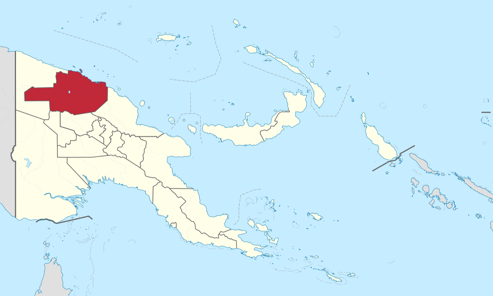
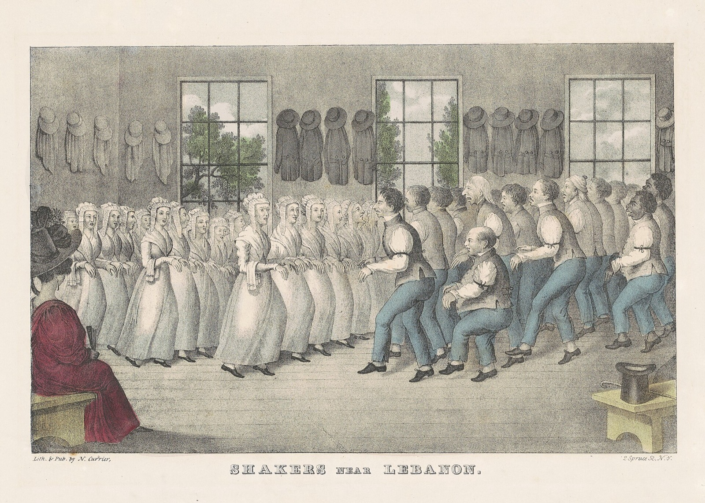
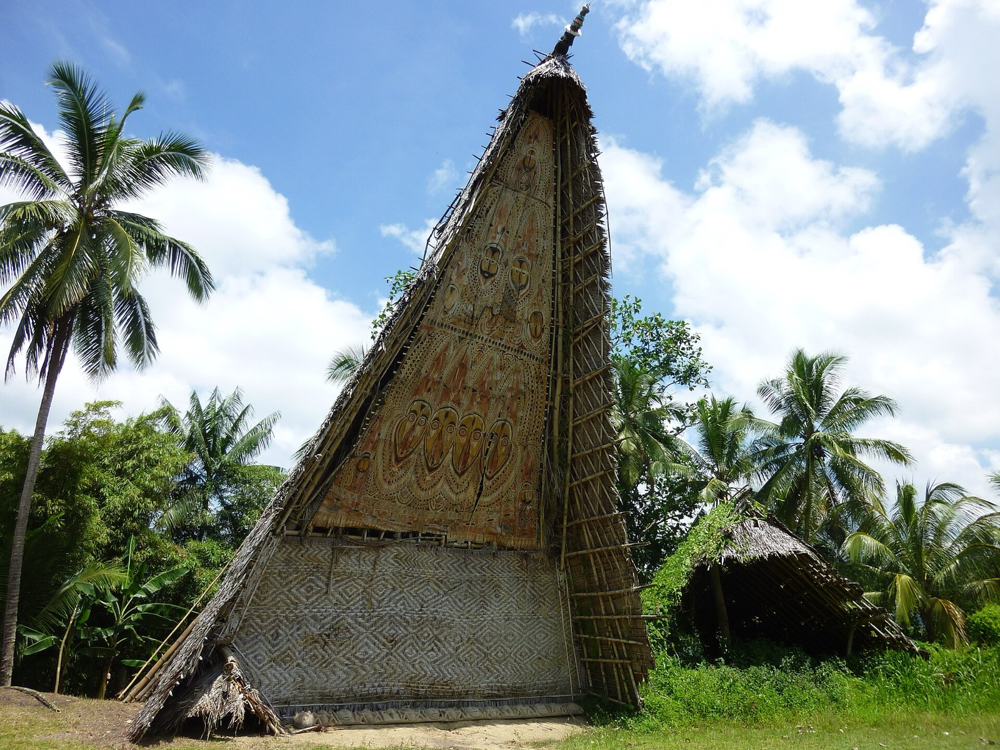
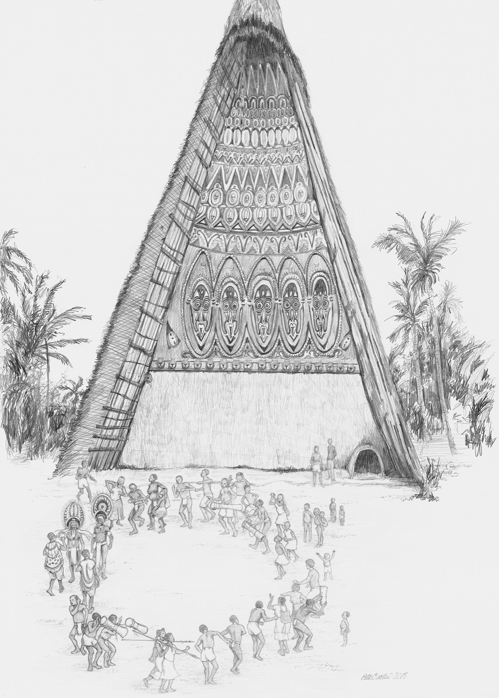
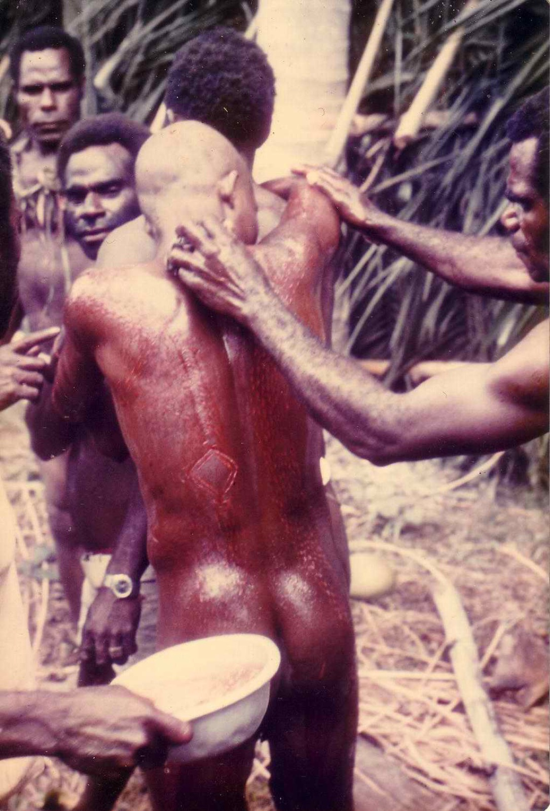
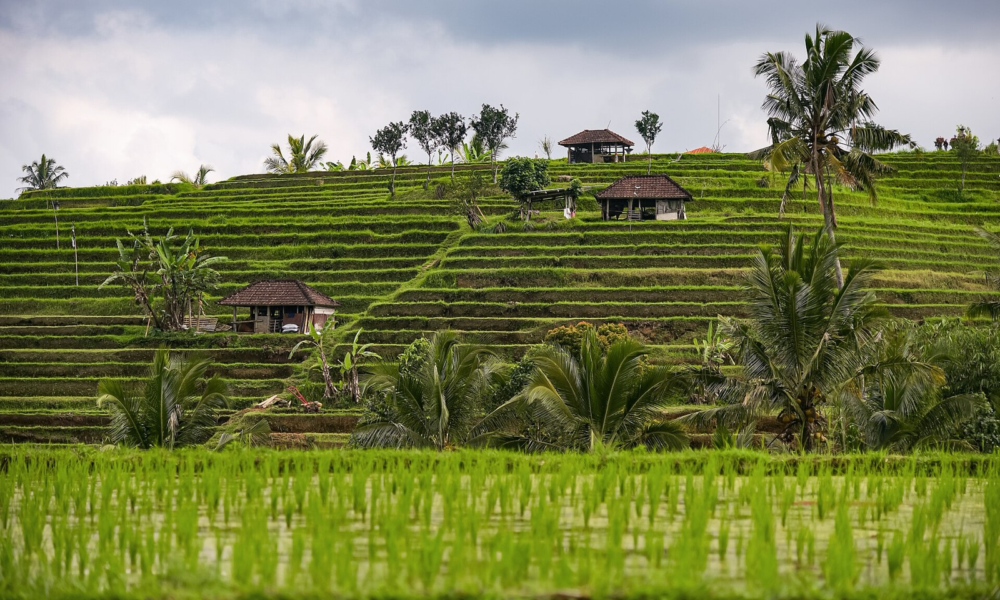

[Chapter 2](../2-village-toolkit/) gave us the village toolkit: meeting again, reputation, seeing, graduated punishment, someone big enough. Its limit: you have to know each other. Past a few hundred people, the faces run out.

The climb goes bands, villages, states, the globe. This chapter is rung 2, the thousands. How do you cooperate with people you'll never really know? It starts with a puzzle, a village in Papua New Guinea that shouldn't exist, and ends with the bill: who the tribe leaves outside.

> [!summary] In this chapter
> 1. **A puzzle**: why Sepik villages split at about 300 people, and how one held 1,500.
> 2. **Three tools** for making strangers kin: ritual, fictive kinship and costly signals, and what they restore.
> 3. **How Ilahita got big**: all three tools in one ritual cult.
> 4. **Where it came from**: nobody designed it. Cultural evolution, the lens for the rest of the climb.
> 5. **The tribe's toolkit**, set next to the village's.
> 6. **Tribes in the AI race**: creeds, costly signals, and tribe against tribe.
> 7. **Who's outside**: the rival tribe, and some of the tribe's own.
> 8. **Your case**, and the three questions that close every rung.
>
> About 20 minutes of reading, plus the clips and the exercises.

## 1. A puzzle in the Sepik

> [!reflect] Reflect: The village that shouldn't exist
> In the Sepik region of Papua New Guinea, villages fall apart at about 300 people. Raiding is constant, so a bigger village is a safer one: everyone has life-and-death reasons to stick together. They still split. One village held 39 clans and well over a thousand people together, with the same land and the same tools as its neighbours. How?

### The 300 rule

People do strange things to belong. Fraternity hazing. A haka before a rugby match. A wedding. From outside, they make no sense. From inside, they hold a group together. Here's the strangest case I know.

*The haka: strange from outside, binding from inside. All Blacks against Wales, Rugby World Cup 2019. Photo: 江戸村のとくぞう, CC BY-SA 4.0.*

In the middle of the last century, anthropologists working in the Sepik noticed something odd. Villages rarely got past about 300 people, about 80 men.[^300rule]

*East Sepik Province, northern Papua New Guinea: home of the Abelam and of Ilahita, inland near Maprik. Map: TUBS, CC BY-SA 3.0.*

Past that, the cracks came. A quarrel over a marriage, an affair, a death blamed on sorcery. Old grievances piled on, and the village split along clan lines into feuding hamlets that moved apart.

And raiding was constant, so a bigger village was a safer one. They still split.

You'll recognise the number. It's where chapter 2's toolkit runs out: past a few hundred, the faces run out too.

### Ilahita

Except in one place. Ilahita, a village of the Arapesh people, had brought 39 clans together: about 1,500 people, and more in the hamlets around it.[^ilahitasize] Same yams, same stone tools, same forest. Five times the ceiling.

How?

### "We're a family"

First, a smaller version you already know. A house of eleven, the shared kitchen from chapters 1 and 2. Some houses run on the rota. But in the best houses, nobody checks the rota much. There's a house dinner on Sunday. The house has a name. When someone leaves a mess, someone else says "that's not what we do in this house", and it works.

"We're a family." They aren't. But it does what the rota did, without anyone checking. That's what this chapter is about: making strangers feel like kin.

## 2. Making strangers kin

> [!poll] Poll: The communes
> In 19th-century America, hundreds of utopian communes were founded, some religious, some secular (socialist, anarchist). Which lasted longer: religious / secular? And did the communes that demanded more of their members (fasting, giving up property, strict rules on dress and sex) last longer / shorter?

### The communes

Richard Sosis, an anthropologist, collected 200 of them.[^sosis2000] The religious communes lasted far longer. In any given year, a secular commune was nearly four times as likely as a religious one to fold.

*Shakers dancing in worship near Lebanon, New York: a religious commune, celibate and demanding, and ritual in motion. Lithograph, N. Currier, 19th century, public domain.*

Then he and a colleague looked at what the communes demanded of their members: no alcohol, no private property, special dress, celibacy or rules on marriage, fasting.[^sosis2003] Among the religious communes, the more they demanded, the longer they lasted. Among the secular ones, demands made no difference.

That's the opposite of what you'd expect. Asking more of people should drive them away. Instead it held them. Why?

A correlation, from old records. But a striking one.

### Ritual, kinship, signals

Kin is the oldest way to cooperate at all: help your family, help your genes. Chapter 1's ant colony is one big family. Most of the thousands we need to cooperate with aren't kin. So cultures make them feel like kin. There are three main tools.

**Ritual.** Doing something together, especially something hard. People who march, sing or dance in time feel closer, though the effect in experiments is small.[^synchrony] The big effect comes from a shared ordeal: people who went through the same frightening thing together are bound for life. Soldiers call it a band of brothers.[^ritual]

**Fictive kinship.** Kin words for people who aren't kin. Brother, sister, father. A common ancestor for a whole clan. Clans that run across villages, so a stranger from far away turns out to be a cousin. We still do it: "brothers in arms", "sisters", "the founding fathers", "we're a family".

**Costly signals.** A price the half-hearted won't pay. Fasting, a vow, a painful initiation, a tattoo. Anyone can say they're committed; paying the price shows it.[^costly] That's why the demanding communes lasted: the price filtered out people who'd have shirked, and everyone who stayed could see that everyone else had paid.

### What they restore

Back to chapter 1's five questions. Which ones do these tools answer?

**Meeting again, through the group.** You may never meet this stranger again. But you'll meet the tribe again. Your reputation travels with the tribe, and the tribe polices its own. It's chapter 2's reputation, stretched to people you've never met.

**Seeing who's in.** A tattoo, a scar, a dialect, a way of dressing: you can tell at a glance who's one of us.[^markers] It's a different kind of seeing from chapter 2's. Törbel's hay barns showed what you *did*. A mark shows what you're *committed to*. And it has to be visible: a shared ordeal binds the people who went through it, but to reach strangers you need a mark of it.

*The mark of a shared ordeal: crocodile scarification, a Sepik coming-of-age rite. A stranger can see you went through it. Photo: \*christopher\*, 2005, CC BY 2.0.*

Both pull the same lever: they change the dimensions.

## 3. How Ilahita got big

### The Tambaran

Back to Ilahita. In the Sepik, villages split at about 300 people. Ilahita held about 1,500. In the late 1960s an anthropologist called Donald Tuzin went to find out why.[^tuzin] The answer was a ritual cult called the Tambaran. And all three tools are in it.

*A Haus Tambaran, the cult's spirit house, in Maprik District, East Sepik: the biggest building in the village. Photo: Sylt-Tinto, CC0.*

*A Tambaran dance at Ilahita: wives of the initiates dance backward, praising their husbands. Beth Curtin, in Henrich, The WEIRDest People in the World (2020), Fig. 3.1. Fair use for teaching.*

### Groups that cut across clans

Ilahita was divided into ritual groups. The whole village split into two halves. Each half split in two again, but across the first split, so each new group had people from both halves. Then again, tier after tier, each cutting across the ones above.[^crosscut]

The effect: brothers ended up in different groups, clans were cut through, and every man was tied to men of other clans in several different ways. You can't split a village along clan lines if every clan is woven into every other.

### Needing each other

Then the rules made the groups need each other. Every household raised pigs. But eating your own pigs was disgusting, like eating your own children. So you gave your pigs to the other group, and they gave theirs to you.

Every boy had to go through initiations to become a man, marry and gain a voice. And the rules said your initiations must be done by the other group. To become a man in Ilahita, you needed men from other clans.

Henrich calls it artificial interdependence. Any clan could have grown its own yams, eaten its own pigs and initiated its own boys. The Tambaran gods forbade it.[^artificial]

### Rites of terror

The initiations were the costly signal. There were five of them, starting at about age five, and they were brutal: pain, isolation, darkness, masked figures, strange sounds. Anthropologists call them rites of terror.[^terror] Boys from different clans went through them together, and came out bound to each other for life. And no one goes through that lightly: it commits you to a group that will ask more of you.

*A Sepik River initiation, 1975: the crocodile scarification being cut. Not Ilahita, but a rite of the same region and kind. Photo: Franz Luthi, CC BY-SA 3.0.*

https://www.youtube.com/watch?v=OIzsRlqcRXg&t=922s

*Harvey Whitehouse, "Rituals as social glue" (The Ritual Project), 15:22–16:27: why a painful, rare ritual sears itself into memory and binds people for life. Not about Ilahita; Whitehouse worked elsewhere in Papua New Guinea.*

### Gods of the whole village

Each clan had its own ancestor gods. The Tambaran gods were bigger: gods of the whole village. They punished people who neglected the rituals, which kept everyone turning up.

And they did one more thing. In the Sepik, an unexpected death was usually blamed on sorcery, which meant blamed on someone, and that started feuds that could last generations. In Ilahita, many of those deaths were now blamed on the anger of the Tambaran gods. Suspicion turned from your neighbours to the gods, and that seems to have cut one of the main fuses that blew villages apart.[^sorcery]

That's how Ilahita got big. Groups that cut across clans, gifts and initiations that made clans need each other, ordeals that bound men for life, and gods for the whole village. There's more on the Tambaran under [Going further](#going-further).

## 4. Where did it come from?

> [!reflect] Reflect: Who designed it?
> Ilahita's elders didn't plan the Tambaran's web of groups. So where did it come from?

### Nobody designed it

Here's the most remarkable part. When Tuzin showed Ilahita's elders how neatly the Tambaran wove their village together, they were as surprised as he was.[^nodesign]

Nobody had designed it. They'd followed rules about who gives pigs to whom and who initiates whom, and the whole thing worked without anyone knowing how. They copied plenty that didn't work, too: along with the Tambaran came the Abelam's elaborate yam magic, which probably did nothing for anyone.

### Copying the enemy

So where did it come from? From the enemy.

From the mid-1800s, a neighbouring people, the Abelam, were expanding by war, seizing land and driving families from their villages. Everyone assumed the Abelam had new rituals that gave them supernatural power. Around 1870, Ilahita's elders heard about the Tambaran from refugees fleeing the Abelam, and decided to copy it: fight fire with fire.[^abelam]

### Three useful mistakes

They copied it from second-hand descriptions, and they got it wrong. Three times, and each mistake made it work better.

- **Across, not within.** The Abelam kept brothers together and kept each clan inside one ritual group. Ilahita's version cut across the clans.
- **Bigger gods.** The Abelam's Tambaran gods were their clans' ancestors. Ilahita didn't recognise the names, and put the Tambaran gods above its own clan gods: one set of gods for all 39 clans.
- **Older elders.** Ilahita added the Abelam's four initiations to its own one. Five levels meant the men at the top were a decade older, and perhaps wiser.

It worked. Ilahita held off the Abelam and took land of its own. Refugees from other villages flooded in, and the Tambaran wove them in too, though they weren't kin to anyone.

### Cultural evolution

That one story has the whole mechanism in it. It's called cultural evolution.[^culturalevolution]

- **Variation.** Groups have different practices, partly by accident: copying errors.
- **Copying.** People copy what seems to work: the Abelam's success, so the Abelam's rituals. We're the imitative ape from chapter 1.
- **Competition between groups.** Groups with better practices win wars, grow, and attract people from groups that are failing. Their practices spread.

No one has to understand why a practice works for it to spread. That's why the tools of rung 2 weren't invented. They evolved. It's also the lens for the rest of the climb: at each rung we'll ask whether the big innovation was designed or evolved, and at rung 5 we'll weigh it up.

### Is it group selection?

One honest caveat. Some of the researchers behind this idea, Boyd, Richerson and Henrich, call the last step cultural group selection. Others, Steven Pinker and the biologist Stuart West among them, argue that "group selection" either adds nothing to ordinary explanations or is a loose metaphor.[^groupselection] It's a live hypothesis, not a settled one. The Ilahita story stands either way. What's disputed is how much it explains.

## 5. The tribe's toolkit

> [!exercise] Exercise: Make your kitchen a tribe
> Your shared kitchen, eleven people. Add one ritual, one name or word, and one small cost of belonging. What would it fix that the rota couldn't?

> [!success]- Answers
> One answer: a house name and a Sunday dinner (ritual); "we're a family" said and meant (fictive kinship); every newcomer does one deep clean in their first week (a small costly signal). It fixes the mess nobody sees: people clean when no one's checking, because it's their house. That's the open question at the end of this chapter, in miniature.

Here's the tribe's toolkit:

| Tool | Restores | Lever | In the kitchen |
|---|---|---|---|
| Ritual | meeting again, through the group | dimensions | the house dinner on Sunday |
| Fictive kinship | meeting again, through the group | dimensions | "we're a family" |
| Costly signals | seeing who's in | dimensions | you did the deep clean in your first week |

Next to chapter 2's toolkit, it's the same questions answered for people who don't all know each other.

## 6. Tribes in the AI race

Same structure, bigger stakes.

> [!reflect] Reflect: Tribes in the race
> Is there a tribe in the AI race? Who's in it, what binds it, and who's outside?

### Creeds

Several. Start with the labs. Many have something like a creed: a charter or a policy saying what they're for and what they won't do. OpenAI's 2018 charter said that if a value-aligned, safety-conscious project got close to general AI first, OpenAI would stop competing with it and start helping it.[^charter] That's a tribe's promise, made in public.

### A community with costly signals

Then the safety community, which runs across the labs, with its own language and its own conferences. Its commitments are backed by costly signals people have actually paid: researchers who resigned in public rather than stay quiet.[^signals] By this chapter's standards, that's a strong tribe.

### Do the creeds hold?

Mixed. The race puts every creed under pressure, and some of the people who hold them leave. The tribe can hold its members, but it can't hold the labs they work for.

### Tribe against tribe

Every tribe has an outside. The safety community has the accelerationists, and they have the "doomers". Both sometimes forget the public, whose future is being decided.

And the same tool works one level up: democracies against autocracies, the US against China. Each country's labs and governments become a tribe, and the other side becomes the rival. The tool that binds a lab is the tool that drives the race.

## 7. Who is a tribe against?

> [!reflect] Reflect: For and against
> Think of a strong group identity: a nation, a team, a faith, a political side. Is it defined by what it's for, or by who it's against?

### War and the in-group

Go back to the rites of terror. A tribe facing an enemy needs men who won't run, and an ordeal shows who won't.

*The men who won't run: hoplites on the Chigi vase, c. 640 BC, from chapter 1. Public domain.*

The evidence runs the other way too. People exposed to war become more cooperative, in experiments as well as in daily life, years afterwards. Where we can tell, mostly with their own side.[^bauer] Some researchers think in-group love and out-group hostility evolved together, as a package: that's a hypothesis, from a model.[^choibowles]

### Ilahita, plainly

Ilahita's most senior rite required initiates to hunt and kill men from enemy villages, to "feed" the Tambaran gods.[^killing]

And there was an outside inside. From their first initiation, boys were warned never to reveal anything about the rites to women, on pain of death. The tribe that wove 39 clans together kept its secrets from half its own people.[^women]

That's the bill at rung 2: the rival tribe, and some of the tribe's own.

### Love without hate

Is it inevitable? No. The psychologist Marilynn Brewer argued that loving your group doesn't require hating others: in-group love is common, and out-group hate is a separate thing, which needs its own triggers, often competition and threat.[^brewer]

And here's what gives me hope. Ilahita made kin of 39 clans that had every reason to split, without meaning to. Could we do it on purpose, and choose who counts as kin? That's rung 5.

## 8. Your case

> [!exercise] Exercise: Is there a tribe in your case?
> Take your case from the last exercise in chapter 1, and the dimension you said fails worst there. (1) Which village tool or tribe tool would restore it? (2) Who would it leave outside? One line each.

## 9. Closing the rung

Three questions close every rung.

### What did it restore?

Meeting again, through the group, and seeing who's in. The lever of the dimensions.

### Watched, or caring?

But I'm not sure that's the whole story.

If the tribe works because you'll meet it again, it should fail when nobody's watching. If it works because you care about it, because "we're a family" means the group's good feels like your own, then it holds even unseen. And then identity hasn't just changed the dimensions. It's changed the game: the payoffs themselves.

My draft answer: both. And the gap, what you do when no one is watching, is exactly what the next rung's gods are for.

> [!poll] Poll: Watched, or caring?
> Why does a strong group identity hold? Because members are watched by the group / Because members care about the group / Both / Neither.

### Who did the lifting?

Culture, almost alone, with our kin instincts underneath, stretched to people who aren't kin. The selecting was often done by war: rung 3's story.

### Who was outside?

The rival tribe. And, in Ilahita, the tribe's own women.

### The limit

The tribe runs on belief and kin. It holds while people believe the story and feel the bond. And belief can end.

It doesn't stretch, either. No ordeal can be shared by millions. No one can be a fictive cousin to a whole empire.

The Tambaran had gods, but they punished only poor ritual. They didn't watch everyone's morals.

> [!key] Key ideas
> - Past a few hundred people, the village toolkit runs out: you can't know everyone. Rung 2, the thousands, holds together by **making strangers feel like kin**.
> - **Three tools**: **ritual** (above all a shared ordeal), **fictive kinship** (kin words, a common ancestor) and **costly signals** (a price the half-hearted won't pay).
> - They restore **meeting again, through the group**, and **seeing who's in**. The lever is the dimensions.
> - A costly or painful practice can be a **cooperation technology**: the demanding religious communes lasted longest.
> - **Ilahita** held 1,500 people where its neighbours split at 300: groups that cut across clans, artificial interdependence, rites of terror and gods of the whole village.
> - **Nobody designed it.** Cultural evolution: variation, copying, and competition between groups. Whether that's "group selection" is contested.
> - **Every tribe has an outside**: the rival tribe, and sometimes some of its own. But in-group love doesn't require out-group hate.
> - The limit: the tribe runs on **belief and kin**, and no ordeal can be shared by millions.

So how did we ever cooperate with millions? With two things the tribe didn't have: someone big enough to force it, and then gods who watch when no one else does. That's the next rung, in chapter 4, "Strangers and states".

---

## Going further

### Ilahita in depth

The spirit house was the biggest building in the village by far, a whole-village project. The Tambaran gods also punished anyone who broke a truce with a neighbouring village, which stopped one clan dragging everyone into a war for its own revenge.[^truce]

### Bali's water temples

Another case, from the other side of the world. In Bali, rice farmers share water from the same rivers. If everyone plants at once, there isn't enough water; if everyone plants at different times, pests move from field to field. For centuries, a network of water temples set a ritual calendar that timed planting across whole watersheds.[^subak]

*Jatiluwih rice terraces, Bali, watered through the subak and its temples. Photo: Jorge Franganillo, CC BY 2.0.*

https://www.youtube.com/watch?v=kZLLGCaz74M&t=90s

*Stephen Lansing, "Perfect order" (TEDxNTU), 1:30–3:56, with footage from The Goddess and the Computer (1988): the Green Revolution arrives, and the pests follow. For the mechanism (planting in sync so the pests starve), 4:29–6:21.*

Image credits: [assets/SOURCES.md](assets/SOURCES.md).

[^300rule]: Henrich, *The WEIRDest People in the World* (2020), pp. 88–89, citing Forge (1972) and Tuzin (1976, 2001). "About 300 people, of whom about 80 were men", divided into a handful of patrilineal clans. Elsewhere in the Sepik, where raiding was less intense, Arapesh groups preferred hamlets of under 90 (p. 96).
[^ilahitasize]: Henrich (2020), p. 89: "39 clans into a population of over 2,500 people"; his n. 5 (p. 522): "Ilahita proper was about 1,500 people", the 2,500 including the hamlets "that huddled in Ilahita's protective shadow" (Tuzin 1976, 2001). "Five times the ceiling" uses 1,500.
[^sosis2000]: Sosis, "Religion and intragroup cooperation: preliminary results of a comparative analysis of utopian communities", *Cross-Cultural Research* 34 (2000): 70–87. 200 communes from Oved's list (88 religious, 112 secular). In any given year, a secular commune's odds of dissolving were nearly four times a religious one's; secular communes were twice as likely to dissolve within five years.
[^sosis2003]: Sosis and Bressler, "Cooperation and commune longevity: a test of the costly signaling theory of religion", *Cross-Cultural Research* 37 (2003): 211–39. 83 communes (30 religious, 53 secular) coded for 22 costly requirements; religious communes imposed more (mean 7.0 against 3.0); more requirements meant longer survival for religious communes but not secular ones. Correlational, and the historical sources favour communes that left records.
[^synchrony]: Wiltermuth and Heath, "Synchrony and cooperation", *Psychological Science* (2009). Effects are small and replications mixed.
[^ritual]: Whitehouse, *Modes of Religiosity* (2004); "rites of terror" is Whitehouse's term (1996). Shared dysphoric experience and identity fusion: Whitehouse and Lanman, *Current Anthropology* (2014); Buhrmester et al. (2015). Henrich (2020), p. 91, makes the "band of brothers" comparison.
[^costly]: Costly signalling theory of religion: Irons (2001); Sosis (2003); Iannaccone, "Why strict churches are strong", *American Journal of Sociology* (1994). The signal works only if it costs the uncommitted more than the committed; otherwise anyone could pay. Henrich (2020), ch. 4, uses the related idea of credibility-enhancing displays (CREDs).
[^markers]: Ethnic markers as signals of who shares your norms: McElreath, Boyd and Richerson, "Shared norms and the evolution of ethnic markers", *Current Anthropology* (2003). The behaviour/commitment contrast with Törbel is my framing.
[^tuzin]: Tuzin, *The Ilahita Arapesh: Dimensions of Unity* (1976) and *Social Complexity in the Making: A Case Study among the Arapesh of New Guinea* (2001). Retold in Henrich (2020), ch. 3, "How Ilahita Got Big", pp. 88–97, which this section follows; also in Henrich, *The Secret of Our Success* (2016).
[^crosscut]: Henrich (2020), p. 90: "a complex organization of eight paired ritual groups", each tier cutting across the one above, "for five more tiers".
[^artificial]: Henrich (2020), pp. 90–91: the pigs ("like eating one's own children"), initiations by the opposite ritual group, and "a kind of culturally constructed interdependence … 'artificial' interdependence". He compares Durkheim's mechanical and organic solidarity (n. 7).
[^terror]: Henrich (2020), pp. 91–93. Five initiation levels, from about age five; the first involved stinging nettles, the second (about age nine) penile bloodletting; adolescent initiates were isolated for months.
[^sorcery]: Henrich (2020), pp. 93–94. The Tambaran gods "were only believed to punish people for inadequate ritual performances", unlike the moralising gods of later world religions: this is the bridge to Big Gods in chapter 4.
[^truce]: Henrich (2020), n. 11 (p. 523), citing Tuzin: the Tambaran gods also punished truce-breakers, which restrained clans from starting raids for their own revenge.
[^nodesign]: Henrich (2020), p. 94, citing Tuzin (2001), p. 83: the elders "were as surprised as he was".
[^abelam]: Henrich (2020), pp. 94–96, citing Tuzin (1976, 2001). "Around 1870" and "fight fire with fire" are Henrich's. The three copying errors and their effects: p. 95. Refugees woven in: p. 96.
[^culturalevolution]: Boyd and Richerson, *Culture and the Evolutionary Process* (1985) and *Not by Genes Alone* (2005); Henrich, *The Secret of Our Success* (2016). Henrich (2020), pp. 96–97, lists five processes of competition between groups, of which the Sepik shows three: war and raiding, differential migration, and prestige-biased group transmission (copying the more successful group). The yam magic: Henrich (2020), p. 97 ("probably didn't contribute to anyone's success").
[^groupselection]: Pinker, "The false allure of group selection", *Edge* (2012); West, El Mouden and Gardner, "Sixteen common misconceptions about the evolution of cooperation in humans", *Evolution and Human Behavior* (2011). Replies: Richerson et al., "Cultural group selection plays an essential role in explaining human cooperation", *Behavioral and Brain Sciences* (2016), with commentaries.
[^charter]: OpenAI Charter (9 April 2018), under "Long-Term Safety": "We are concerned about late-stage AGI development becoming a competitive race without time for adequate safety precautions. Therefore, if a value-aligned, safety-conscious project comes close to building AGI before we do, we commit to stop competing with and start assisting this project." Its example trigger: "a better-than-even chance of success in the next two years". https://openai.com/charter/
[^signals]: For example, in May 2024 OpenAI's head of alignment resigned, saying safety had "taken a backseat to shiny products" (Fortune, 17 May 2024).
[^bauer]: Bauer, Blattman, Chytilová, Henrich, Miguel and Mitts, "Can war foster cooperation?", *Journal of Economic Perspectives* 30 (2016): 249–74. About 20 studies; exposure to war violence raises cooperation, in games, community participation and trust, and the effect lasts. Where it can be told, it's mostly toward the in-group; the authors flag that as preliminary.
[^choibowles]: Choi and Bowles, "The coevolution of parochial altruism and war", *Science* 318 (2007): 636–40: game-theoretic analysis and agent-based simulations, not evidence that it happened. Altruism and parochialism could evolve together under late-Pleistocene conditions, though neither alone would be viable.
[^killing]: Henrich (2020), p. 93: "initiates had to hunt down and kill men from enemy communities in order to 'feed' the Tambaran gods".
[^women]: Henrich (2020), pp. 92–93: boys were "warned never to reveal anything about these special rituals to women, under pain of death". Women were not wholly excluded: Henrich's Fig. 3.1 shows wives dancing in a Tambaran rite.
[^brewer]: Brewer, "The psychology of prejudice: ingroup love or outgroup hate?", *Journal of Social Issues* 55 (1999): 429–44. Core claim: in-group attachment doesn't require out-group hostility; much in-group bias is favouring your own, not hating others.
[^subak]: Lansing, *Priests and Programmers* (1991) and *Perfect Order* (2006). Contested: Helmreich (1999, 2000). The case stands; the strength of the mechanism is what's disputed. Strictly a coordination problem (closer to the stag hunt than the battle line).

---

[← Chapter 2: The village toolkit](../2-village-toolkit/) · [Course home](../) · Next: Chapter 4, Strangers and states (coming soon)
