[Chapter 3](../3-manufactured-tribe/) gave us the tribe's toolkit: ritual, fictive kinship and costly signals, which made kin of strangers in their thousands. Its limit was belief and kin: no ordeal can be shared by millions, and no one can be a cousin to a whole empire.

Yet from about 5,000 years ago, millions of strangers were cooperating. How? The climb goes bands, villages, states, the globe, and this chapter is rung 3, the millions. It starts with a puzzle, why anyone farmed at all, and ends with the bill: who paid for the first states.

> [!summary] In this chapter
> 1. **Why scale at all?** Farming as a trap and war as a ratchet: why millions of strangers had little choice.
> 2. **The first Leviathans**: a ruler who can punish you, and the god-kings of the first states.
> 3. **The limit of force**: who watches the watchers, and why force never worked alone.
> 4. **Gods who watch**: the dice game, and how a god who sees you makes you fairer to strangers.
> 5. **Gods with ethics**: the Axial Age, when religion went from watching you to changing what you want.
> 6. **Rung 3's toolkit**, set next to the tribe's and the village's.
> 7. **The AI race**: is anyone big enough between the US and China?
> 8. **Who paid?** The enslaved, the conquered, the taxed farmer, and the unbeliever.
> 9. **Your case**, and the three questions that close every rung.
>
> About 25 minutes of reading, plus the clips and the exercises.

## 1. Why scale at all?

> [!reflect] Reflect: The farmer's bad deal
> On average, in many regions, early farmers were shorter than the foragers before them, had worse teeth and more disease. So why did nearly everyone end up farming?

### A bad deal that won

Farming looks like progress. For the people who did it, it often wasn't. The skeletons of early farmers are, on average, shorter and sicker than those of the foragers they replaced: more tooth decay, more signs of hunger in childhood, more infectious disease from crowding together with each other and with animals.[^health] The evidence is mixed and varies by region. But it's not the story of a better life that everyone chose.

So why did it spread? Because a farming group feeds far more people from the same land. Turchin puts it bluntly: groups of poorly nourished farmers could beat healthy, tall foragers "simply by force of numbers".[^numbers]

That's a trap. Each forager band might have been better off staying as it was. But a band that stayed out alone was pushed out or swallowed up by the farmers next door. Once the land is fields, nobody goes back. It's chapter 1's battle line, played between whole groups.

### War as a ratchet

Remember Ilahita, the village in Papua New Guinea that held 1,500 people when its neighbours split at 300? Raiding was constant, so a bigger village was a safer one.

Scale that up and you have the engine of this rung. Bigger groups win wars. Groups that manage to grow survive, and the rest are absorbed, driven off or wiped out. Where there's nowhere to flee, in a river valley hemmed in by desert, say, the losers don't leave: they become subjects.[^carneiro] Each turn of the ratchet makes groups bigger, and it doesn't turn back.

The complexity scientist Peter Turchin sums it up in four words: "we cooperate to compete".[^turchin] Competition inside a group destroys cooperation. Competition between groups builds it.

https://www.youtube.com/watch?v=fDigwxbSmBU&t=67s

*Peter Turchin, "10,000 years of war increased the size of human groups" (Seshat interview), 1:07–2:59. Watch for the spiral: bigger groups win, rivals must grow too, and only societies that find ways to hold together survive.*

War alone doesn't do it: it ratchets scale up only when some groups have better ways of cooperating than others, and those ways spread.[^maeenga] And every so often the ratchet jumps, when a new weapon breaks the old balance between neighbours: the horse, the chariot, iron.[^weapons] Each time, the only defence was to get bigger.

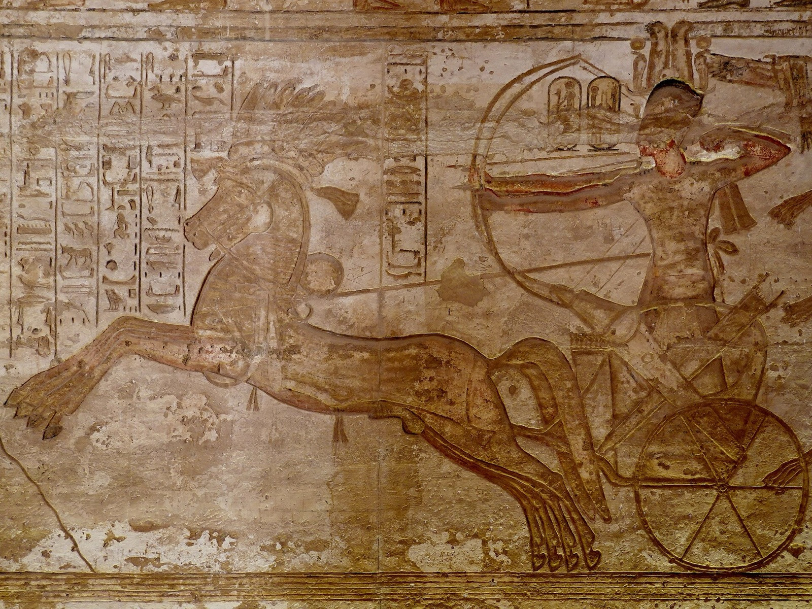
*The chariot breaks the balance. Ramesses II shoots from his chariot at a Syrian fortress, great temple of Abu Simbel, about 1260 BCE (the Kadesh battle is on the opposite wall). Photo: Olaf Tausch, CC BY 3.0.*

### Not progress

One honest caveat. The political scientist James C. Scott reads the same record as states built on captured labour and taxed grain, which many people fled given the chance; *The Dawn of Everything* shows people moving in and out of hierarchy for thousands of years.[^critique] Neither denies the mechanism. They deny it was progress. Nor does this course: it's a climb in scale, not in wellbeing. And the rungs are scales, not stages: tribes and villages carried on alongside the states.

## 2. The first Leviathans

> [!poll] Poll: The strongman
> Your village is raided every few years. A strongman offers protection. He'll take a third of your grain, and he can kill you. Do you accept? Yes / No.

### Leviathan

In 1651, after a decade of civil war in England, Thomas Hobbes asked what life would be like with no government at all. His answer: a war of everyone against everyone, and life "solitary, poor, nasty, brutish, and short".[^hobbes] His fix was a sovereign so powerful that everyone fears him. He called it Leviathan, after the sea monster in the Book of Job.

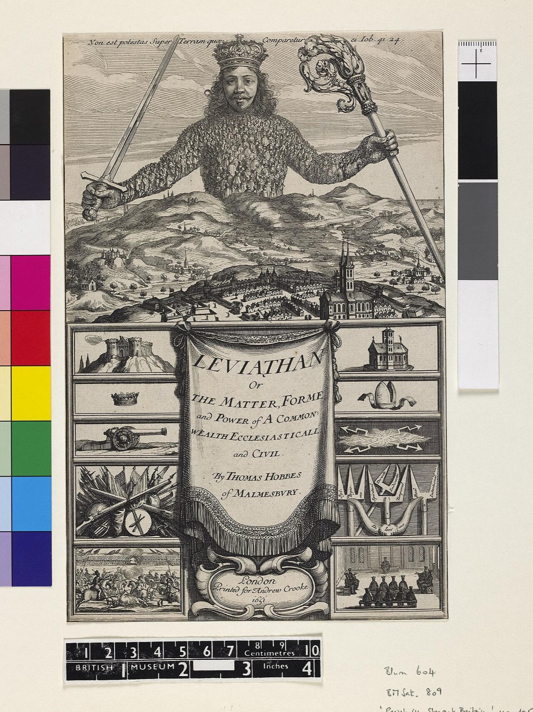
*Leviathan in one picture: a sovereign whose body is made of his subjects, holding the sword and the crozier. Frontispiece of Hobbes's* Leviathan *(1651), engraving by Abraham Bosse, public domain.*

Put that in the language of chapter 1. In the battle line (chapter 1's prisoner's dilemma), each soldier does better by running, whatever the others do. Now add a king who hangs deserters. Running no longer pays. The king hasn't made anyone nicer. He's changed the payoffs, so the battle line stops being a battle line.

That's chapter 1's fifth question, *is anyone big enough?*, answered at a new scale: one ruler over millions. In chapter 1, "big enough" meant big enough to act alone. Here it means big enough to make everyone else's choice for them. And it pulls the first of chapter 1's two levers, the payoffs: the king doesn't change who's playing, he changes what defecting costs. This is the top-down path.

### God-kings

The first states arose about 5,000 years ago: in Mesopotamia (Uruk), in Egypt, and much later in China (the Shang, from about 1600 BCE). They had armies, scribes counting grain, and kings who were gods, or nearly.

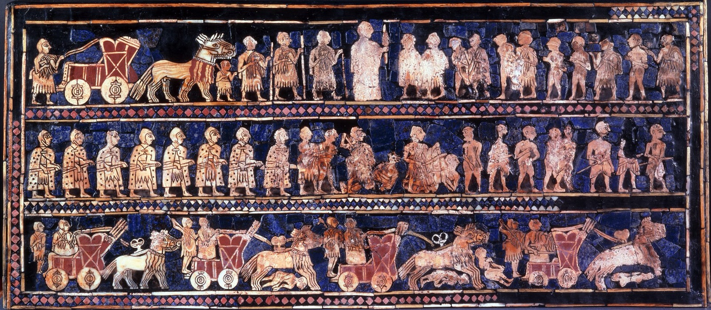
*The first states, war side. The Standard of Ur, "war" panel: chariots ride down enemies, captives are brought before the king. Ur, about 2600 BCE, British Museum. Public domain.*

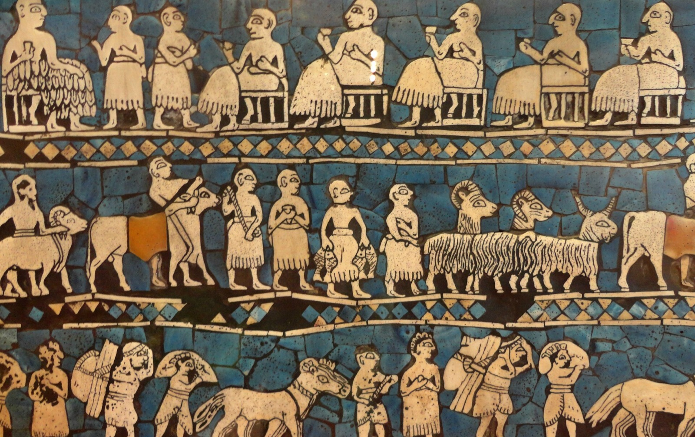
*And the peace side. The "peace" panel: animals and goods brought in, the king and his elite at a feast. Photo: Juan Carlos Fonseca Mata, CC BY-SA 4.0.*

Hawaii, much later, shows what a god-king state was like from inside. The king was sacred. A commoner who raised a knee in the presence of an eating chief could be put to death. When the king died, ten men were to be killed.[^hawaii] Turchin, drawing on the archaeologist Bruce Trigger's comparison of seven early civilisations, from Egypt to the Aztecs, reports divine kings, slavery and human sacrifice in all of them.[^trigger]

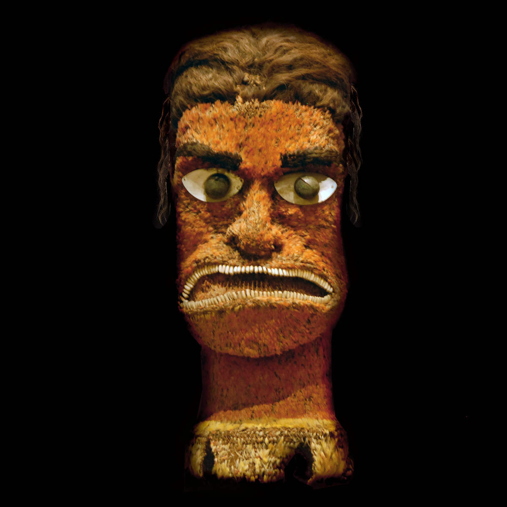
*The sacred power behind the Hawaiian king. A feathered image of Kūkaʻilimoku, the war god of the kings, collected on Cook's voyage, 18th century. Ethnologisches Museum, Berlin. Photo: Jean-Pierre Dalbéra, CC BY 2.0.*

For most of our history, foragers kept their would-be bosses in check; the first states swung hard the other way.[^zigzag] And, Turchin argues, it was easier to be a god-king than merely a king: a claim to divinity held better than a claim to strength.[^godking]

Did these states' gods care about morals? Mostly they wanted ritual and loyalty. But not only: in Mesopotamia, Shamash, the sun god, was the god of justice, and merchants swore oaths to him on their contracts.[^shamash] How moral the early gods were is debated.

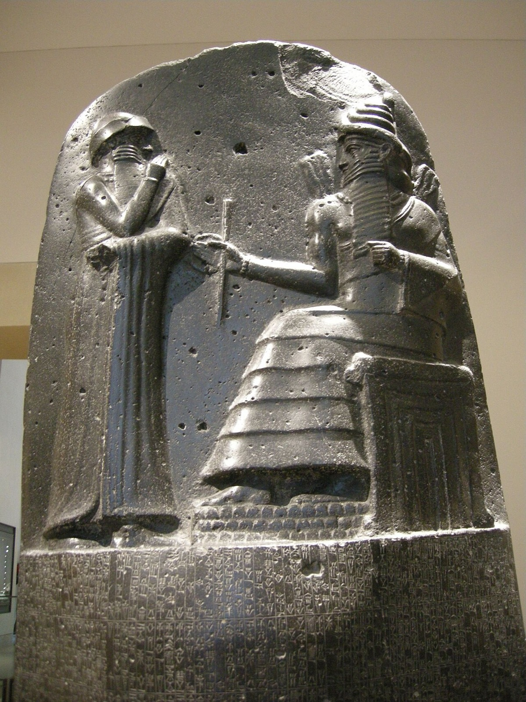
*Law from the god of justice: Hammurabi stands before Shamash, the sun god, on top of the stele carrying his laws. Babylon, about 1750 BCE, Louvre. Photo: sailko, CC BY 2.5.*

### The kitchen

The smallest Leviathan you've lived under: your parents. "Because I said so." Pocket money docked if you don't do the washing-up. It works. The washing-up gets done.

## 3. The limit of force

> [!reflect] Reflect: The parents are away
> Your parents go away for the weekend. What happens to the washing-up?

### Who watches the watchers?

It piles up. Leviathan has the same problem, a million times over. A ruler can't watch everyone. He needs soldiers, tax collectors, governors, and they face the same choice as everyone else: do the job or skim off the top. Who watches them? The ruler's own elites can defect too, and often did. Even Rome's strongest man, Julius Caesar, won everything and was stabbed 23 times by his own senators.[^fragile]

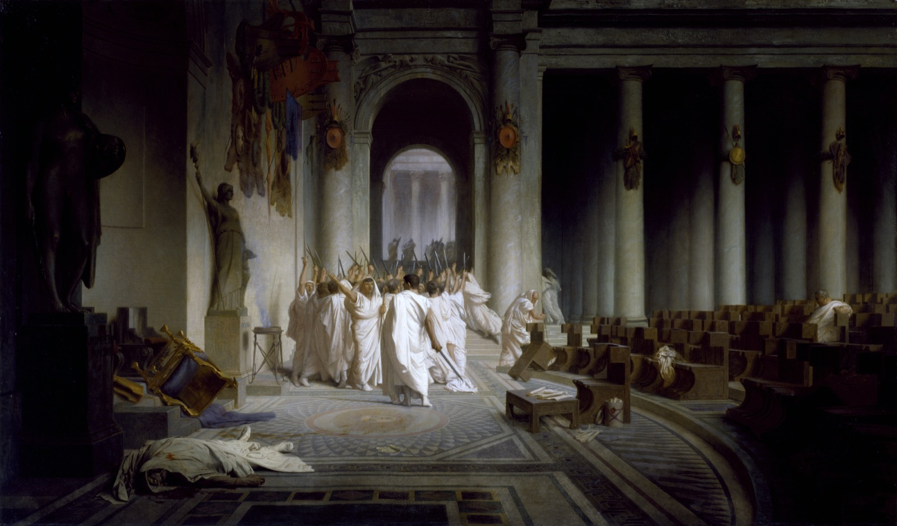
*Who watches the watchers? Caesar lies dead and his own senators walk away, swords raised. Jean-Léon Gérôme,* The Death of Caesar *(1859–67), Walters Art Museum. Public domain.*

Turchin again: "A complex society cannot be held together by force alone."[^force]

### Force never worked alone

And it never was force alone. The god-king was already a belief: a claim that the king's right came from the gods, which subjects and soldiers had to accept for it to work. Force made the first states. Belief helped hold them, from the start.

But a belief in the king is only as strong as the king. God-king states were brittle; revolts and collapses were common. To hold millions, you need people to behave well when no one is looking: the soldier on the frontier, the merchant in a distant market, the official with the tax chest. That needs a deeper belief.

## 4. Gods who watch

> [!poll] Poll: The dice game
> You have 30 coins and two cups: yours, and one for a stranger who shares your faith but lives far away. For each coin, pick a cup in your head, then roll a die. One colour: the coin goes where you pictured. The other: it goes in the other cup. Nobody can know what you pictured, so you can cheat for free. Do people who believe in an all-seeing, punishing god give the stranger more, the same, or less?

### Watched people are nice people

The anthropologists Ben Purzycki, Joseph Henrich and colleagues ran this game in eight societies, from hunter-gatherers in Tanzania to villagers in Fiji and Hindus in Mauritius.[^dice] Fair play gives the stranger 15 coins out of 30. People cheated a little, mostly for themselves and their own village.

Then they asked about people's gods. Those who believed their main god knew what they did and punished wrongdoing gave more to the distant stranger. Those who were unsure about their god's powers gave least. Overall, the strongest belief in a punishing god cut the bias against strangers four- to five-fold. That held even comparing people in the same village. And beliefs about local spirits made no difference at all.[^dicedetail]

A little fairer, to a stranger, in secret. That's what millions of strangers need.

### Moralising gods

So here is the bottom-up path, at the scale of millions: gods who watch everyone's morals, punish and reward, and see what no king can. The psychologist Ara Norenzayan's phrase for it: "watched people are nice people".[^norenzayan]

https://www.youtube.com/watch?v=I7TJlDH3jYU&t=701s

*Ara Norenzayan, "Researching religion and prosociality" (CERC plenary, 4 May 2013), 11:41–13:27. Watch for the problem (cooperation among strangers) and the answer: "an eye in the sky that's watching over you".*

They worked in markets. In Athens, merchants swore at the altars that their goods were sound. On Delos, a Mediterranean trading hub, a Greek traveller noted that "the presence of the god made it safe to do business there".[^delos]

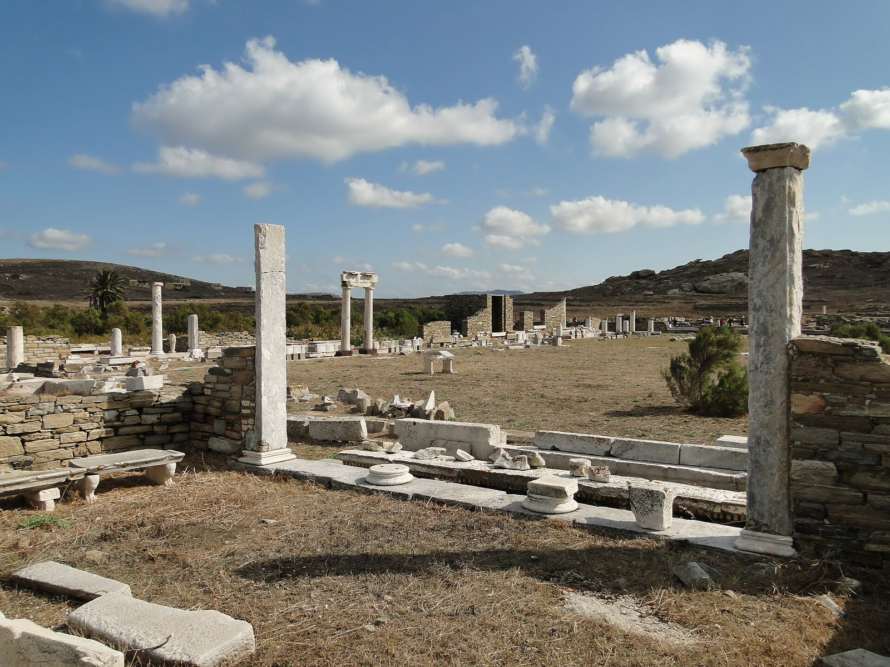
*The god in the marketplace. The Agora of the Italians on Delos, a market built by Italian traders next to Apollo's sanctuary, 2nd century BCE. Photo: Bernard Gagnon, CC BY-SA 3.0.*

And they bound the rulers too. Hammurabi of Babylon said he ruled by the gods' mandate, "to further the well-being of humankind". In China, a king held the Mandate of Heaven only while he ruled well. Rulers were, in Henrich's words, "as much subject to the demands of the gods as they were in control of them".[^hammurabi]

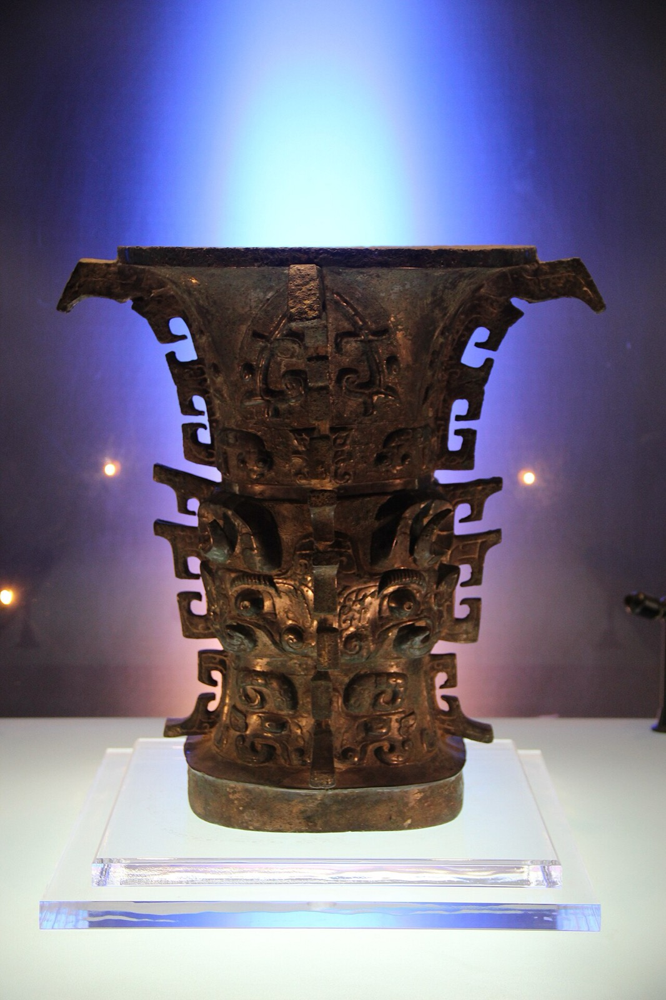
*The king under Heaven. A Western Zhou bronze zun, a national treasure at the Baoji Bronze Museum, very likely the He zun: its inscription recalls that King Wen "received this great mandate". Early Western Zhou, about 1040 BCE. Photo: Gary Todd, CC0.*

### The first monotheism

At the end of this road is one god, all-seeing, for a whole people. Akhenaten in Egypt raised one god, the Aten, above all others around 1350 BCE; it died with him. The God of Israel is the version that lasted, firming up as the next stage began: the two overlap.[^monotheism] The Big God at its fullest. But still mostly a god who watches, commands and punishes. "Thou shalt not."

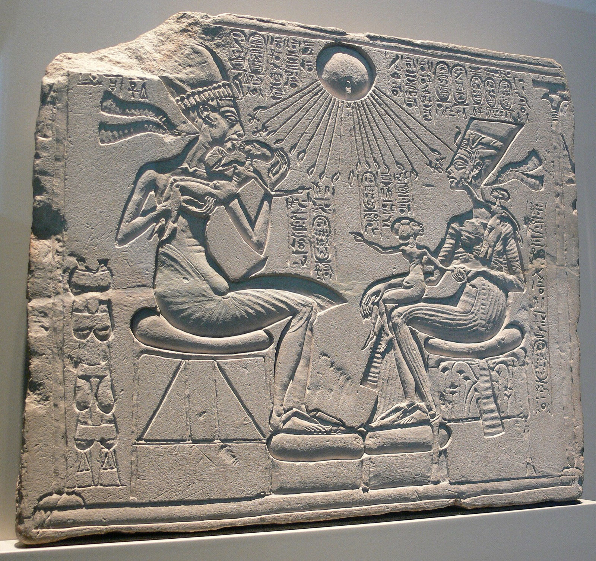
*One god above all others: Akhenaten, Nefertiti and three daughters under the Aten, its rays ending in hands. House altar, Amarna, about 1340 BCE, Neues Museum, Berlin. Photo: Andreas Praefcke, public domain.*

### When did they come?

The timing is contested. A big 2019 study claimed moralising gods came only after societies got large; it was retracted over how it handled missing data.[^seshat] Turchin puts them after the first states; critics point to Shamash and Egypt's Ma'at. Open.

## 5. Gods with ethics

> [!reflect] Reflect: Watched, or caring?
> Some children clear up even when their parents are away. Why? Are they watched, or do they care?

### Ashoka

Around 260 BCE, the Indian emperor Ashoka conquered the kingdom of Kalinga. By his own account, 100,000 people were killed and 150,000 deported.[^ashoka] Then he carved his remorse into stone, across his empire. He gave up conquest by war, banned animal sacrifice at court, and ruled as "Beloved of the Gods", bound by the dharma he preached. A ruler under a moral law.

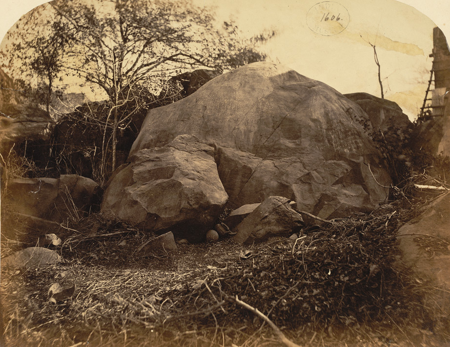
*A ruler carves his remorse in stone: the boulder at Girnar, near Junagadh, Gujarat, which carries Ashoka's major rock edicts, Rock Edict XIII among them. Photo: D. H. Sykes, 1869, public domain.*

Was it propaganda? Turchin thinks he meant it, and says the inscriptions convince scholars too.

### A new stage

Ashoka was a Buddhist, and the Buddha belongs to a remarkable few centuries, roughly 800 to 200 BCE, that the philosopher Karl Jaspers called the Axial Age. In India, the Buddha and Mahavira. In China, Confucius and Laozi. In Israel, the prophets. In Greece, Socrates and the philosophers.[^axial]

Some historians doubt it was one "age" at all.[^axialdoubt] But something changed, and it's a new stage after Big Gods. The new religions offered three things:[^three]

- **an afterlife that depends on how you live,** not on who you were born;
- **free will:** your choices, not just your rituals, decide your fate;
- **one moral law for everyone,** not a different one for each people.

And they went deeper than watching. They set out to change what you want: compassion, selflessness, the golden rule. "What you do not want done to yourself, do not do to others" (Confucius).[^golden] Prophets turned that on the powerful: Amos condemned those who "sold the righteous for silver, and the poor for a pair of shoes".[^amos]

The picture in one tradition: the jealous God of much of the Old Testament, who punishes, against the Sermon on the Mount: love your enemies.[^ntot]

Why then? Turchin's answer: horse-riding archers from the steppe forced empires of tens of millions, Persian, Indian, Chinese, Roman. Empires that big, ruling many peoples, needed a religion that bound everyone, rulers included.[^steppe] Others say rising wealth let people care about more than survival.[^baumard] Both are contested.

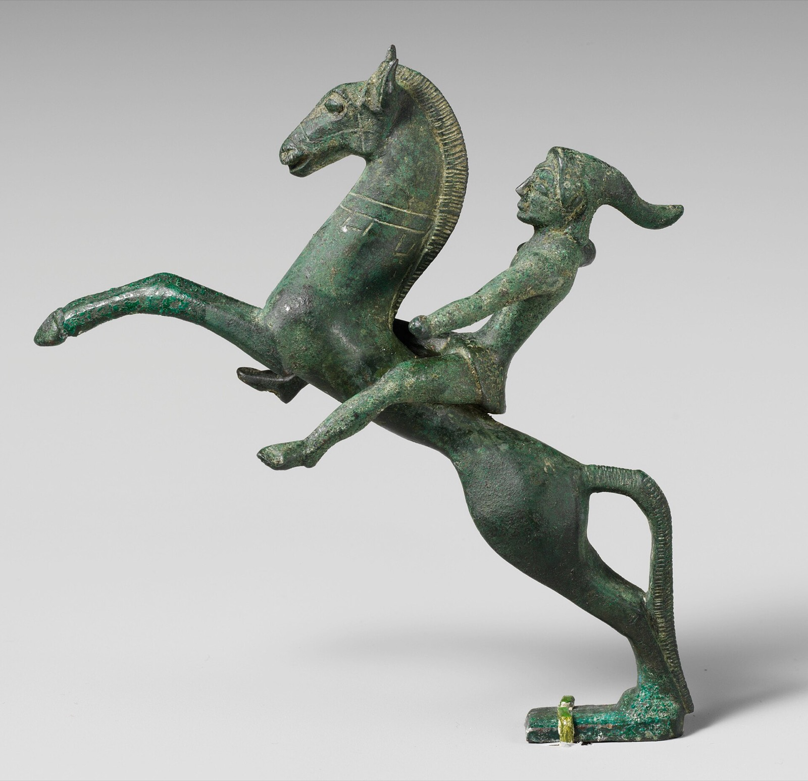
*The steppe as others saw it. A Scythian mounted archer, in his pointed cap, a figure from an Etruscan bronze urn, mid-5th century BCE. Metropolitan Museum of Art. Photo CC BY-SA 4.0.*

### Watched, or caring?

At the end of chapter 3 I asked: does a tribe hold because its members are watched, or because they care? My answer: both. And this rung has both. Moralising gods watch. Axial religions teach you to care.

That's a different kind of change. Watching restores one of the game's dimensions: defection becomes visible again, even when no human sees it. Caring changes the game itself. If you genuinely want the stranger to do well, the payoffs have changed from inside.

Back in the kitchen: the child who clears up with the parents away has taken the rule inside. First "Mum will know". Later, "it's the right thing to do".

> [!reflect] Reflect: Your own unwatched rule
> What's one thing you do even when no one could ever find out? Is that "Mum will know", or "it's the right thing to do"?

## 6. Rung 3's toolkit

Here's the toolkit of the millions:

| Tool | Restores | Lever | Path | In the kitchen |
|---|---|---|---|---|
| Leviathan | someone big enough | payoffs | top-down | parents: "because I said so" |
| Moralising gods | seeing and punishing, unseen | dimensions | bottom-up | "Mum will know" |
| Axial ethics | none: it changes the game | payoffs, from inside | bottom-up | "it's the right thing to do" |

Next to chapters 2 and 3's toolkits: someone big enough, now one ruler over millions, and for the first time a tool that changes what people want.

## 7. Leviathan in the AI race

Same structure, bigger stakes.

> [!reflect] Reflect: Who's in charge?
> Who is the Leviathan in the AI race?

### Inside a country

Inside a country, there could be one. A state can change a lab's payoffs: licences, audits, liability, fines. So far, states have mostly acted on the race between countries, with chip export controls, rather than on the labs, where rules come and go.[^aistates]

*What the export controls are about: the chips, and the rooms full of them. Photo: Carl Lender, CC BY 2.0.*

### Between countries

Between the US and China, there's no Leviathan. The UN isn't one: it can't watch the great powers' labs, can't punish them, and both hold a veto in the Security Council.[^un] The race between them is Ilahita and its neighbours again, with chips: each side is safer if it's bigger and faster, and so is the other.

### No shared god

And there's no Big God either: no belief both sides hold that would make them behave when nobody can check. That's the open question for the next two rungs.

## 8. Who paid?

> [!reflect] Reflect: The bill
> Who paid for the first states?

### Unfree labour

Every one of Trigger's seven early civilisations, as Turchin reports them, had slavery. Captives were a main prize of war, and forced labour built the canals, walls and pyramids. James Scott goes further: he argues that early states were, in large part, slave states, and that their walls may have been as much for keeping people in as keeping enemies out.[^unfree]

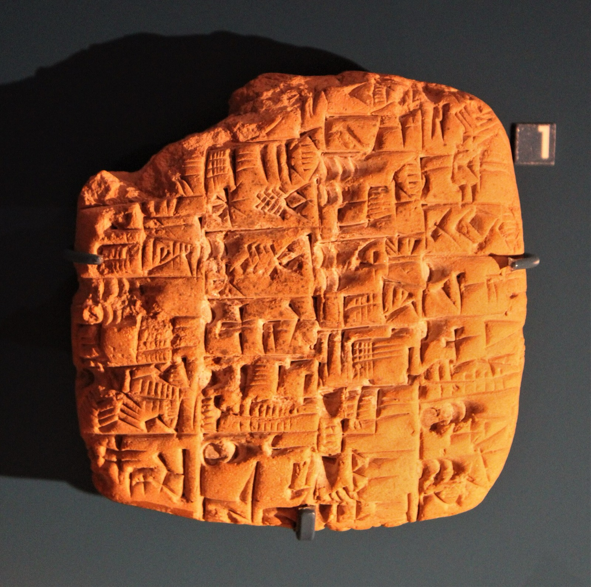
*Unfree labour, counted: a list of workers and their rations, from Kish, Early Dynastic period (about 2900–2350 BCE). Ashmolean Museum, Oxford. Photo: Zunkir, CC BY-SA 4.0.*

### Conquest and grain

The Assyrian kings boasted of flaying rebels and impaling them on stakes.[^assyria] And the farmer who survived gave a share of every harvest to the palace. A Chinese song more than 2,500 years old compares the lord to a large rat: "Large rat! Large rat! Do not eat our millet."[^rat]

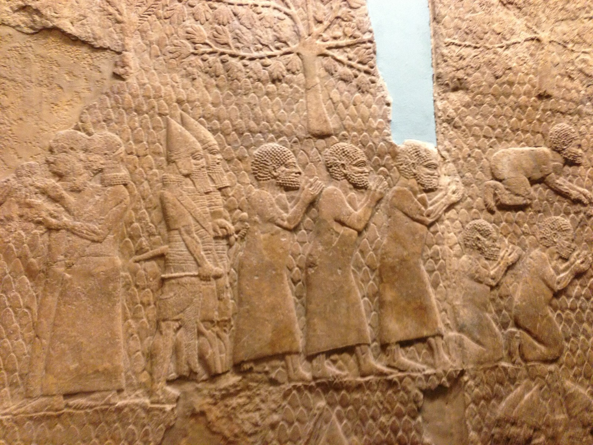
*Conquest without gore: people of Lachish led away after Sennacherib's siege, 701 BCE. Lachish reliefs, Nineveh, British Museum. Photo: Nate Loper, CC BY 2.0.*

### The gods' bill

The dice game, where belief in a punishing god made people fairer to strangers, had a catch. The stranger was a stranger of the same faith. Big Gods widened the circle, from the village to everyone who shared the god. And it stopped there. The same gods blessed holy war, conquest and forced conversion. Henrich puts it plainly: "it's still a circle that places some people on the outside".[^circle]

### The lift

But look at what else this rung produced. An emperor, Ashoka, carving his remorse in stone. Amos against those who sold the poor. Confucius's golden rule. One moral law for everyone, including the king. For the first time, people claimed the circle could include everyone. It didn't. But the claim was made, and it's still with us. Whether the circle can actually close, with no one left outside, is rung 5's question.

## 9. Your case

> [!exercise] Exercise: Is there a Leviathan in your case?
> Take your case. (1) Is there anyone big enough to change the payoffs? If so, who watches them, and who pays? (2) If not, what would people have to believe to behave well when no one can check? One line each, in your case notes. Keep them: chapter 5 picks up the cases with no one above them, and chapter 6 the three answers.

## 10. Closing the rung

Three questions close every rung.

### What did it restore?

Two of chapter 1's questions. Is anyone big enough? Yes: a ruler who changes what defecting costs. Can defection be seen and punished? Yes, even unseen: gods who watch. And the Axial Age went past the questions, changing the game itself: what people want.

### Who did the lifting?

Both paths, together, with the balance shifting from force towards belief. Agriculture and new weapons pushed; war selected. That's one reading, broadly Turchin's, not a settled one.[^tally]

### Who was outside?

The enslaved, the conquered, the taxed farmer, and the unbeliever.

### An open question: is coercion cooperation?

I don't think this is settled, and I'd like your view. If a king makes you dig his canal, the canal gets dug. Is that cooperation, or extraction?

My answer, for now: it's a collective action problem solved by changing the payoffs, the same move as docking pocket money. Whether it's cooperation or extraction depends on who gains. If you'd have taken the strongman's deal, call it cooperation. If not, extraction. Turchin sees the god-kings as a dip and the Axial Age as the recovery. Scott would say that for most people the dip never ended.

> [!poll] Poll: Is coercion cooperation?
> A king makes you dig his canal. Is that cooperation? Yes / No / Depends who gains.

### The limit

There's no Leviathan above the states. And the Big Gods split along faiths: holy war is war between moralising gods.

> [!key] Key ideas
> - **Scale was forced, not chosen**: farming was a trap and war a ratchet. Competition between groups builds cooperation inside them.
> - **Two paths**: top-down, a **Leviathan** who changes everyone's payoffs by force; and bottom-up, beliefs that make people behave when no one is looking.
> - **Force made the first states, but never alone**: a ruler can't watch the watchers, and the god-king was already a belief.
> - **Big Gods**: watched people are nice people. Belief in a god who sees and punishes made people a little fairer to strangers, even unseen.
> - **The Axial Age**: from being watched to caring. One moral law for everyone, the king included, and religions that set out to change what you want.
> - **The bill**: the enslaved, the conquered, the taxed farmer, and the unbeliever. The gods' circle stopped at the faith.
> - The limit: **no Leviathan above the states**, and no god they share.

So: between states with no ruler above them and no god in common, how do strangers cooperate across a continent, and then the world? That's the next rung, in chapter 5, "Modernity's try".

---

## Going further

### Law, writing and money

The state had other tools, which we'll only name here.

- **Law codes** make the rules public and the same for everyone, at least on paper: Hammurabi's stele stood where people could see it.
- **Writing** makes defection visible: debts, taxes and contracts recorded, so a promise can be checked years later.[^writing]
- **Money** makes trade between strangers easy: you don't need to trust the person, only the coin.
- **Focal points and commitments.** Thomas Schelling showed how a shared expectation can pick the good outcome in a stag hunt, and how tying your own hands can make a promise believable. We'll meet him properly with the treaties of rung 4.
- **Not every early state was a god-king.** Some archaeologists argue that a few early states, Monte Albán in Mexico among them, ran more on shared revenue and public goods than on a god-king: states built more bottom-up than top-down.[^collective]
- **Grain.** James Scott argues the first states grew on grain because grain can be seen, measured, stored and taxed.[^scott]

Image credits: [assets/SOURCES.md](assets/SOURCES.md).

[^health]: The bioarchaeology of the farming transition: Larsen, "The agricultural revolution as environmental catastrophe", *Quaternary International* (2006), and Cohen and Armelagos (eds), *Paleopathology at the Origins of Agriculture* (1984): stature, enamel defects, caries and infection. Regional variation is large and the picture is mixed; Turchin, *Ultrasociety* (2016), ch. 8, takes the "worse off" reading.
[^numbers]: Turchin, *Ultrasociety* (2016), ch. 8: "Groups of poorly nourished … farmers were able to exterminate healthy and tall foragers simply by force of numbers."
[^carneiro]: Carneiro, "A theory of the origin of the state", *Science* 169 (1970): 733–38. Circumscription: where arable land is hemmed in (by desert, sea or mountains), defeated groups can't flee and are subordinated.
[^turchin]: Turchin (2016), ch. 4, its last line: "We cooperate to compete." Also ch. 4: "competition within groups destroys cooperation, but competition between groups creates cooperation". He calls war between groups "destructive creation" (ch. 6).
[^maeenga]: Turchin (2016), ch. 6. His example: in the New Guinea highlands about 35% of Mae Enga men died in war, yet there was no cultural evolution, because rival clans were culturally the same. Cultural selection needs variation between groups.
[^weapons]: Turchin (2016), ch. 9: horses domesticated about 3500 BCE; the chariot from the Sintashta culture about 2000 BCE (5,000–6,000 chariots at Kadesh, 1274 BCE); iron about 1200 BCE; bitted bridle and cavalry about 1000 BCE; the composite bow. Ch. 8: Lanchester's square law gives big returns to scale for ranged-weapon armies on open ground, less in mountains (hence New Guinea).
[^critique]: Scott, *Against the Grain: A Deep History of the Earliest States* (2017). Kemp, *Goliath's Curse* (2025), makes a related case: a few aggressive rulers set the incentives for everyone nearby ("Goliath traps"). Graeber and Wengrow, *The Dawn of Everything* (2021): seasonal and reversible hierarchy. Turchin himself calls the debate over prehistoric war "extremely controversial" (ch. 8).
[^hobbes]: Hobbes, *Leviathan* (1651), ch. 13: "the life of man, solitary, poor, nasty, brutish, and short", in "a war … of every man against every man". The name is from Job 41.
[^hawaii]: Turchin (2016), ch. 7: Hawaii's three classes (ali'i, commoners, kauwa outcasts); death for raising a knee before an eating chief; Captain King's account that on the death of King Terreeoboo (Kalaniʻōpuʻu) "ten men were destined to suffer": planned, not counted; a population of 120,000–150,000. Turchin's source is an early European account.
[^trigger]: Trigger, *Understanding Early Civilizations* (2003): seven early civilisations (Egypt, Mesopotamia, Shang China, the Maya, the Aztecs, the Inca, Yoruba/Benin). As reported in Turchin (2016), ch. 7: all had slavery, divine kings and human sacrifice; sacrifice became rare after early state formation in Egypt and Mesopotamia, regular in the other five.
[^zigzag]: Turchin (2016), ch. 7 and ch. 10 ("zigzag", the "Z-curve"): foragers' reverse-dominance hierarchy (Boehm) kept upstarts down; archaic states reversed it; the Axial Age partly reversed it again.
[^godking]: Turchin (2016), ch. 8: "it is easier to become a god-king than merely a king." His mechanism: war leaders turn temporary power into permanent power with a retinue and ritual authority. First priest-chiefs about 7,500 years ago, first god-kings about 5,000.
[^shamash]: Henrich, *The WEIRDest People in the World* (2020), pp. 144–45: Shamash, patron of truth and justice, presided over oaths in business and treaties; an early-second-millennium BCE contract between two merchant families of Ur includes an oath to Shamash; Hammurabi's code required divine oaths for contracts and testimony. Egypt's Ma'at (truth, order, justice) is the other usual counter-example to "early gods weren't moral".
[^fragile]: Turchin (2016), ch. 8 (Caesar's 23 stab wounds; Arminius and Maroboduus deposed or killed by kin) and ch. 9 (chiefdoms "very fragile"; Shaka ruled about 12 years and was assassinated by his half-brother Dingane).
[^force]: Turchin (2016), ch. 9. He draws on Bellah's distinction between dominance and legitimate hierarchy, and on Michels's "iron law of oligarchy" (ch. 8).
[^dice]: Purzycki et al, "Moralistic gods, supernatural punishment and the expansion of human sociality", *Nature* 530 (2016): 327–30. The Random Allocation Game, 30 coins, private die rolls; eight field sites including the Hadza (Tanzania), Tanna (Vanuatu), Yasawa (Fiji), Mauritius, Tyva (Siberia) and others. Procedure and results as reported in Henrich (2020), pp. 135–38.
[^dicedetail]: Henrich (2020), pp. 136–38 and fig. 4.2: those who saw their Big God as most punishing gave about 14.5 of 30 coins to a distant coreligionist, against about 13 for the least; "don't know" answers (mostly Hadza and Tanna) gave 12.5–13. Moving from little or no belief in supernatural punishment to the strongest "reduced the bias against strangers by a factor of four to five", holding wealth, schooling, age and gender constant. Beliefs about Local Gods had no effect (p. 138).
[^norenzayan]: Norenzayan, *Big Gods: How Religion Transformed Cooperation and Conflict* (2013): "watched people are nice people", quoted in Turchin (2016), ch. 9. See also Atran and Henrich, "The evolution of religion", *Biological Theory* (2010).
[^delos]: Henrich (2020), pp. 145–46: Athenian merchants' oaths at market altars; Delos as a Roman-era trading hub where merchants swore to Mercury and Hercules; Pausanias: "the presence of the god made it safe to do business there".
[^hammurabi]: Henrich (2020), p. 138 ("as much subject to the demands of the gods …", with the Maya kings' bloodletting) and p. 144, quoting the prologue to Hammurabi's code: "I should rule over the black-headed people like Shamash, and enlighten the land, to further the well-being of humankind."
[^monotheism]: Akhenaten's cult of the Aten, about 1350–1335 BCE, abandoned after his death; whether it was monotheism or monolatry is debated. Israelite monotheism firmed up over centuries, probably around the 6th century BCE (the exile).
[^seshat]: Whitehouse et al, "Complex societies precede moralizing gods throughout world history", *Nature* 568 (2019), retracted 2021. Henrich (2020), p. 530 n. 27: it treated missing data (about 60%) as absence of moralising gods; Beheim et al (2019) reanalysed it. Turchin was a co-author.
[^ashoka]: Turchin (2016), ch. 9, from Ashoka's Rock Edict XIII: about 100,000 killed and 150,000 deported at Kalinga; 33 inscriptions; animal sacrifice abolished; the title *Devanampiya*, "Beloved of the Gods". Turchin asks how much was "reality, and how much propaganda", and says the inscriptions convince scholars "(and me)" he was genuine. "Beloved of the Gods" was also used by other kings.
[^axial]: Jaspers, *The Origin and Goal of History* (1949). Turchin (2016), ch. 9, lists Confucius, Laozi, the Buddha, Mahavira, Zarathustra, Heraclitus, Parmenides, Socrates and the Hebrew prophets. Bellah, *Religion in Human Evolution* (2011).
[^axialdoubt]: Mullins et al, "The Axial Age", *Journal of Cognitive Historiography* (2018), with Seshat data, question whether the changes cluster in one period; others see a long process.
[^three]: Henrich (2020), pp. 146–47: by about 200 BCE, universalising religions had contingent afterlives, free will and moral universalism, "psychological game changers".
[^golden]: Confucius, *Analects* 15.24 (also 12.2). Versions of the golden rule appear in many traditions.
[^amos]: Amos 2:6 (King James Version). Amos was active around 760–750 BCE, early in Jaspers's window. Turchin (2016), ch. 9, uses the prophets as Bellah's "renouncers and denouncers".
[^ntot]: The Old Testament against the New Testament is a picture of the shift within one tradition, not of the Axial dates: the Hebrew prophets fall inside Jaspers's window; the New Testament is 1st century CE. "Love your enemies": Matthew 5:44. "Jealous God": Exodus 20:5. Much of the Old Testament is also ethical (Leviticus 19:18, "love thy neighbour").
[^steppe]: Turchin (2016), ch. 9: the Achaemenid (25–30 million), Mauryan (about 50 million), Han and Roman empires (50–60 million each); steppe cavalry drove a military revolution, empires scaled up, and multi-ethnic empires needed universal religions with an egalitarian ethic.
[^baumard]: Baumard et al, "Increased affluence explains the emergence of ascetic wisdoms and moralizing religions", *Current Biology* 25 (2015). Contested, including by Henrich (2020) in an endnote on life-history theory.
[^writing]: Early writing in Mesopotamia was largely accounting: rations, taxes, debts. See Schmandt-Besserat, *How Writing Came About* (1996).
[^collective]: Blanton and Fargher, *Collective Action in the Formation of Pre-Modern States* (2008), on "collective" states funded by internal revenue and more accountable to subjects.
[^scott]: Scott, *Against the Grain: A Deep History of the Earliest States* (2017).
[^aistates]: US Commerce Department export controls on advanced chips and chip-making tools to China, 7 October 2022, tightened in 2023 and 2024. Executive Order 14110 (30 October 2023), revoked 20 January 2025. EU AI Act, in force August 2024.
[^un]: The UN General Assembly's first AI resolution (March 2024) is non-binding; the US and China are permanent members of the Security Council with a veto.
[^unfree]: Trigger, as reported in Turchin (2016), ch. 7, on slavery in all seven early civilisations. Scott (2017) on early states as slave states and on walls (his conjecture).
[^assyria]: Turchin (2016), ch. 8, opening: Assyrian royal inscriptions (on clay cylinders) boast of flaying and impaling; Turchin notes the kings exaggerated.
[^rat]: *Book of Odes* (*Shijing*), "Large Rat" (Shuo shu), quoted in Turchin (2016), ch. 7, as the peasants' view of the ruling elite, "at least 2,500 years old"; Legge's translation.
[^circle]: Henrich (2020), p. 139: "Intergroup competition favors expanding the circle, but it's still a circle that places some people on the outside." He adds that evolving gods "have justified war, blessed genocide, and empowered tyrants".
[^tally]: Force never worked alone; belief made it hold, and went deeper. That's one reading, close to Turchin (2016), not a settled one. Scott (2017) would put more weight on force and on who benefited; *The Dawn of Everything* on choice.

---

[← Chapter 3: The manufactured tribe](../3-manufactured-tribe/) · [Course home](../) · [Next: Chapter 5, Modernity's try →](../5-modernitys-try/)
