[Chapter 4](../4-strangers-and-states/) left us with millions of strangers held together by a king who could punish them and gods who could see them. And it left us with a limit. Between states there is no ruler above them, and the Big Gods split along faiths.

The climb goes bands, villages, states, the globe. This chapter is rung 4, modernity's try: nations, then the globe. How do strangers come to trust each other across a continent, and then the world? It starts with a puzzle about Roman citizens, takes in the strangest causal story on the ladder and the most successful treaty ever signed, and ends with the bill: who was left outside the nation.

> [!summary] In this chapter
> 1. **A state is not a nation**: why big states ran for millennia without their people feeling like one people.
> 2. **The nation**: strangers who feel they belong together, made by print from below and by schools and armies from above.
> 3. **Trusting strangers**: how medieval marriage rules may have taught Europeans to trust people they don't know.
> 4. **Rules for the ruler**: the rule of law, and science as a commons anyone can check.
> 5. **Montreal and Kyoto**: why one treaty worked and the other didn't.
> 6. **No one above the nations**: the rung's limit, and the AI race.
> 7. **Who was outside?** Empire, minorities, and the colonised who turned the nation's idea round.
> 8. **Your case**: Montreal-like or Kyoto-like?
> 9. **Closing the rung**: the three questions, and an open one.
>
> About 25 minutes of reading, plus the exercise.

## 1. A state is not a nation

> [!reflect] Reflect: Were they Romans?
> In 212 CE, the emperor Caracalla made nearly every free person in the Roman Empire a citizen. Did a farmer in Syria now feel Roman, the way a French person today feels French?

### Old states, thin rulers

We tend to say "nation" and "state" as if they were one thing: the nation-state. For most of history they weren't.

The big states of chapter 4 held together by law, force and faith in the king and his gods. At the top sat a small elite, a few hundred families tied to each other by marriage and patronage. Under the Roman Empire, about 600 senators and their families, with a larger order of knights below them, ruled something like 50 to 60 million people.[^rome] Below them were peasants who spoke dozens of languages, worshipped local gods, and mostly never travelled more than a day's walk from home.

The philosopher Ernest Gellner called this the agrarian state: a thin ruling layer on top, and underneath, many small communities walled off from each other and from the rulers.[^gellner] Each subject was tied *upward*, to the lord, the king and his gods. The peasants weren't tied to each other, except in their own village.

So when Caracalla made almost everyone a citizen, it was a legal change, not a change of heart. One ancient historian says he did it to widen a tax.[^caracalla] Provincial elites did come to feel Roman; for the mass of farmers, citizenship was a status you held, not a people you belonged to.[^romanness]

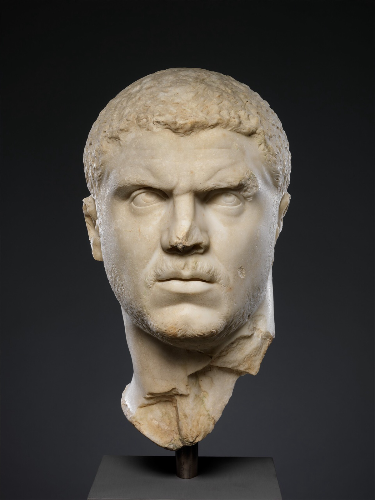
*Caracalla, the emperor who made nearly every free person a citizen in 212 CE, perhaps for a tax. Marble portrait, 212–217 CE, Metropolitan Museum of Art. CC0.*

### Nations had to be made

A nation is something else: millions of strangers tied *to each other*, who feel they belong together. And that feeling is recent. It had to be made.

The idea came fast. In 1789 the French Revolution declared that "the principle of all sovereignty resides essentially in the nation", not in the king.[^rights] The nation was the people, and the people took part: as citizens, voters, soldiers. In 1793 the levée en masse put every French person at the Republic's service, and armies of citizens marched under the tricolour.[^levee] Not yet a democracy, but a new sense that the state belonged to everyone in it.

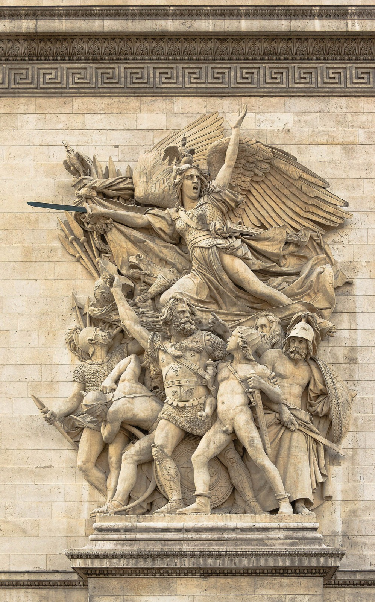
*Citizens as soldiers: the nation taking part. François Rude's* Le Départ des volontaires de 1792 *("La Marseillaise"), Arc de Triomphe, 1833–36. Photo: Jebulon, CC0.*

Making everyone feel it took longer. In 1863 the French government surveyed its own schools. In about a fifth of France's communes, people didn't speak French.[^weber] The historian Eugen Weber argues that most rural French people didn't fully feel French until about 1900. When Italy was unified in 1861, one of its founders is said to have put it like this: "We have made Italy. Now we must make Italians."[^dazeglio]

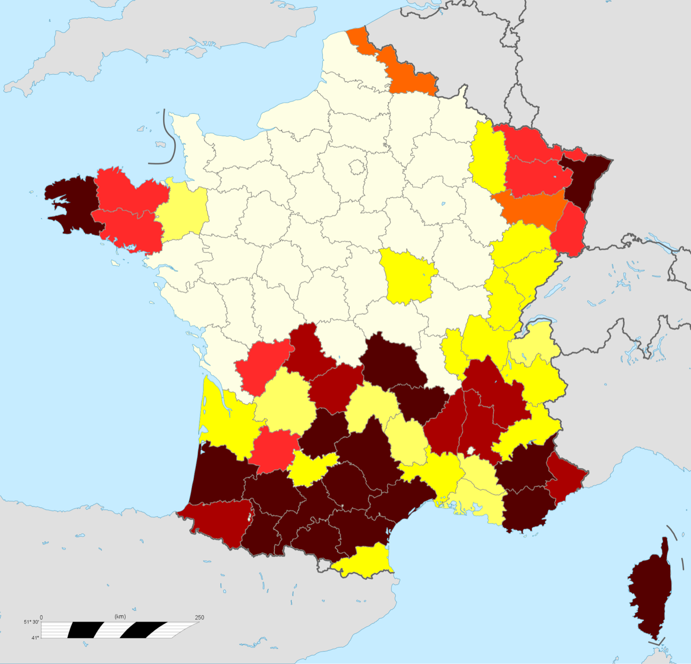
*A patchwork, not one people. Where communes didn't speak French in the 1863 school survey; the darker, the more communes. Data from the Archives nationales, as cited by Eugen Weber. Map: XIIIfromTOKYO, CC BY-SA 4.0.*

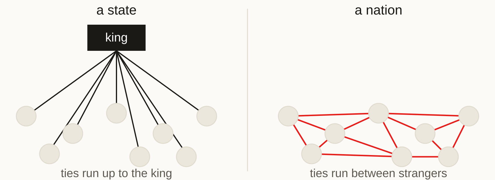
*A state's ties run up to the king; a nation's run between strangers. Diagram: Seeds of Renaissance.*

## 2. The nation

> [!reflect] Reflect: Would you die for them?
> Would you die for millions of people you will never meet?

### Imagined communities

In 1914, millions did. The historian Benedict Anderson started from that puzzle. Why would anyone die for people they will never meet?

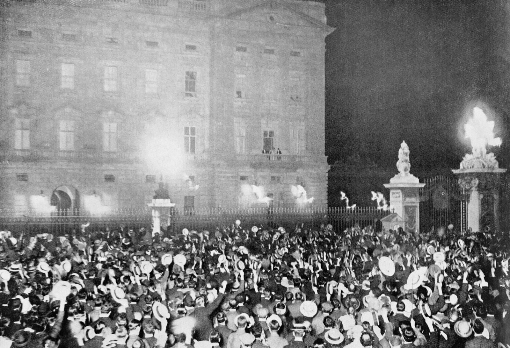
*Millions ready to die for strangers: crowds outside Buckingham Palace cheer the King after Britain declares war, August 1914. Imperial War Museums Q 81832, public domain.*

His answer: the nation is an "imagined political community".[^anderson] Imagined, because even in the smallest nation you will never meet most of the others. Yet each of you holds an image of the whole: people like you, out there, doing what you do. Anderson calls it a "deep, horizontal comradeship". Horizontal: not peasants under a lord, but equals.

### Print

What made the image possible was print. Print in a shared language turned dialects into a few big reading publics. And the newspaper made a daily ritual of it: millions reading the same news on the same morning, each knowing the others were reading it too. Anderson borrows Hegel's remark that the newspaper is the modern man's morning prayer.[^anderson]

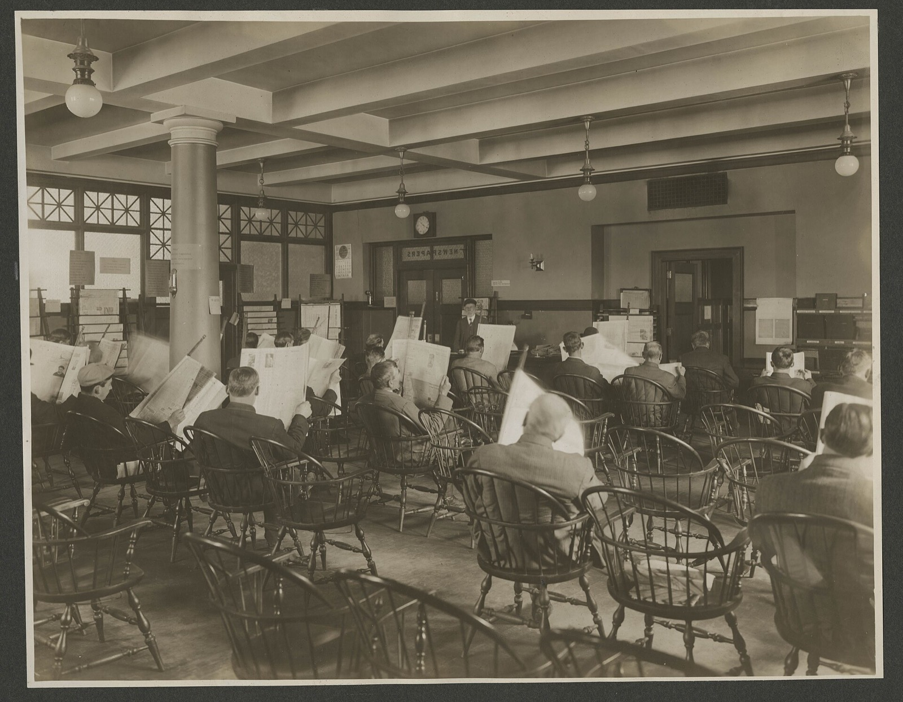
*The daily ritual of the imagined community, strangers reading the same news at the same time. Newspaper Room, Seattle Central Library, about 1910. Romans Photographic Company, public domain.*

That's chapter 3's manufactured tribe again, at a hundred thousand times the scale. The ritual becomes the anthem, the flag, the national holiday. Fictive kinship, kin words for people who aren't kin, becomes the fatherland and the motherland.

### Made from below, and from above

Print built nations from below. States built them from above, with schools that taught one language and one history, conscription and the census.[^gellner2] So the nation runs on both of chapter 4's paths: bottom-up, a feeling among strangers; top-down, a feeling the state set out to make.

What does it restore? **Trust at a distance**: you treat a stranger from Lyon or Leeds as one of yours. The lever is chapter 1's **dimensions**: it changes who counts as "us".

## 3. Trusting strangers

> [!poll] Poll: The Passenger's Dilemma
> You're in a car driven by a close friend. He hits a pedestrian. You know he was doing at least 35 in a 20 zone. There are no other witnesses. His lawyer says that if you testify he was doing 20, it may save him from serious consequences. Pick one:
> (a) My friend has a right to expect me to testify, and I would say he was doing 20.
> (b) My friend has little or no right to expect it, and I wouldn't testify falsely.

### Two moralities

This question has been put to managers in 43 countries.[^passenger] In Canada, Switzerland and the United States, more than 90% pick (b). In Nepal, Venezuela and South Korea, most pick (a). South Korea is rich, so this isn't just poverty. If you picked (b), you're in the minority, worldwide and through history.

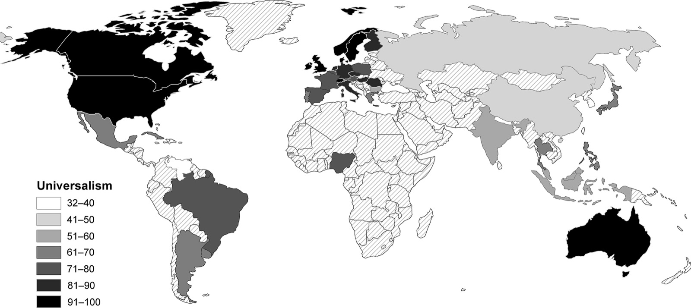
*The two moralities on one map: the share who won't lie for their friend, by country. Henrich,* The WEIRDest People in the World *(2020), fig. 1.6. Fair use.*

Neither answer is stupid. The (a) is loyalty, the morality of kin and friends: where your family is your safety net, it's the right answer. The (b) is a morality for strangers: the same rules for everyone, whoever they are. Henrich calls it universalistic, and it goes with impersonal trust, a willingness to trust people you don't know. Together they let you do business, borrow, vote and share a kitchen with people you'll never really know.

So where did the (b) come from?

### The strangest story on the ladder

The anthropologist Joseph Henrich's answer is the oddest causal story in this course.[^henrich]

From the 4th century onwards, the Western Church slowly built up a set of rules about marriage and the family. No marrying your cousins: at its peak, out to sixth cousins, anyone who shared one of your 128 great-great-great-great-great-grandparents. No marrying your dead husband's brother. One wife only. Both bride and groom had to say "I do". Couples were encouraged to set up their own household. You could leave your land by will, not only to your clan.[^mfp]

Nobody planned what happened next. Clans run on marrying cousins: that's how they hold on to land and bind families into alliances. Ban it for centuries and the clans fall apart. By the late Middle Ages, much of Western Europe was made of small families, free to move, who had to find their friends, partners and protection among strangers.

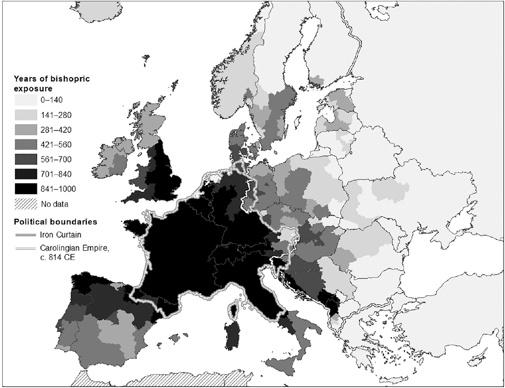
*The dose. Years each region spent under the Western Church's bishops, 500–1500 CE; Charlemagne's empire is outlined. Henrich (2020), fig. 7.1. Fair use.*

### Trust followed

And so they built new groups, of strangers, by choice: charter towns, merchant guilds, universities, monastic orders that spanned Europe.[^associations] Each ran on rules that applied to all its members, whoever their family. Impersonal markets grew, and courts to settle disputes between strangers.

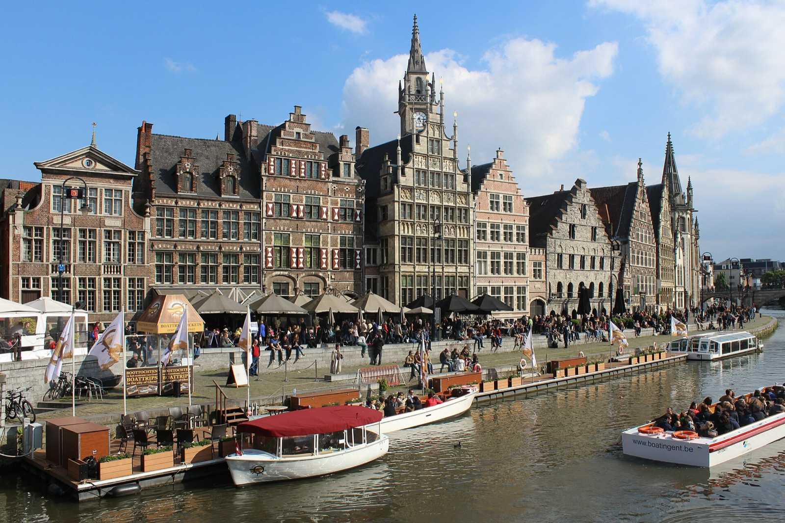
*Groups of strangers, by choice. Guild houses on the Graslei, Ghent, where boatmen, grain measurers and masons had their halls. Photo: Martinvl, CC BY-SA 4.0.*

### The chain, with the evidence

Here is the whole story as one chain, with Henrich's evidence on each link.[^dose]

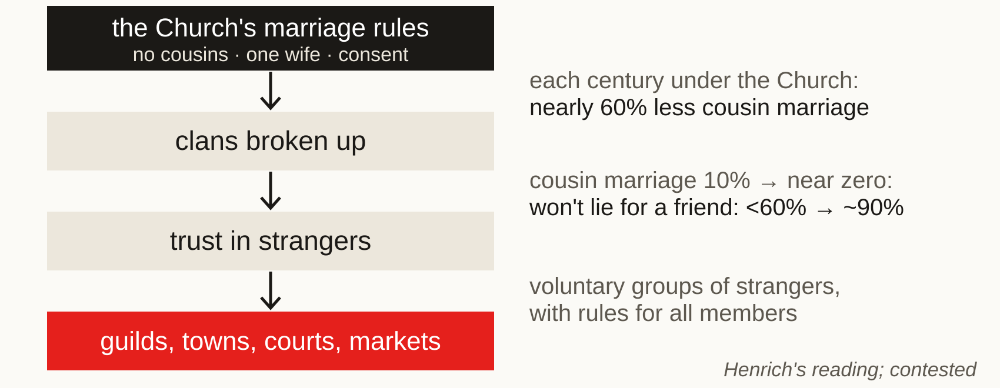
*The rung's core causal story, with Henrich's evidence on each link. Henrich's reading, and contested. Diagram: Seeds of Renaissance.*

The striking thing is the dose. The longer a region was under the Western Church, the weaker its clans and the WEIRDer its people today, and this holds even comparing regions inside Europe, and inside Italy.

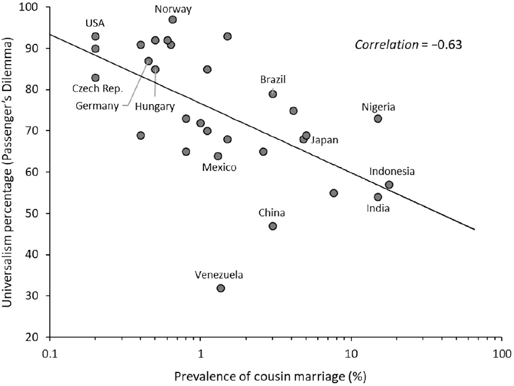
*The evidence on the second arrow: where cousins marry more, fewer people refuse to lie for a friend. Henrich (2020), fig. 6.7. Fair use.*

Two cautions. This is Henrich's reading, and it's contested: the obvious worry is reverse causation, that the regions which were already richer or more commercial took up the Church's rules more readily.[^henrichdebate] And causes run both ways: towns and markets fed back into trust. That loop is for the interlude. For now, hold on to the chain. A rule about marriage, made for religious reasons, ended up making people who trust strangers.

### The kitchen

The office kitchen, in a building of strangers. Your milk sits in the shared fridge alongside milk from people on three other floors you'll never meet, and you expect it to be there tomorrow. Mostly it is. That's impersonal trust in miniature.

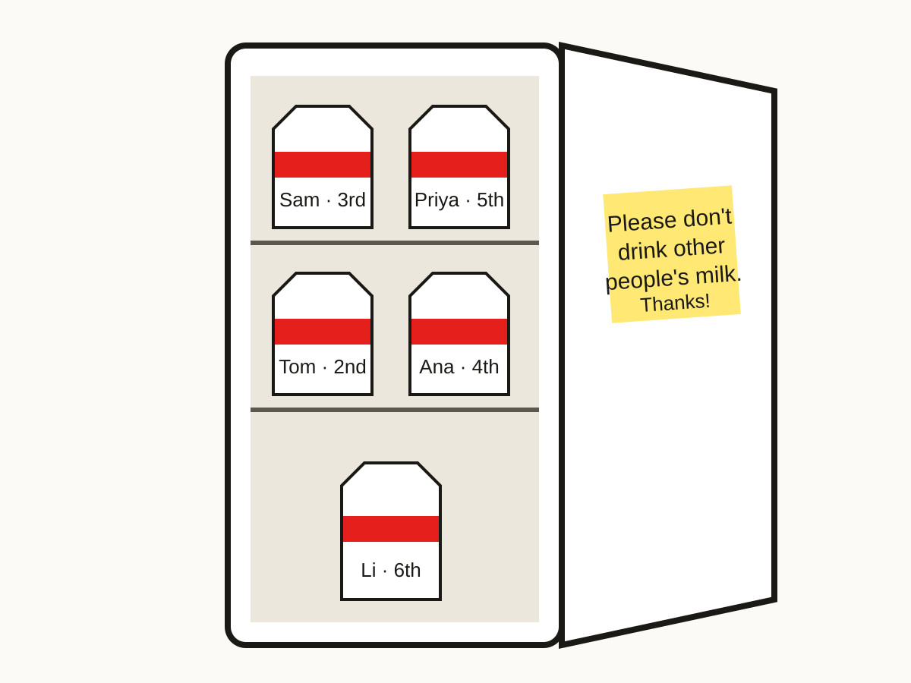
*The shared fridge in a building of strangers. Illustration: Seeds of Renaissance.*

## 4. Rules for the ruler

> [!reflect] Reflect: Who binds the king?
> In chapter 4, the Big Gods bound the king: he ruled by heaven's mandate, and could lose it. What binds a ruler on earth?

### The rule of law

The answer modernity tried is law that binds the ruler too, applied by courts he doesn't control. In 1215, English barons forced King John to seal Magna Carta: no free man to be imprisoned or stripped of his rights "except by the lawful judgment of his peers or by the law of the land".[^magna] A generation later the English jurist Bracton put it plainly: the king is under no man, but he is under God and the law.[^bracton]

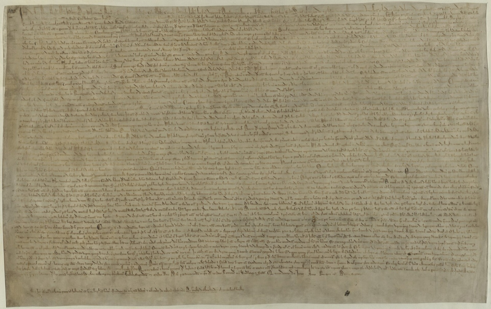
*The law above the king: one of the four surviving 1215 copies of Magna Carta. British Library, Cotton MS Augustus II.106. CC0.*

It took centuries to be more than words. But the idea is the point. Chapter 4's god-king was the law. Here the law is above the king.

In the office kitchen, the sign on the wall ("Please wash your own mug") applies to the boss too.

### Science as a built commons

Modernity built one more commons for strangers: knowledge anyone can check. The Royal Society, founded in London in 1660, took as its motto *Nullius in verba*: take nobody's word for it.[^royalsociety]

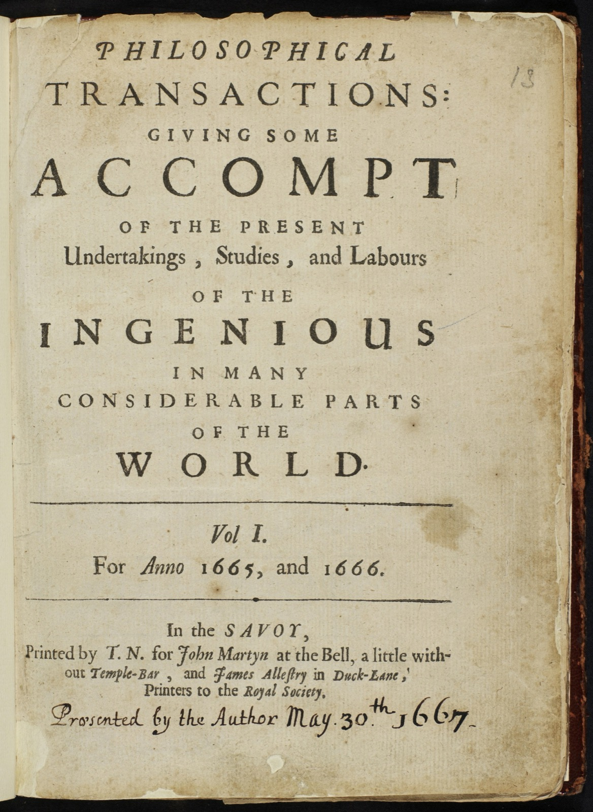
*Knowledge published for anyone to check. Title page of the first volume of* Philosophical Transactions *(1665–66), edited by Henry Oldenburg. CC BY 4.0.*

Knowledge is a public good: once it exists, anyone can use it, so no one has much reason to pay to make it. Why share your discovery if a rival can use it? Science's answer was a norm. You get the credit only if you publish first. So scientists race to give their knowledge away, and private discovery becomes a shared stock that anyone can test.[^priority] A collective action problem, solved by a norm among strangers.

## 5. Montreal and Kyoto

So much for strangers inside a country. Can they cooperate across borders?

> [!poll] Poll: The ozone layer
> The ozone layer is a commons everyone breathes and no one owns. To fix it, what would you need? Every country to agree / A few big players / Can't be fixed by agreement.

### Montreal

In 1985, British scientists in Antarctica published measurements showing a hole opening in the ozone layer every spring.[^farman] The cause was CFCs, the chemicals in fridges and aerosols. In 1987 the world signed the Montreal Protocol to phase them out. Today every country on earth has ratified it (with its parent, the Vienna Convention, the first UN treaties to manage that), and the ozone layer is on track to recover: around 2040 for most of the world, the 2060s over Antarctica.[^montreal]

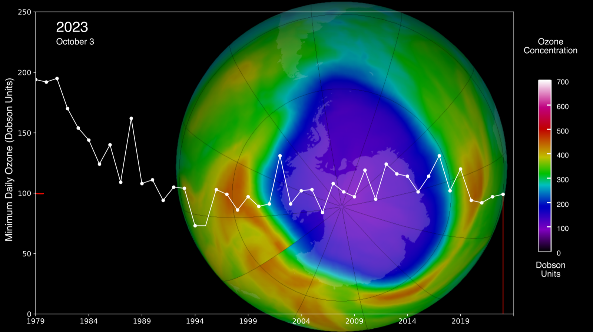
*The commons, and "it worked": the ozone hole on the day of its 2023 minimum, with each year's lowest ozone since 1979. It fell until the 1990s, then stopped falling. NASA Scientific Visualization Studio, public domain.*

Why did it work? Run chapter 1's diagnostic, its five questions.

- **How many players?** Not 190 countries: a few chemical firms. DuPont alone made about a quarter of the world's CFCs.
- **Can you see defection?** Yes. Production is industrial and traceable, and the atmosphere can be measured.
- **Can you punish it?** Yes. The treaty banned trade in CFCs with countries that stayed out. Staying out cost you more than joining.
- **Will you meet again?** Yes, every year, and the treaty has been tightened again and again.
- **Is anyone big enough?** Nearly: the US had already banned CFCs in aerosols, and in 1988 DuPont announced it would stop making them.

And one more feature that turned out to matter most: **substitutes**. Replacement chemicals existed, and the same firms held the patents. Doing the right thing was cheap, and for the incumbents it was profitable. A fund paid poorer countries the cost of switching.

So four features did the work: a few producers, defection you can see, a stick for those who stay out, and a cheap substitute.

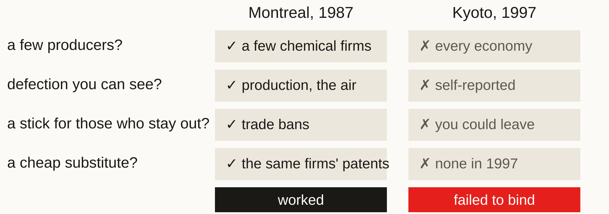
*Montreal and Kyoto on the four features that did the work. The full diagnostic, with Paris, the NPT and the AI race, is under [Going further](#going-further). Diagram: Seeds of Renaissance.*

### The atmosphere tells on you

In 2018, scientists noticed that CFC-11, banned years earlier, was rising again. The next year, using air samples from stations in South Korea and Japan, a second team traced about half of the rise to eastern China. Investigators on the ground found the source: factories using it to make foam insulation. The Chinese authorities cracked down, and by 2019 emissions were back down.[^cfc11]

No treaty inspector found it. The air did. That is "can you see defection?" answered by measurement.

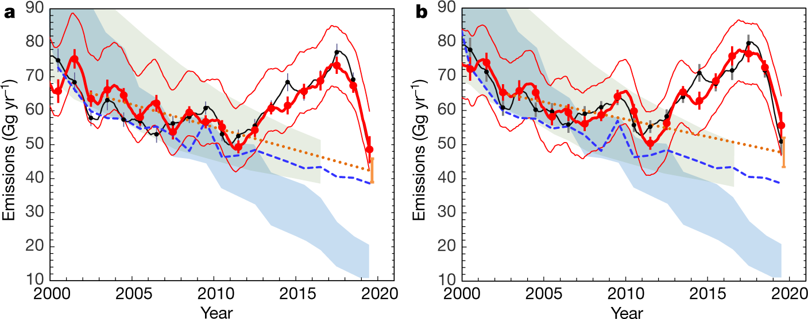
*The atmosphere tells on you: global CFC-11 emissions fall, rise again after 2012 against the expected decline (dotted), then drop in 2019. Montzka et al.,* Nature *(2021), fig. 4. Fair use.*

### Kyoto and Paris

Now climate. In 1997 the Kyoto Protocol set binding targets to cut emissions, for the rich countries only. The United States signed but never ratified. Canada walked out in 2011, citing a possible bill of $14bn, and paid nothing for leaving. Kyoto failed to bind the big emitters, though the EU met its own target.[^kyoto]

Run the diagnostic and you can see why. Every economy on earth emits: not a few firms but billions of people. Emissions were self-reported. The only penalty was a stricter target later, in a treaty you could leave. And in 1997 there was no cheap substitute for coal, oil and gas.

Paris, in 2015, gave up binding targets for national pledges, reviewed every five years.[^paris] No stick, by design: the bet is that transparency and peer pressure can stand in for one. The United States has now left it twice. The thing moving climate most since is the falling cost of solar, wind and batteries: substitutes arriving, slowly moving climate towards Montreal's position. That's chapter 6's question: what technology can and can't fix.

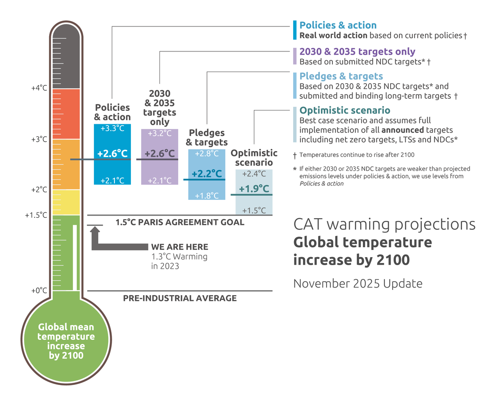
*Where Paris leaves us. Projected warming by 2100: 2.6 °C on current policies, 1.9 °C at best. Climate Action Tracker, November 2025. All rights reserved, fair use.*

Montreal: a few firms, defection you can see, a stick, a substitute. Kyoto: every economy, self-reported, no stick, no substitute. There's one more treaty that held, against the odds, under [Going further](#the-npt): the Non-Proliferation Treaty.

## 6. No one above the nations

> [!reflect] Reflect: Who holds the stick?
> Montreal had a stick: trade bans on those who stayed out. Who holds the stick for climate? For AI?

### The rung's limit

There is no Leviathan above the nations: no ruler over everyone, big enough to punish anyone (Hobbes's word, from chapter 4). A treaty binds only those who sign it, and its stick is whatever its members are willing to use. Montreal had one, because a few firms, a substitute and a trade ban made joining cheap and staying out costly. Climate doesn't, yet.

### The AI race

The AI race sits in Kyoto's position, not Montreal's. It has some of Montreal's features: a handful of frontier labs, and a chokepoint in the chips, made by very few firms. But there's no substitute, no cheaper way to get the capability without the risk. And the thing that matters most, how careful each lab is, can't be seen from outside. Capability is visible; care is not.[^ai]

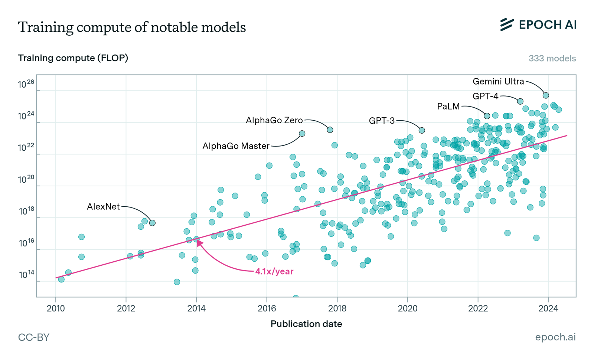
*The race, visible from outside. Training compute of notable AI models, 2010–2024, growing about 4× a year. Epoch AI, CC BY 4.0.*

## 7. Who was outside?

> [!reflect] Reflect: The outside
> The nation widened the circle to millions of strangers. Who was outside it?

### Empire

The nations that preached rights at home ran empires abroad. By 1914, European states and their offshoots controlled most of the world's land.[^empire] The rights of the citizen stopped at the colony's edge: the colonised were subjects, not citizens, ruled by law and force, like the peasants of the old agrarian state.

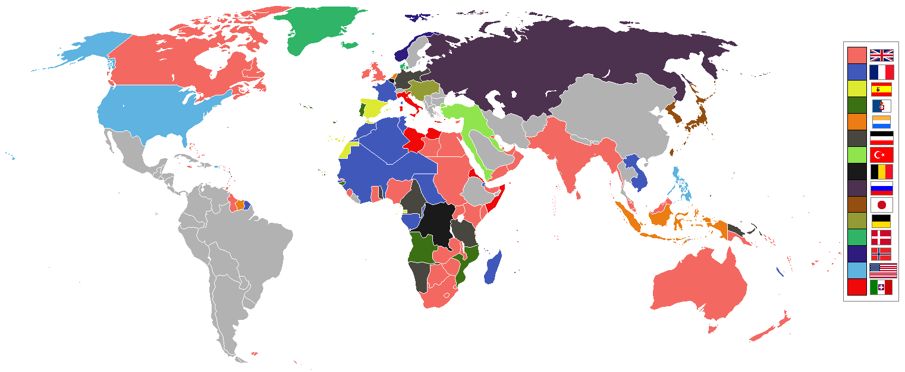
*Most of the world's land held by a few nations: empires and colonies in 1914. Map: Andrew0921, CC BY 3.0.*

### Inside, too

The nation was also defined by who it wasn't, chapter 3's bill at a much larger scale. Children were punished for speaking Breton or Welsh at school.[^languages] Minorities were told to become the nation or leave it, and in the twentieth century nations killed and expelled whole peoples in its name: the Armenians in 1915, the Jews of Europe in the Holocaust.

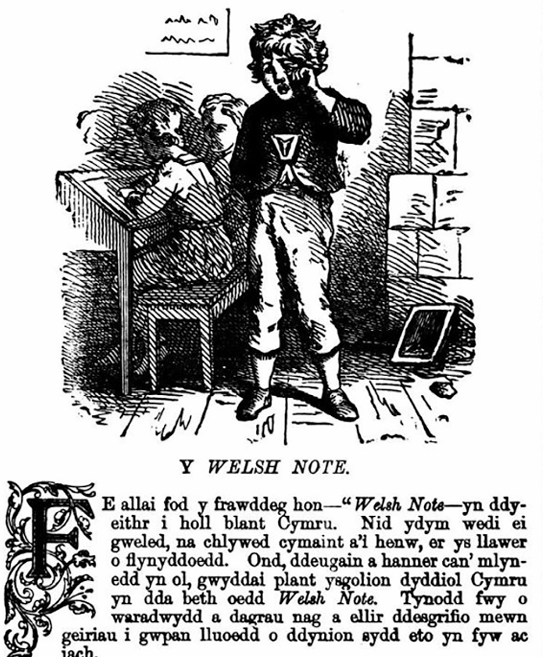
*The nation's inside edge. A boy made to wear the Welsh Not for speaking Welsh at school, from the Welsh children's magazine* Trysorfa y Plant*, 1879. Public domain.*

The treaties have an outside too. The NPT is a two-tier bargain: five states keep the weapons everyone else gives up. And on climate, the people who emitted least are often the ones who pay most.[^ipcc]

### The lift

But the colonised took the nation's own idea and turned it round. On 2 September 1945, Ho Chi Minh declared Vietnam's independence. His first words were from the American Declaration: "All men are created equal."[^hochiminh] The idea of a people who rule themselves, made in Europe, was used to end Europe's empires. The United Nations began with 51 members. Today it has 193.

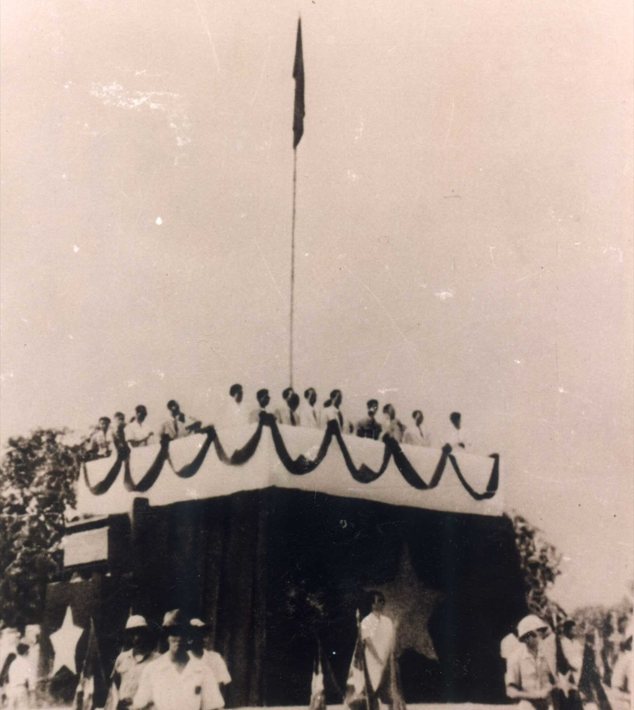
*The colonised using the nation's own idea: the platform in Ba Đình Square, Hanoi, 2 September 1945, where Ho Chi Minh read Vietnam's declaration of independence. Public domain (Vietnam).*

The circle widened again, to whole peoples who had been outside it. Wider, not closed.

## 8. Your case

> [!exercise] Exercise: Montreal or Kyoto?
> Take your case. Run it against Montreal's features. (1) A few producers? (2) Can defection be seen? (3) Is there a stick for those who stay out? (4) Is there a cheap substitute? Which is missing, and could anyone supply it? One line each in your case notes. Keep them: chapter 6 tests three answers on them.

## 9. Closing the rung

Three questions close every rung.

### What did it restore?

Run chapter 1's questions. *Will you meet again?* No, and it matters less: the nation and impersonal trust let you treat a stranger as one of yours. *Can you see defection?* Across borders, sometimes: by measuring the air. *Can you punish it?* Inside a nation, yes: courts, under a law that binds the ruler too. Between nations, only with a stick the treaty builds, like a trade ban. Both of chapter 1's levers: the nation changes who counts as "us"; law and treaties change the payoffs.

### Who did the lifting?

Both paths, bottom-up and top-down. Which led is the interlude's question.

### Who was outside?

The colonised, the minorities pressed into the nation, and the second tier of the treaties.

### An open question: the trust or the rules?

Which came first? Henrich says the trust: a cultural accident, then institutions to match. Others, among them the economists Daron Acemoglu and James Robinson, say the institutions, which then made the culture. I don't think it's settled, and I'd like your view. The interlude takes it up.

### The limit

Rules let strangers cooperate across a country, and sometimes across the world. Inside a country, someone writes the sign on the kitchen wall and someone enforces it. Above the nations there is no one to write the sign.

> [!key] Key ideas
> - **States are old; nations are new.** The state's ties run up to the king; the nation's run between strangers.
> - The nation was **made from below** (print) and **from above** (schools, armies, the census). It restores **trust at a distance**; the lever is the dimensions.
> - **Impersonal trust**: medieval marriage rules broke up the clans, and Europeans came to trust strangers. Henrich's reading, and contested.
> - **Rules for the ruler**: the rule of law binds the king too; science made knowledge a commons anyone can check.
> - **Montreal worked**: few firms, defection you can see, a stick, a cheap substitute. Kyoto had none of them.
> - **There is no Leviathan above the nations**: a treaty is only as strong as its own stick. The AI race sits in Kyoto's position.
> - **Every nation has an outside**: the colonised, the minorities, the treaties' second tier. And the colonised used the nation's own idea to win their freedom.

So: four rungs climbed. What has actually done the lifting so far, and can it lift the planet? That's the interlude, "What did the lifting?".

---

## Going further

### The NPT

In 1963 President Kennedy said he could imagine a world in the 1970s with 15, 20 or 25 nuclear powers.[^kennedy] The Non-Proliferation Treaty opened for signature in 1968. Today there are nine nuclear states. India, Pakistan and Israel never joined; North Korea left. But dozens of states that could have built a bomb didn't. Its stick was real: sanctions, and sometimes force. And it had a protector: US security guarantees made going without a bomb safe for Germany, Japan and South Korea. It held, as a two-tier bargain: five states keep what everyone else gives up.[^npt]

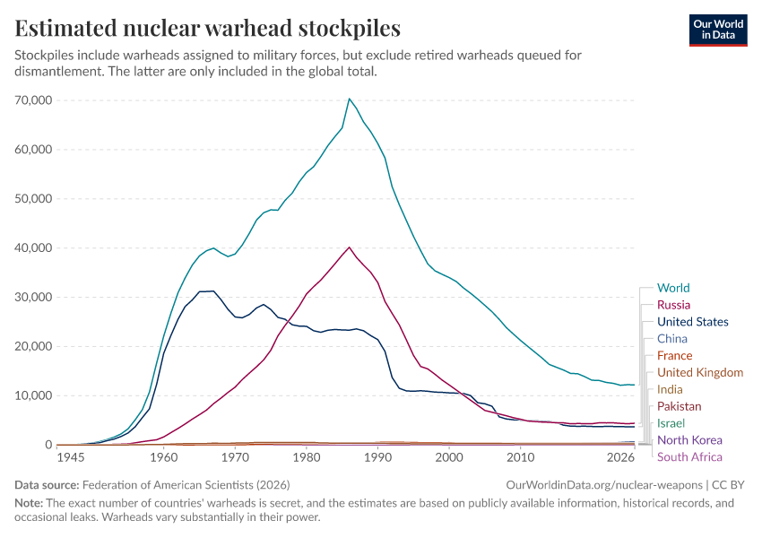
*Fewer bombs than feared, and still thousands. Warhead stockpiles, 1945–2026, peaking around 1986. Our World in Data, from Federation of American Scientists data. CC BY 4.0.*

### Focal points

The economist Thomas Schelling noticed that agreements among equals work best when they pick an obvious point everyone can see: a date, a number, a line on a map. "Phase out CFCs by 2000" is a point. "Do your fair share" is not.[^schelling]

### The applied record on the diagnostic

Chapter 1's five questions, plus the one Montreal adds: is there a cheap substitute? From the course's case notes.

| Question | Montreal (1987) | Kyoto (1997) | Paris (2015) | NPT (1968) | The AI race |
|---|---|---|---|---|---|
| How many players? | A few firms | Every economy | All ~195 parties | ~40 states able to build | Under ten frontier labs |
| Can you see defection? | Yes: production, and the air | Partly: self-reported | Better: transparency rules, satellites | Yes, increasingly: inspectors, seismic, satellites | Capability yes; care no |
| Can you punish it? | Yes: trade bans on non-parties | No: you could leave | No, by design | Yes: sanctions, sometimes force | Barely: chip export controls act on states |
| Will you meet again? | Yes, every year | Yes, weakly | Yes, every five years | Yes, every five years | Constantly |
| Is anyone big enough? | Nearly: the US, DuPont | No | No | Yes: US security guarantees | No; the chipmakers are the chokepoint |
| A cheap substitute? | Yes, patented by the incumbents | No, not in 1997 | Arriving: solar, wind, batteries | Of a kind: an ally's protection | No |
| Result | Worked | Failed to bind the big emitters | Open | Held, as a two-tier bargain | Kyoto's position |

Image credits: [assets/SOURCES.md](assets/SOURCES.md).

[^rome]: Senators: about 600 under Augustus, with the much larger equestrian order (the knights) below them. Population: something like 50–60 million at the empire's height (Scheidel's estimate). The picture of an elite bound by kin and marriage is Gellner's, for agrarian states in general.
[^gellner]: Gellner, *Nations and Nationalism* (1983), ch. 2: the "agro-literate polity", a small ruling class rigidly separated from the mass of agricultural producers, who live in "laterally insulated" communities.
[^caracalla]: The Constitutio Antoniniana (212 CE). Cassius Dio, *Roman History* 78.9, says Caracalla's purpose was to increase revenue, since only citizens paid certain taxes, such as the inheritance tax.
[^romanness]: Provincial elites took on Roman identity widely, and some historians (Kaldellis, *Romanland*, 2019) argue that the later Eastern Roman Empire was a Roman nation in something like the modern sense. The claim here is about the mass of people in the earlier empire.
[^weber]: Eugen Weber, *Peasants into Frenchmen: The Modernization of Rural France, 1870–1914* (1976), ch. 6: the 1863 Ministry of Public Instruction survey, French not spoken in 8,381 of France's 37,510 communes (about 22%).
[^rights]: Declaration of the Rights of Man and of the Citizen (1789), article 3.
[^levee]: The levée en masse, decree of the National Convention, 23 August 1793: all French people in permanent requisition for the army until the enemy was driven out (young men to fight; the married to make arms; women to make tents and clothes and serve in hospitals). The tricolour became the national flag in 1794.
[^dazeglio]: Usually attributed to Massimo d'Azeglio; the wording is later and disputed.
[^anderson]: Benedict Anderson, *Imagined Communities: Reflections on the Origin and Spread of Nationalism* (1983), ch. 1 ("imagined political community", "deep, horizontal comradeship") and chs. 2–3 (print capitalism; the newspaper as a mass ceremony, Hegel's remark that newspapers serve modern man as a substitute for morning prayers).
[^gellner2]: Gellner (1983): industrial society needs a mobile, literate workforce sharing one "high culture", provided by a state education system. Nationalism is "primarily a political principle, which holds that the political and the national unit should be congruent" (ch. 1). On the state making the nation in France, through schools, roads, the army and the railway: Weber (1976).
[^passenger]: Henrich, *The WEIRDest People in the World* (2020), pp. 45–46 and fig. 1.6, from Trompenaars and Hampden-Turner (1998), 43 countries. The wording here follows Henrich's.
[^henrich]: Henrich (2020), chs. 5–7 and 9–10. The core statistical work is Schulz, Bahrami-Rad, Beauchamp and Henrich, "The Church, intensive kinship, and global psychological variation", *Science* 366 (2019).
[^mfp]: Henrich (2020), pp. 165–67, the nine points of what he calls the Church's Marriage and Family Program, and pp. 172–73: taboos out to sixth cousins by the early 11th century, narrowed to third cousins by the Fourth Lateran Council (1215).
[^associations]: Henrich (2020), ch. 5 and ch. 9: charter towns, professional guilds, universities and transregional monastic orders, and the Urban, Commercial and Legal Revolutions of the High Middle Ages.
[^dose]: Henrich (2020), pp. 226–27: each century of Western Church exposure cuts the rate of cousin marriage by nearly 60%. Fig. 6.7 (p. 208): cutting cousin marriage from 10% to near zero takes universalistic answers in the Passenger's Dilemma from under 60% to about 90%. Fig. 6.15: duration of exposure to the Western Church against impersonal trust, universalism and other measures. Ch. 7 and fig. 7.1: the same pattern within Europe, and within Italy.
[^henrichdebate]: One common objection is reverse causation: regions that were already more commercial, urban or open may have adopted the Church's rules faster, so the rules mark a change rather than cause it. Another asks how far the rules were enforced on ordinary people. The within-Europe and within-Italy comparisons are Henrich's main answer.
[^magna]: Magna Carta (1215), clause 39.
[^bracton]: *De Legibus et Consuetudinibus Angliae*, attributed to Henry de Bracton (13th century): the king "ought not to be under man but under God and the law".
[^royalsociety]: The Royal Society, chartered 1660–62; its journal, *Philosophical Transactions*, from 1665.
[^priority]: Merton, "The normative structure of science" (1942); Dasgupta and David, "Toward a new economics of science", *Research Policy* (1994): the priority rule as a reward system that turns discovery into a public good. See also Hess and Ostrom (eds), *Understanding Knowledge as a Commons* (2007).
[^farman]: Farman, Gardiner and Shanklin, "Large losses of total ozone in Antarctica reveal seasonal ClOx/NOx interaction", *Nature* 315 (1985). Measured from the ground at Halley; satellites confirmed it afterwards.
[^montreal]: The Vienna Convention and the Montreal Protocol both reached universal ratification on 16 September 2009. Ozone Secretariat, "Facts and figures on ozone protection"; WMO/UNEP, *Scientific Assessment of Ozone Depletion: 2022* (recovery to 1980 levels around 2040 globally, 2066 over Antarctica). On the mechanism: Barrett, *Environment and Statecraft* (2003); Sunstein, "Of Montreal and Kyoto: A tale of two protocols", *Harvard Environmental Law Review* 31 (2007). Barrett's caution: Montreal was an easy case, a diagnostic result rather than a template.
[^cfc11]: Montzka et al., *Nature* 557 (2018), found the rise; Rigby et al., *Nature* 569 (2019), traced about half of it to eastern China from stations at Gosan (South Korea) and Hateruma (Japan); the Environmental Investigation Agency's 2018 report found foam factories using CFC-11; Park et al. and Montzka et al., *Nature* 590 (2021), reported the fall back to pre-2013 levels by 2019.
[^kyoto]: UNFCCC, Kyoto Protocol targets for the first commitment period (2008–12), an average 5% below 1990 for Annex B; in force 2005. Canada's withdrawal: December 2011. EU emissions in 2020 were well below its target.
[^paris]: Paris Agreement (2015), in force 2016: nationally determined contributions and a five-yearly review. The US withdrew in 2020, rejoined in 2021, and withdrew again from January 2026.
[^ai]: From the course's case notes on the frontier AI race: under ten labs at the frontier; Nvidia and TSMC closer to chokepoints than any lab; "capability is observable, care is not".
[^schelling]: Schelling, *The Strategy of Conflict* (1960), ch. 3, on focal points.
[^kennedy]: Kennedy, press conference, 21 March 1963.
[^npt]: Arms Control Association, "The Nuclear Nonproliferation Treaty at a Glance": 191 parties; India, Israel, Pakistan and South Sudan never joined; North Korea announced withdrawal in 2003. South Africa dismantled its arsenal; Ukraine, Belarus and Kazakhstan gave theirs up.
[^empire]: Often given as about 84% of the world's land by 1914, counting former colonies such as the US (Hoffman, *Why Did Europe Conquer the World?*, 2015).
[^languages]: In Wales, the "Welsh Not", a token hung on children caught speaking Welsh in 19th-century schools. On the suppression of Breton and other regional languages in French schools, see Weber (1976).
[^ipcc]: IPCC, *Sixth Assessment Report*, Working Group II, Summary for Policymakers (2022), on vulnerable people who have contributed least to climate change being disproportionately affected.
[^hochiminh]: Declaration of Independence of the Democratic Republic of Vietnam, Hanoi, 2 September 1945.

---

[← Chapter 4: Strangers and states](../4-strangers-and-states/) · [Course home](../) · Next: the interlude, What did the lifting? (coming soon)
