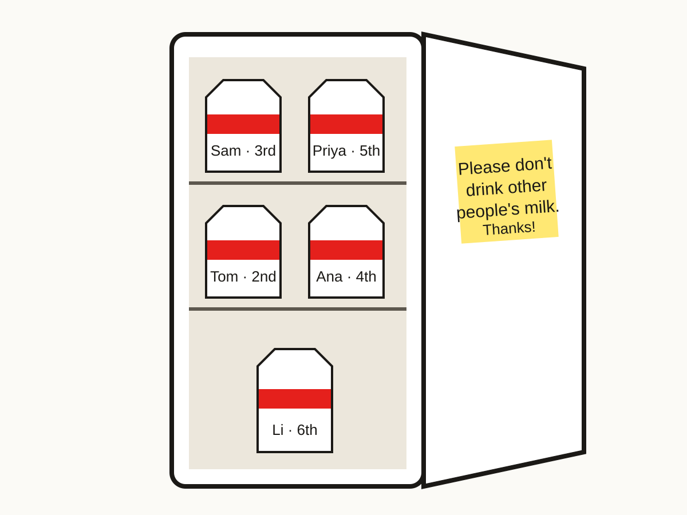
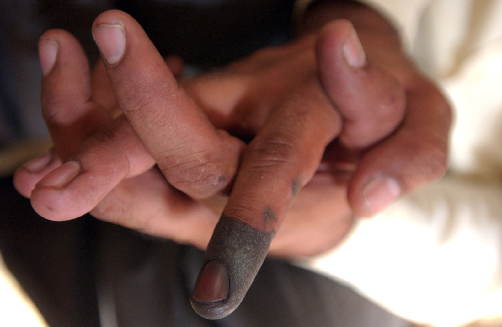
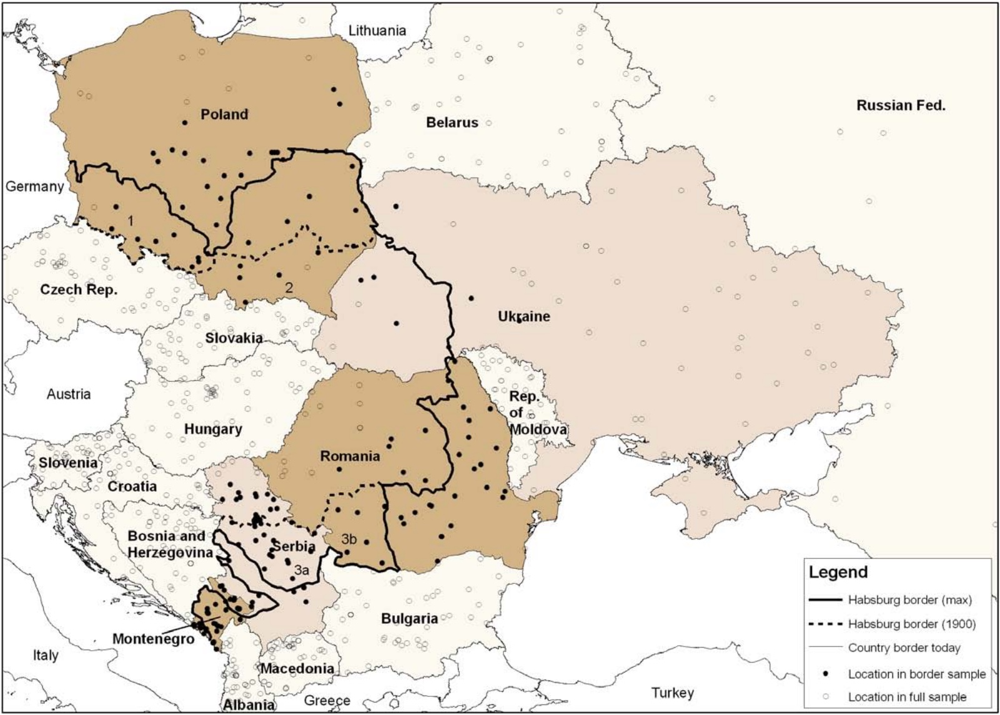
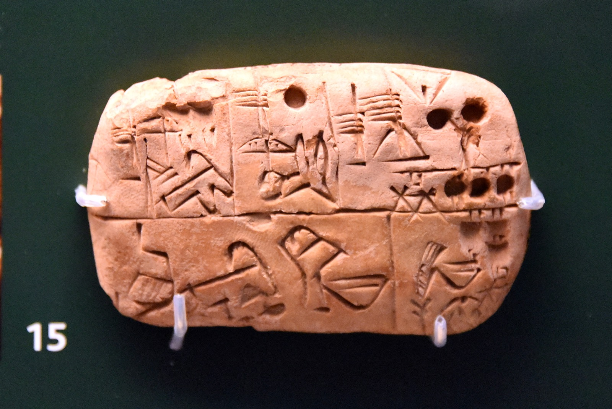
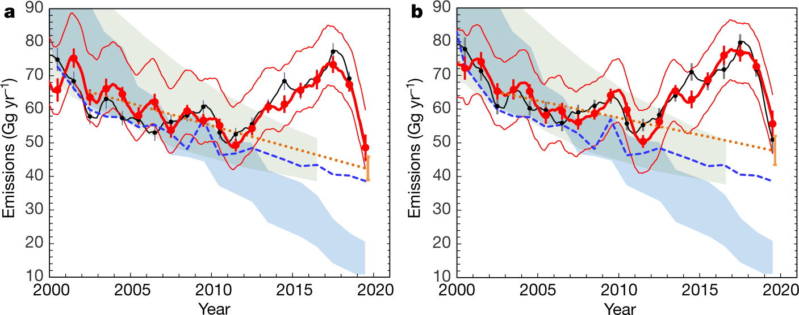
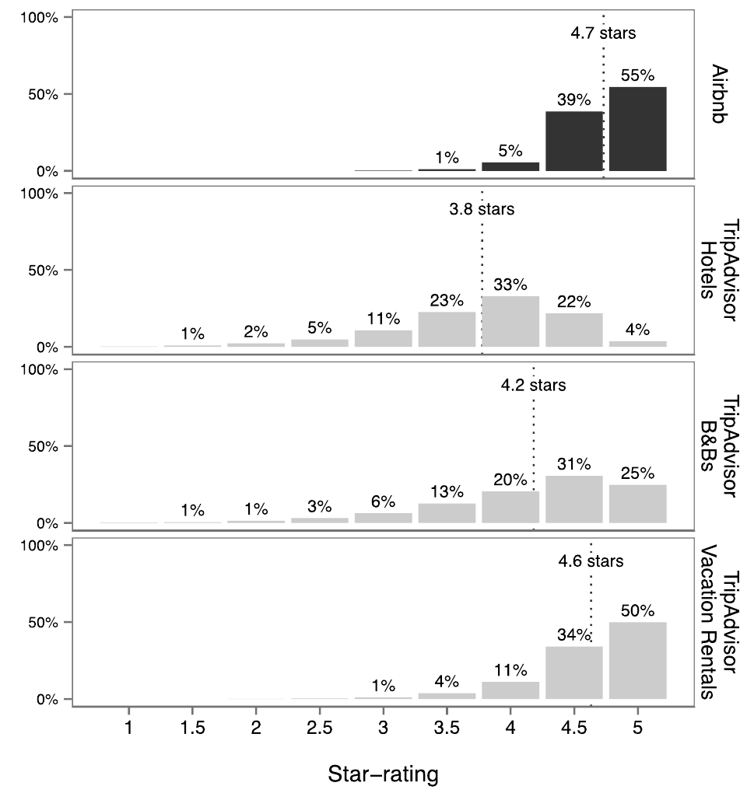
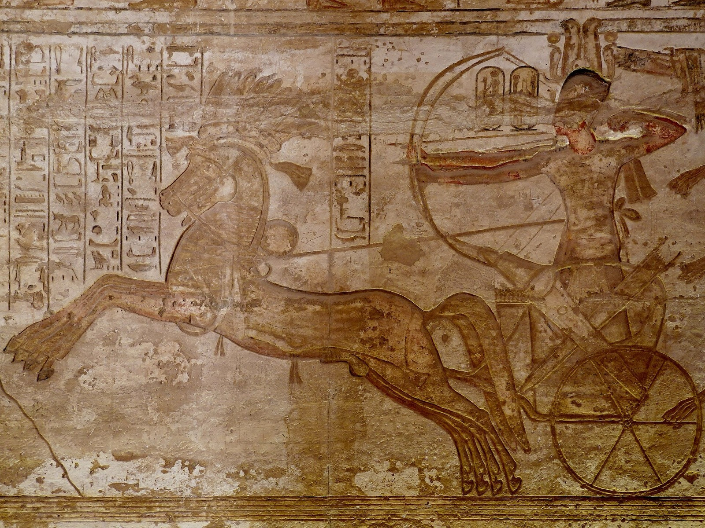
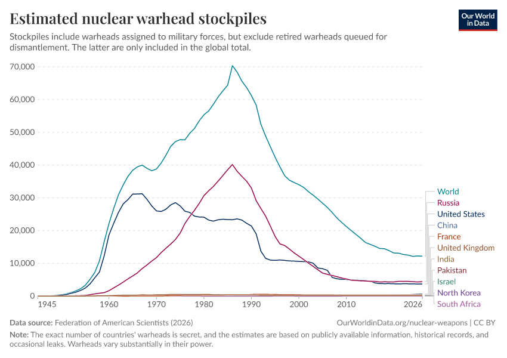
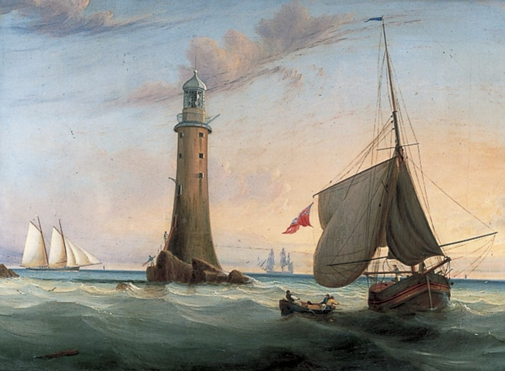
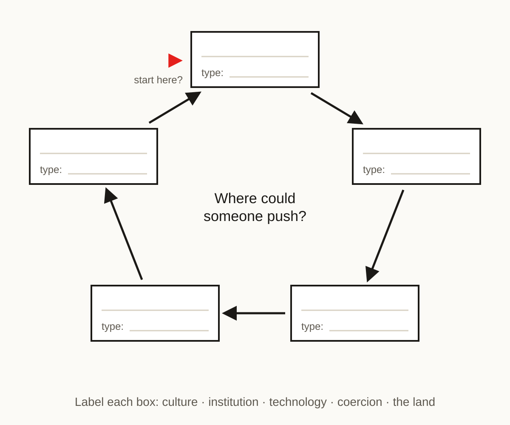

Four rungs climbed. Bands of dozens, villages of thousands, states of millions, nations of hundreds of millions and treaties between them. At each rung we asked the same three questions: what did it restore, who did the lifting, and who was left outside.

[Chapter 5](../5-modernitys-try/) ended on a tension it couldn't resolve. Henrich says trust in strangers came first and the rules followed. Acemoglu and Robinson say the rules came first and the trust followed. Before we try the last rung, the planet, it's worth stepping off the ladder for a moment and asking the question underneath that tension. What actually did the lifting?

This isn't a rung. It's a landing: a look back down the stairs.

```
  ?          the planet
  ┄┄┄┄┄┄┄┄   ← you are here: the landing
  globe      nations
  states     millions
  villages   thousands
  bands      dozens
```

> [!summary] In this chapter
> 1. **The question**: culture, institutions, technology or coercion: what did most of the lifting?
> 2. **Culture or institution?** Why the line between them is a gradient, not a wall.
> 3. **The rules, without the culture**: a strict test, and the evidence both ways.
> 4. **Seeing and binding**: what technology does for cooperation, and its limits.
> 5. **The ratchet**: war technology, and how the contest turned existential.
> 6. **When technology dissolves the problem**: the limit case, and the temptation.
> 7. **Markets**: why they don't get round the free-rider problem.
> 8. **Not a ladder: a loop**: why "which came first?" depends on where you start.
> 9. **Your case**: draw your loop.
> 10. **Back to the poll**: one reading of the tally.
> 11. **The kitchen sign, and the lift**.
>
> About 25 minutes of reading, plus the exercise.

## 1. The question

> [!poll] Poll: What did most of the lifting?
> Across the four rungs, from bands to nations, what did most of the work of getting strangers to cooperate?
> Culture / Institutions (formal rules) / Technology / Coercion

Hold on to your answer. We'll come back to it at the end.

The candidates, in a line each, so we're talking about the same things. **Culture** is everything we learn from each other: beliefs, rituals, habits, values, know-how.[^culture] **Institutions** are formal rules with roles attached: courts, parliaments, guilds, the tax office. **Technology** is tools and techniques: writing, the printing press, the satellite. **Coercion** is force: someone who can punish you without asking.

Why not markets? Because a market isn't a separate lifter. It's built out of the other four: trust between strangers, property and contracts someone enforces, the technology to trade, and a state in the background.

## 2. Culture or institution?

> [!reflect] Reflect: The Tambaran
> In chapter 3, the village of Ilahita in Papua New Guinea held 1,500 people together, five times the usual ceiling, through the Tambaran cult: grades of initiation, senior men who ran the rites, penalties for those who broke them. Was the Tambaran culture or an institution?


*Back to chapter 3: a Haus Tambaran, the cult's spirit house, in Maprik District, East Sepik. Culture, or an institution? Photo: Sylt-Tinto, CC0.*

### Both

It was both, and that's the first thing to see. Culture is everything we learn from each other: beliefs, rituals, habits, values, know-how. Institutions aren't a different kind of thing from culture. They're culture that has grown roles.

Inside the Tambaran you can see the steps. There are things people do together: the dances, the carvings, the spirit house. There are things people expect of each other and enforce: every man must be initiated. And there are roles: grades, initiators, keepers of the secrets, with penalties for those who break the rules. A modern state goes one step further and writes the rules down, with courts and paid enforcers.

```
practice       the dances
    ▼
norm           men must be initiated
    ▼
institution    the cult: grades,
               initiators, penalties
    ▼
formal         written law, courts,
institution    paid enforcers
```

A test for where something sits: **is there a role whose job it is, and would it survive the people now in it?** The dances, no. The cult, yes: the initiators die and the grades carry on. A court, plainly yes.

### The blur is the point

In practice you often can't draw the line, and the blur is where things happen. The Church's marriage rules from chapter 5 were norms (a good Christian doesn't marry his cousin) and rules (with priests and church courts to enforce them) at once. The office kitchen's sign, "Please wash your own mug", is a rule on the wall. But does it work because someone enforces it, or because most people already agree with it and the sign just says so out loud?


*The office kitchen from chapter 5, with its note on the door: a rule, or a norm written down? Illustration: Seeds of Renaissance.*

There is one clean case, where you can tell them apart: new rules arriving suddenly with none of the culture behind them. That's the strict test, in the next section.

Technology sits off to one side: it's not learned behaviour but tools and techniques. And coercion isn't a separate cause at all. It's what a role can do when it holds the weapons.

### What each tool can do

Go back to chapter 1's five questions: how many players are there, will you meet again, can you see defection (someone breaking the deal), can you punish it, is anyone big enough to act alone? Each tool reaches different ones.

- **Culture** changes what we want, what we punish (and so the payoffs), and even what we think is real: chapter 4's Big Gods, who watch everyone's morals.
- **Institutions** often formalise what culture already does, or let a Leviathan, a ruler big enough to punish anyone, impose it from above.
- **Technology** lets us see, reach and bind a promise. At the limit, it can make a problem go away.
- **Coercion** supplies someone big enough.

Culture and institutions sit side by side and feed each other all the time. Technology does different jobs.

## 3. The rules, without the culture

> [!reflect] Reflect: The strict test
> You're parachuted into a country with the power to impose any rules you like, but none of the culture behind them. Say, a new constitution in Iraq after 2003. Or, more peacefully: Finland's schools are among the best in the world, so you copy them, rules, timetable and all, into a very different country. Does it work?


*The strict test made concrete. A voter's inked finger after the constitutional referendum, Mosul, 15 October 2005. US Army photo, Spc. Jeffery Sandstrum. Public domain.*

### Rules work when they formalise culture

My view is that mostly it doesn't. Rules work when they formalise culture that is already there.

The best-known evidence is Italy. In 1970, Italy set up new regional governments across the country, on the same national rules. The political scientist Robert Putnam followed them for twenty years. Some became efficient and responsive; others stayed corrupt and slow. What predicted which? Not money, not party, but civic habits: newspaper reading, choral societies, football clubs, people who joined things and trusted each other. Those were mostly in the north.[^putnam] Same rules, different culture, different result.

The same lesson keeps turning up when countries copy institutions wholesale from elsewhere. The anti-corruption agency, the procurement law, the independent central bank arrive on paper and change little in practice. Development economists have a name for it: isomorphic mimicry, copying the form without the function.[^mimicry]

Iraq isn't a clean test, because the new constitution came with an occupation and a civil war. But it's the test in its starkest form.

### Why rules need the culture

Here's one reason. Formal rules are always too narrow. No rule can say everything. Take the sign in an office kitchen, "Please wash your own mug". It says wash your mug, not the spoon, not the sink, not the milk you spilled. A rule covers what it names and leaves gaps everywhere else, and it's the norm, what people think a decent person does, that fills them. Take the norm away and people do exactly what the rule says and nothing more. Workers have a name for that: work-to-rule, and it's a form of strike.

### The pushback: if you impose them long enough

But there is real evidence the other way, and it's worth taking seriously.

Putnam's own story for where the north's civic culture came from is institutional: the self-governing medieval communes of the north against the Norman kingdom in the south. Rules, centuries ago, may have made the culture he measured.

Along the old border of the Habsburg Empire, in today's Poland, Romania, Ukraine, Serbia and Montenegro, people on the Habsburg side still trust the courts and the police more, and pay fewer bribes, than people in the same country on the other side of the old line. The empire had a famously well-run bureaucracy. It ended in 1918. Its effect on trust was still there 90 years later.[^habsburg]


*Where the natural experiment runs: the old Habsburg border (solid line at its furthest extent, dashed in 1900) cuts across five of today's countries; the black dots are the surveyed communities either side of it. Becker, Boeckh, Hainz and Woessmann, IZA discussion paper 5584 (2011), the working paper of their* Economic Journal *article, fig. 1. Fair use.*

So does it work if you impose the rules long enough? Maybe, over generations. I don't think it's settled, and I'd like your view.

One way to hold it: culture is the slow stock, changing over generations; institutions are the faster flow, which can change in a year. And a rule that never becomes a norm needs an enforcer for ever.

## 4. Seeing and binding

> [!reflect] Reflect: A stranger in your home
> Would you let a stranger sleep in your home, or get into a stranger's car at night? Many people do both, through Airbnb and Uber. What makes that possible?


*Seeing sideways: a stranger's home, vouched for by a few hundred other strangers. A generic mock-up, not any real platform. Illustration: Seeds of Renaissance.*

### Seeing from above

Start at the beginning. Among the first writing we have, from the city of Uruk in Mesopotamia, over 5,000 years ago, is not poetry or law. It's accounts: lists of rations and goods. Writing was invented, in large part, to keep track of who owed what.[^uruk]


*Writing's first job: seeing. A proto-cuneiform list of rations from the late Uruk period, 3300–3100 BCE; the sign for a ration is a head and a bowl. British Museum. Photo: Osama Shukir Muhammed Amin, CC BY-SA 4.0.*

That's technology's job for cooperation: **seeing**. It answers "can you see defection?", whether someone is breaking the deal. Clay tokens, then writing, then tax rolls, then the census, the map, print, and now satellites. In chapter 5 it was the atmosphere itself that told on the factories making CFC-11, read by instruments a thousand miles away.


*Seeing at planetary scale. Global CFC-11 emissions rise again after 2012, then drop in 2019. Montzka et al.,* Nature *(2021), fig. 4. Fair use.*

For most of history, this seeing ran one way: from rulers down to subjects. The state counts you; you don't count the state.

### Seeing sideways

The platforms are different. Airbnb checks who you are, from your passport. And because it's a long-lived platform, everyone gets rated, hosts and guests both. Your ratings follow you.

That's reputation, the word of mouth that keeps a shared house honest (chapter 2), rebuilt for strangers at the scale of millions. You've never met this host, but a hundred people have, and they've told you.

Notice what it stands on. Airbnb works in countries where there's already enough trust in strangers, and courts and police in the background, for the ratings to be believed. The technology doesn't create that trust from nothing. It takes trust that is already there and lifts it a level.

### The limits

Seeing has limits, even with technology.

It costs money, and it takes judgement. A camera can see who took the milk; it can't tell whether they meant to replace it. The finer the judgement, the more the monitoring costs, and some judgements still need a person.

And whatever you measure becomes the target, and then the measure stops measuring. That's known as Goodhart's law.[^goodhart] Airbnb ratings show it: nearly every listing is rated four and a half stars or more, so the stars stop telling you much.[^ratings] A hospital measured on waiting times gets better at waiting times, and sometimes worse at everything that isn't measured.


*Goodhart's law in one picture: 94% of Airbnb properties rated 4.5 or 5 stars in 2015, against an average of 3.8 for hotels on TripAdvisor. Zervas, Proserpio and Byers, author draft of their* Marketing Letters *paper (2020), fig. 1. Fair use.*

Formal rules have the same flaw, for the same reason. Rules and measures are both too narrow: they cover what they name and distort what they don't.

Could artificial intelligence one day judge like a person, cheaply, everywhere? Maybe. That's one of the technological fixes chapter 6 looks at.

### Binding forward

Ratings look back: they tell you how someone behaved. There's a stronger kind of technology for trust, which binds how someone *will* behave.

Imagine two bank robbers, about to do the job together. Each is afraid the other will give them up to the police. Now suppose they could arrange, beforehand, that if either betrays the other, the betrayer's head explodes. Or the positive version, the mob's: "Don't give me up, and your family will be looked after for ever", a promise the mob keeps because it has a name to keep. Either way the prisoner's dilemma stops being one. Neither can gain by betraying.

What changes is not what they want but what betraying pays, and so whether a promise can be believed. "I'll cooperate if you do, and I can't back out" is a promise anyone can make; the trick is making it stick. The economist Thomas Schelling called these commitments. The classic is burning your boats on the beach, so that retreat is impossible: a commitment to fight, made by taking away your own way out.[^schelling]

This matters most where meeting again doesn't help: a one-shot deal, or the last round. Chapter 2's trench truces held because both sides would be there again tomorrow. Take tomorrow away, with a finish line where betraying pays once and for all, and that reason is gone. That's the AI race's problem, and a commitment that binds even the last round is exactly what it lacks. Even when we do meet again, a binding promise helps: it locks both sides into returning the favour, so one mistake or one temptation doesn't start the unravelling.

Some commitment devices are technical. A smart contract, a program on a blockchain that pays out by itself, tries to make a promise run itself, with no one to trust. But in 2016, when a bug let someone drain a large fund called the DAO, the community changed the rules of the whole system to move the money back.[^dao] Code was law until people disagreed. Many commitment devices are institutional, not technical: Airbnb holds your money and pays the host only after you've checked in.[^escrow] That's escrow, a small trusted third party: a role whose job it is, and in a way a little Leviathan we both agree to submit to. The dream of a technical commitment is to do without it: a device that binds us both directly, with no third party to trust.

## 5. The ratchet

Technology also changes how big groups get, and this is a different kind of effect from seeing, so keep it apart. Call it the ratchet: it turns one way, towards bigger groups, and doesn't turn back.

New military technology raises the scale of war: the chariot, then cavalry, then iron weapons cheap enough to arm a whole army. As the scale of war rises, small groups get absorbed by big ones, and the states that survive are the ones that can raise, feed and pay big armies. The historical sociologist Charles Tilly put it in a line: war made the state, and the state made war.[^tilly] It's one of the best-supported stories in this course (chapter 4).


*Military technology raising the scale of war: Ramesses II in his chariot, attacking a Syrian fortress, from chapter 4. Great temple of Abu Simbel. Photo: Olaf Tausch, CC BY 3.0.*

No single weapon did it alone. The most famous example, that the stirrup let knights charge with a lance and so created feudalism, turned out to be wrong.[^stirrup] It's the competition, not the gadget.

Then nuclear weapons changed what the contest is. The competition that built every rung so far hasn't stopped, but now, if it goes wrong, we all die. Not one side losing: everyone. It becomes a new kind of game, played at the scale of the planet. An arms race is a prisoner's dilemma: both sides would be safer disarmed, but each is safer armed whatever the other does. A crisis is a game of chicken: each side gains by standing firm, and if neither backs down, no one is left. The engine that built every state is still running, and now it can end us all.


*The contest turns existential. Nuclear warhead stockpiles, 1945–2026: tens of thousands at the peak, about 12,000 now. Our World in Data, from Federation of American Scientists data. CC BY 4.0.*

## 6. When technology dissolves the problem

> [!reflect] Reflect: The magic weapon
> Back to chapter 1's hoplite line: your shield covers your neighbour, and the line holds only if no one runs. Now someone hands you a weapon that lets you hold the whole line on your own. Do you still need your neighbours?

So far technology has helped us cooperate: by seeing, by binding promises. Now the limit case: sometimes technology makes cooperating unnecessary. Usually it only makes cooperating easier; at the extreme, the dilemma goes away.

### Two ways a problem dissolves

It can dissolve in two ways. The first: the selfish move becomes the group's best move. If something new is simply better and cheaper, everyone switches, and no one has to hold back. The second: one player becomes big enough to provide the good alone, chapter 1's fifth question. With the magic weapon, there's no line to hold together; the others can free-ride, and it doesn't matter.

### The bomb, again

The bomb is the nearest real thing to the magic weapon, in theory at least. When de Gaulle's France built its own (first test, 1960), it was partly to need its allies less: de Gaulle doubted that America would risk its own cities to defend France.[^degaulle] An ally's promise he didn't think could be made to stick.

But look at what happened to the problem. It didn't vanish; it moved. Inside the border, France still had to agree, pay for and run the thing. And between the nuclear powers it made the existential game we just saw. One problem partly dissolved; a worse one took its place.

### The whales, and the temptation

In the mid-1800s, whale oil lit many of the lamps of Europe and America, and the whales were a commons, hunted further and further out across the oceans. From the 1860s, kerosene, distilled from oil out of the ground, was cheaper and brighter, and it helped end the lamp-oil hunt.[^whales] No treaty, no one asked to hold back. People simply wanted the better thing.

That's the shape of today's biggest hopes. Clean energy so cheap that everyone switches, with no climate treaty. Solve the alignment problem in AI, and no one needs to agree to slow the race down. Whether that works on the planet is chapter 6's test. But in an age that trusts technology to save us, we tend to overestimate how often it can.[^techtrust]

The whales show why. Kerosene took away one demand, for a while. Then technology brought the hunt back: harpoon cannons, steam catchers and factory ships killed about 2.9 million large whales in the twentieth century.[^whaling] It took an agreement in the end, the moratorium on commercial whaling, agreed in 1982 and in force from the 1985–86 season. And the fix brought the next problem: kerosene was the first big market for oil, and the carbon from oil is in the air we now have to share.

Nor does the hope of a fix cost nothing. Waiting for a technology that will make cooperation unnecessary can become a reason not to cooperate now: why cut emissions today, if we'll capture the carbon later? Researchers call it mitigation deterrence; it's argued more than measured.[^deterrence] And if the bet fails, there's no plan B. At the planetary scale, a fix that doesn't arrive in time is not a small mistake.

So technology really can dissolve a problem, and sometimes has. Not as often as we hope, and rarely for good.

## 7. Markets

> [!reflect] Reflect: Who pays for the lighthouse?
> Every passing ship is safer for a lighthouse, and none of them can be made to pay as it sails by. So who pays for it?

"The market lets us coordinate without anyone having to solve the free-rider problem." Free-riding is taking the benefit without paying your share. You hear this often. It's half true.

Markets are astonishing at coordination. Prices carry information no planner has: when tin gets scarce, its price rises, and millions of people who never hear why use less of it.[^hayek] But markets don't solve free-riding. They avoid it. A market works on things that can be fenced: no money, no bread. There's nothing to free-ride on.

And every market stands on problems that were solved before it: property (someone has to enforce it), contracts (someone has to judge them), trust in strangers, and money itself, which works only because everyone expects everyone else to accept it.

The classic test is the lighthouse. Every ship benefits from it and none has to pay, so economists used it as the textbook public good. Then Ronald Coase showed that many of England's lighthouses had been private. But those private owners collected their fees at the ports, under the Crown's authority, with payment made compulsory.[^lighthouse] The market needed a state to make free-riding impossible.


*The textbook public good. Smeaton's Eddystone lighthouse, off Plymouth, one of the English lights Coase looked at. Painting by John Lynn, 19th century. Public domain.*

What markets can't fence, they don't touch: the air, the ozone layer, the climate.

## 8. Not a ladder: a loop

> [!reflect] Reflect: Where does it start?
> Here's the anthropologist Joseph Henrich's story of how Europeans came to trust strangers (chapter 5): the medieval Church's marriage rules → clans broken up → trust in strangers → guilds, towns, courts, markets. Where does it start?

### The chain becomes a loop

It looks like it starts with a rule. But where did the rule come from? From Christian belief: a Church with views about marriage and the family. And where does the chain go? Trust in strangers made guilds, towns and markets; those made print, science and wealth. And, on my reading, they fed back into belief: print helped the Reformation spread, and Protestantism, by pushing everyone to read the Bible, deepened the psychology the Church's rules had begun.[^loop]

In the diagrams that follow, ▶ marks where the story starts.

```
▶ Christian belief (culture)
    ▼
  Church marriage rules
  (norm and rule at once)
    ▼
  clans broken up (culture)
    ▼
  trust in strangers (culture)
    ▼
  guilds, courts, markets
  (institutions)
    ▼
  print, science (technology)
    └─▶ back to belief, changed:
        the Reformation
```

It isn't a ladder. It's a loop.

### Where you start decides the cause

Start at belief, and culture looks like the cause. Start at the marriage rules, and institutions do. Start at the printing press, and it's technology. The loop is the same; only the starting point has moved.

Every rung we've climbed is a loop like this.

```
ILAHITA (chapter 3)
▶ Abelam raids (a threat)
    ▼
  villages merge
    ▼
  the Tambaran, copied
  from the enemy (culture)
    ▼
  grades, initiators,
  penalties (institution)
    ▼
  strangers feel like kin
  (culture)
    └─▶ a village of 1,500
        holds off the raids,
        and refugees join
```

```
THE FIRST STATES (chapter 4)
▶ river valleys, grain
  (the land)
    ▼
  tokens, writing, tax rolls
  (technology)
    ▼
  someone can count and take
  (coercion)
    ▼
  law codes, temple, army
  (institutions)
    ▼
  god-kings; later, gods
  who bind the king (culture)
    └─▶ more land farmed,
        more grain to count
```

Ilahita starts with a threat. The first states start with the land. Henrich's story starts with belief. Move the ▶ and the cause seems to move with it.

So the tension chapter 5 left us with, the trust or the rules, is partly a disagreement about where to start the story. Acemoglu and Robinson are the strongest voice for institutions first, in *Why Nations Fail*.[^ar] In their later book, *The Narrow Corridor*, they draw something closer to a loop, though theirs is a race between the state and society, and they would still start it with power, not belief. The disagreement that's left is about the entry point.

### The AI race as a loop

Draft, and I'd welcome pushback.

```
THE AI RACE
▶ "whoever gets there first
  wins" (culture)
    ▼
  a race for compute
    ▼
  chips, data centres
  (technology)
    ▼
  export controls between
  states (coercion)
    ▼
  labs and states that see
  each other as rivals
  (culture)
    └─▶ back to "first wins"
```


*The AI race's technology box, chips and data centres. Photo: Carl Lender, CC BY 2.0.*

Start at the belief and the race looks like a story about what labs believe. Start at the chips and it looks like a story about technology. Start at the export controls and it's about states.

## 9. Your case

> [!exercise] Exercise: Draw your loop
> Take your case. Draw it as a loop of four or five boxes, and label each one: culture, institution, technology, coercion, or the land (geography, climate, an outside threat: what sets the game before anyone acts). Mark the ▶ where your story starts. Then ask: where could someone push? Keep it in your case notes: chapter 6's three answers each push at a different point of the loop.


*The blank loop for this exercise. Label each box, mark the ▶ where your story starts, then mark where someone could push. Diagram: Seeds of Renaissance.*

## 10. Back to the poll

Go back to your answer to the opening poll. What did most of the lifting?

Here's one reading, and it isn't settled. Look back down the stairs and force, rules and technology often moved first: the raids at Ilahita, the tax rolls in the first states, the Church's rules (though those came from belief). But they held only where they formalised culture that was already there, or as they became it. The Tambaran lasted as long as people believed in it; the trust the Habsburg bureaucracy built outlived the empire. What lasts is what people come to want.

Whether that means culture has to lead this time, on the planet, with no Leviathan to impose anything, is chapter 6's question.

## 11. The kitchen sign, and the lift

Back to the office kitchen, and the sign on the wall. "Please wash your own mug." Is it a rule, with someone whose job is to enforce it? Or a norm written down, working only because most people already agree? I don't think there's one answer, and I'd like to leave it open.

But here is what the loop gives us. A loop has several ways in. If culture, institutions and technology all drive each other, then there's more than one place to push. That's the hopeful thing.

> [!key] Key ideas
> - Institutions are culture that has grown roles. The test: is there a role whose job it is, and would it survive the people now in it?
> - Rules work best when they formalise culture already there; imposed for long enough, they can make culture too. Open question.
> - One of technology's jobs for cooperation is seeing: from writing to satellites, and now ratings. Seeing costs money and judgement, and what you measure becomes the target.
> - Technology can also bind a promise: ratings look back, a commitment binds forward.
> - War technology is a separate story: it scaled the state, and nuclear weapons have made the contest existential: if it goes wrong, we all die.
> - At the limit, technology can dissolve a problem, but it usually moves it or makes a new one; we tend to overestimate it.
> - Markets don't solve free-riding; they stand on problems already solved.
> - It's a loop, not a ladder: where you start the story decides what looks like the cause.

Now the last rung. Eight billion people. No one above us to write the sign. The contest that built every state could now end us all. And the market can't fence the air. So at eight billion, where can we push on the loop? That's chapter 6, the planetary leap.

Image credits: [assets/SOURCES.md](assets/SOURCES.md).

[^culture]: Henrich, *The Secret of Our Success* (2016) and *The WEIRDest People in the World* (2020): culture as information acquired by learning from others (beliefs, values, practices, rituals, know-how, norms). Institutions, on this view, are a product of culture.
[^putnam]: Robert Putnam, *Making Democracy Work: Civic Traditions in Modern Italy* (1993). He traces the north's civic traditions to the medieval communal republics.
[^mimicry]: Andrews, Pritchett and Woolcock, *Building State Capability* (2017). Berkowitz, Pistor and Richard (2003, *European Economic Review*) find that transplanted legal systems worked where they were adapted to local conditions or where people already knew their principles.
[^habsburg]: Becker, Boeckh, Hainz and Woessmann, "The empire is dead, long live the empire! Long-run persistence of trust and corruption in the bureaucracy", *Economic Journal* 126 (2016). Survey data from 2006 (the Life in Transition Survey), comparing communities either side of the former border, inside the same present-day countries.
[^uruk]: Denise Schmandt-Besserat, *How Writing Came About* (1996), traces writing to clay accounting tokens used for thousands of years before. James C. Scott, *Against the Grain* (2017), on writing and the early state.
[^goodhart]: Charles Goodhart (1975), on monetary targets: a statistical regularity tends to collapse once pressure is placed on it for control. Campbell's law (1976) says the same for social indicators.
[^ratings]: Zervas, Proserpio and Byers, "A first look at online reputation on Airbnb, where every stay is above average", *Marketing Letters* (2021): nearly all Airbnb listings are rated between 4.5 and 5 stars.
[^tilly]: Charles Tilly, "Reflections on the history of European state-making" (1975) and *Coercion, Capital, and European States, AD 990–1990* (1990).
[^stirrup]: Lynn White, *Medieval Technology and Social Change* (1962); answered by, among others, Bachrach (1970).
[^hayek]: Friedrich Hayek, "The use of knowledge in society", *American Economic Review* (1945).
[^lighthouse]: Ronald Coase, "The lighthouse in economics", *Journal of Law and Economics* (1974).
[^loop]: The chain is Henrich's (2020, chs. 5–7 and 9–10; Schulz et al., *Science*, 2019). That print helped the Reformation spread is Elizabeth Eisenstein's argument (*The Printing Press as an Agent of Change*, 1979). Drawing it as a closed loop is our reading.
[^ar]: Daron Acemoglu and James Robinson, *Why Nations Fail* (2012); *The Narrow Corridor* (2019), on the "shackled Leviathan", the state and society racing each other.
[^schelling]: Thomas Schelling, *The Strategy of Conflict* (1960), on commitment and credible threats; Oliver Williamson, "Credible commitments: using hostages to support exchange", *American Economic Review* (1983). Ulysses and the mast is the self-binding case: Jon Elster, *Ulysses and the Sirens* (1979).
[^dao]: The DAO, an Ethereum investment fund, was drained of about a third of its funds in June 2016 through a flaw in its code; in July the Ethereum community adopted a "hard fork" that reversed the transfers. A minority refused and kept the original chain, Ethereum Classic.
[^escrow]: Airbnb takes the guest's payment at booking and releases it to the host about 24 hours after scheduled check-in (Airbnb help centre, "When you'll get your payout").
[^degaulle]: France's *force de frappe* was about independence from its allies and about national standing; it tested its first bomb in 1960.
[^whales]: American whaling was already declining when kerosene arrived, from depletion of the grounds, ships lost in the Civil War and crews leaving for the gold fields: Davis, Gallman and Gleiter, *In Pursuit of Leviathan* (University of Chicago Press, 1997). Candles, lard oil, camphene and town gas also competed for lighting.
[^whaling]: Rocha, Clapham and Ivashchenko, "Emptying the oceans", *Marine Fisheries Review* 76 (2014). Svend Foyn's grenade harpoon was developed in the 1860s and patented in 1870; floating factories date from about 1903, stern-slipway factory ships from 1925. The International Whaling Commission agreed the moratorium in 1982; it took effect from the 1985–86 season, with holdouts (Japan, Norway, Iceland).
[^techtrust]: Rufus Pollock, Sylvie Barbier and Rosie Bell, *In Tech We Trust: the god-like authority of technology in the modern age, and what it means to set a wiser course* (February 2026).
[^deterrence]: Markusson, McLaren and Tyfield, "Towards a cultural political economy of mitigation deterrence by negative emissions technologies (NETs)", *Global Sustainability* (2018); on solar geoengineering, Duncan McLaren, "Mitigation deterrence and the 'moral hazard' of solar radiation management", *Earth's Future* 4(12) (2016). Survey evidence that the public actually reduces effort is mixed.

---

[← Chapter 5: Modernity's try](../5-modernitys-try/) · [Course home](../) · [Next: Chapter 6, The planetary leap →](../6-planetary-leap/)
