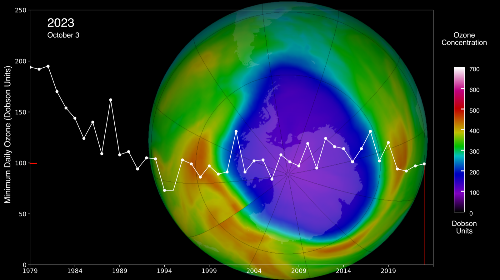
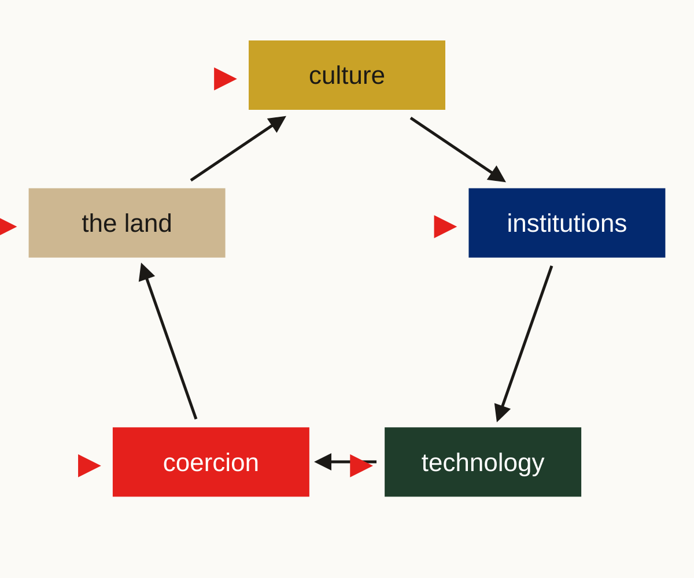

[The interlude](../5b-what-did-the-lifting/) ended on a question. Culture, institutions and technology drive each other in a loop, and where you start the story decides what looks like the cause. So at eight billion, where can we push on the loop?

This chapter is rung 5, the last: eight billion people, one atmosphere, and a technology race that may decide what comes after us. We run chapter 1's five questions on the AI race and on climate, look at the two times we've already cooperated as a planet, and face the dark point of the course: there's still an outside, and it's our children. Then three answers, and my bet on which is most plausible. It ends where the course began, with the organ and the kitchen, and with the chance to become a planetary species.

> [!summary] In this chapter
> 1. **Where can we push?** The last rung, and a poll on fusion.
> 2. **The five questions, on the planet**: the AI race and climate side by side, and the one question that fails.
> 3. **We've done it before**: the ozone layer and smallpox, and why they worked.
> 4. **The first rung with no outside?** The rival outside is gone; the outside has moved from space to time.
> 5. **Three places to push**: rules with teeth, the tech fix, and the widening circle, the most plausible.
> 6. **Your case, at eight billion**: where would you push?
> 7. **Closing the rung**: the three questions, back to the organ, and three take-aways.
> 8. **The last word**: the kitchen, and what you'll seed.
>
> About 20 minutes of reading, plus the exercise.

## 1. Where can we push?

We've climbed four rungs. Bands and villages, where everyone knows everyone. The manufactured tribe, thousands held together by ritual. States, millions held by a ruler and then by gods who watch. Nations and the global order, held by imagined communities, trust in strangers, and treaties.

In the interlude we asked what did the lifting, and the answer was not one thing. It ended on a question: at eight billion, where can we push on the loop? That's what this chapter is about.

> [!poll] Poll: If fusion arrived tomorrow
> Cheap, clean, unlimited energy, from tomorrow. Would climate be solved? Yes / Mostly / No.

Hold that answer. We'll come back to it.

## 2. The five questions, on the planet

Chapter 1 gave us five questions. How many players? Do we meet again? Can we see defection? Can we punish it? Is anyone big enough to act alone? Let's run them on our two planetary cases, side by side. The AI race first, because it's moving fastest; then climate.

| | The AI race | Climate |
|---|---|---|
| How many players? | Few: two states, a handful of labs | A handful at the table, 8 billion behind it |
| Do we meet again? | Unevenly: a few could win big; we could all lose | Not really: the harm lands later and elsewhere |
| Can we see defection? | Fairly well: big data centres, chips, power | More and more: satellites |
| Can we punish it? | No one can | No one can |
| Anyone big enough alone? | No | No |

**How many players?** For the AI race, few. The United States and China, and inside them a handful of frontier labs. That should make it easier: small groups can organise, as chapter 1's hinge said. For climate it's different. At the negotiating table, a handful: China, the United States, India, the EU and Russia put out about two thirds of today's CO₂.[^co2] Behind each of them, millions or billions of people who have to accept the cost. Two games at once: a deal has to hold at the table and at home.

**Do we meet again?** It looks like yes, for ever: there's no leaving the planet. In chapter 2 that was good news: meeting my neighbours again and again makes cooperation pay. But this game isn't symmetric. With climate, the harm from what I do doesn't come back to me at home. It lands on other people, in other parts of the world, and later, on people who aren't born yet. I don't meet them again. With AI, the stakes are uneven in a different way. If it goes badly, we may all lose. If it goes well, a few win very big, and many lose their jobs. So the shadow of the future, which held the village together, is weak here: the people who'll pay most aren't the ones at the table. We'll come back to that.

**Can we see defection?** For climate, more and more. Satellites now spot methane plumes from single gas fields, and big point sources of CO₂. National totals are still mostly reported by the countries themselves, but the gap is closing. For AI, better than you might think. Frontier AI needs huge data centres, vast amounts of power, and advanced chips that come from a handful of companies (Nvidia designs them, TSMC makes them, ASML makes the machines that make them). All of that can be tracked. What's harder to see is what's trained on them, and how carefully.

**Is anyone big enough to act alone?** No. China is about a third of today's emissions, the United States about an eighth. Neither can fix the climate alone. But a handful together could: what Olson called an intermediate group, few enough to notice each other, none big enough alone. In AI, either the US or China could slow down, and the other would gain.

**Can we punish defection?** Here's where it breaks, in both columns. There's no one above the nations to punish. Chapter 5 ended there: still no Leviathan above the states. At this rung, that's the question that fails.

So the diagnosis: we can see more and more, and a few big players could act together. But the people who pay most aren't at the table, and there's no one above the nations who can punish. Hold on to "above".

## 3. We've done it before

And yet we have cooperated at planetary scale before. Twice, very clearly.

**The ozone layer.** In the 1970s and 80s, scientists found that CFCs, the gases in fridges and aerosol cans, were eating the ozone layer. In 1987 the Montreal Protocol began phasing them out. Every country in the UN has since ratified it, the first treaty ever to manage that. The ozone layer is healing, and on current trends should be back to its 1980 state over Antarctica around the 2060s.[^montreal]

*Planetary cooperation that worked: the Antarctic ozone hole on the day of its 2023 minimum, with each year's lowest ozone since 1979. It fell until the 1990s, then stopped falling. NASA Scientific Visualization Studio, public domain.*

Why did it work? Three things. Few players: a handful of companies made most of the CFCs. A substitute: DuPont and others had alternatives close to ready, so cooperating was cheap. And something we haven't seen yet at this rung: **punishment from the side**. Article 4 of the treaty bans trade in these chemicals with countries that don't sign. No world government was needed. If you stay out, you lose the market. That's a club with a border.

**Smallpox.** Smallpox killed perhaps 300 million people in the twentieth century. In 1967 the World Health Organization launched an intensified campaign; the last natural case was in Somalia in 1977, and in 1980 the disease was declared gone.[^smallpox] The United States and the Soviet Union worked on it together, in the middle of the Cold War. It had a finish line: once it's gone, it's gone for everyone. But every country had to get to zero. It needed every one of the lifters we've talked about.

Now set our two cases beside these. Climate has no cheap substitute for everything at once, and the cost falls on billions, not a few companies. There's no finish line: the emissions go on every day. The AI race has few players, like ozone, but no substitute: the thing being raced for is the prize itself. And in neither case has anyone yet built the club with a border.

So: we can do this. But the two we did were the doable ones.

## 4. The first rung with no outside?

At every rung we asked: who was outside? The next village. The rival tribe. The conquered, the enslaved. The colonies. Every circle of cooperation had an outside, and the outside paid the bill.

And at every rung, the outside also did the lifting. Competition between groups is what forced scale: villages merged against raiders, states grew through war. The rival outside was the engine of the climb.

At eight billion there's no rival planet. No outside to race against. But the race hasn't stopped: it's moved inside. The United States and China. The labs. And as we said in the interlude, the contest has turned existential. In the old ratchet, the loser was absorbed. With nuclear weapons, and perhaps with AI, if the contest goes wrong, there's no winner to absorb anyone. We all lose.

And there is an outside after all. Who pays the bill now? The people who aren't here. Our children and their children, and the rest of life on the planet.

**The outside has moved from space to time.** That's the dark point of the course. At this rung, the outside isn't over the border. It's in the future. We're sending the bill to our children, and they can't send it back.

## 5. Three places to push

So where can we push? Back to the interlude's loop: culture, institutions and technology drive each other. That gives three places to push, and three answers that people actually offer.

*The interlude's loop: you can start the story at any box. This chapter pushes on three of them: institutions, technology and culture. Diagram: Seeds of Renaissance.*

- **Rules with teeth** (institutions): someone, or something, that can punish.
- **The tech fix** (technology): make cooperating cheap enough that we don't need to.
- **The widening circle** (culture): change what we want, so the circle takes in everyone.

All three are possible. Let's test each on the record.

### Rules with teeth

The obvious answer to "no one can punish" is: build someone who can. A world government, a planetary Leviathan. Chapter 4's answer at the next scale up.

That's the extreme. What actually exists is more modest: clubs with a border. Montreal's trade ban. William Nordhaus, the climate economist, proposed climate clubs: countries that cut emissions put a tariff on goods from countries that don't.[^nordhaus] The EU's carbon border tax is a step that way. In AI, the US has restricted exports of advanced chips to China since 2022. That's not a club, exactly, more one bloc denying the other, but it's punishment from the side, and it's the start of something.

The weakness? First: who watches the watcher? Every Leviathan in this course was oppressive at the start. Second: AI changes the sums. Chapter 4 said a ruler can't watch everyone. With AI, perhaps one could. A world Leviathan used to be impossible; it may now be possible, and that's not reassuring.

### The tech fix

The second answer says: we don't need to cooperate, we need to invent. Fusion means no need to cut carbon. Alignment means AI will be safe, so no need to slow down. It's the get-out-of-jail-free card.

Back to the poll. Whatever you answered, the record says: not solved. Cheap clean electricity is a huge help. But it doesn't take out the CO₂ already up there; it doesn't touch methane, farming, forests or the oceans; cheaper energy means we use more of everything; and the grids to carry it are a coordination problem in their own right.

The pattern runs right through the record. Technology changes the price of cooperating. It doesn't do the cooperating for us. Montreal worked partly because the substitutes were cheap, but the substitutes, HFCs, turned out to be powerful greenhouse gases, and in 2016 the Kigali Amendment had to phase them down too. The fix made a new commons.

**Technology changes the price of cooperating. Someone still has to buy.**

And alignment? Alignment means an AI does what its owner wants. Which owner? An AI aligned to one lab or one state is the Leviathan answer by another route. Scott Alexander, who wrote *Meditations on Moloch*, ends his essay hoping for an aligned superintelligence, a Gardener, to tend the world.[^moloch] That's a Leviathan dressed as a tech fix. And the race itself is what starves alignment: the more labs race, the less each spends on safety.[^race] Safety research is a public good inside the race. Coordination comes first; alignment needs it.

So the tech fix is possible, and helps. But someone still has to buy.

### The widening circle

> [!reflect] Reflect: Someone born in 2100
> Would you give up something now (a flight, some income, a lead in a race) for a stranger's child born in 2100, whom you'll never meet?

Many of us would say yes, at least a little. People have always planted trees for their grandchildren; caring for strangers that far off is new. The circle of who counts has moved.

This is the third answer, and I think it's the most plausible of the three. Not because it's the nicest. Because it has happened before, it's happening now, and the record of the last two hundred years is full of it.

Look at what we've done. Legal slavery, everywhere for most of history, is now abolished in every country on earth; the last to criminalise it was Mauritania, in 2007. Torture, once ordinary, is banned by a UN convention that most of the world has signed. In 1948, the Universal Declaration of Human Rights said that every human being counts, everywhere. And since Nagasaki, no one has used a nuclear weapon in war. Many scholars put that down less to the weapons than to a norm, the nuclear taboo.[^taboo]

None of this is finished. Some 50 million people are still in forced labour or forced marriage.[^slavery] Torture still happens. And circles go backwards: colonialism and the Holocaust happened at modernity's height. But the direction, over two centuries, is real. These are huge achievements, and no world government made them happen.

**How does it spread?** This is the important part, and it's easy to get wrong. The widening circle doesn't mean everyone becomes enlightened, or that if we were all just good people the problem would go away. That's not how culture changes. It changes the way the interlude showed: by copying.

Take attitudes to gay people. In 1996, about a quarter of Americans supported same-sex marriage. By the early 2020s it was about seven in ten. The Netherlands was the first country to legalise it, in 2001; now more than thirty have.[^ssm] Not everyone sat down and reasoned it through. People saw friends, family and neighbours change their view, copied, and the norm tipped. In online experiments, a committed minority of about a quarter could tip a group's norm.[^centola] Once an attractive idea is seeded in a population, attitudes can move very fast.

Abolition began the same way: small groups of Quakers in Britain in the 1780s, then petitions, then a movement, then law. Culture first, then the rules formalised it. That's the interlude's loop, entered at culture.

**The honest counter-case.** The record at this rung so far points the other way. Montreal worked mostly on price and structure: few producers, a cheap substitute, a trade ban. Norms helped (American consumers boycotted aerosols in the 1970s), but they weren't the main thing. And notice what most of these widenings asked: stop harming someone. Abolition also needed rules, and a navy, and a civil war. Climate and the AI race ask us to pay: to give something up for people we'll never meet. That's harder, and I don't have a clean case of it at this scale yet. If the planetary rung gets solved the way ozone was, technology will ease it and institutions close it, with culture following. That's a fair reading, and I'd hold it beside mine.

**A new worldview.** So here's my bet, and I'd like you to push back on it. Modernity was itself a kind of religion: a shared picture of what's real and what matters (progress, the individual, growth) that bound strangers across the world.[^religion] It got us to eight billion and a global order. It also got us here. The next jump may need a new shared picture. Not a new church: a new sense of what we are.

Thich Nhat Hanh, the Vietnamese Zen teacher, had a word for it: **interbeing**. We don't exist separately. We exist through each other, and through the air, the soil, the rest of life. In that picture nothing is outside: not the people born in 2100, not the rest of life. The circle that started with kin, and widened to the tribe, the nation and humanity, takes in the whole planet.

My bet: without a Leviathan we'd want, culture has to move first for the rules to hold. But I've just given you the case against. Push back on this.

## 6. Your case, at eight billion

> [!exercise] Exercise: Your case, at eight billion
> Take the case you've carried through the course to the scale of the planet.
> 1. Which of the five questions fails?
> 2. Where on the loop would you push: rules, technology or culture?
>
> Write one line: your case, and where you'd push. Keep that line.

## 7. Closing the rung

Let's close rung 5 the way we closed every rung, with the three questions.

Which question did it restore? None, yet. Punishing still fails. Who did the lifting? Open, and I've told you my bet. Who's outside? The future, and the rest of life.

And now back to where we began. In [chapter 0](../0-intro/) I said collective action failure is the failing organ, not the whole disease. We've now looked at that organ at five scales: the village, the tribe, the state, the nation and the planet. The same organ, failing in different ways, and fixed in different ways, at each.

We also said this isn't an ascent. Bigger hasn't meant better. We didn't choose the planetary scale; it's been forced on us by what we've built. The question was never whether to cooperate at this scale. It's whether we can.

Three take-aways from the whole course:

1. **Break it into its games.** A symptom area (the AI race, climate) is several collective action problems. Find them before reaching for a fix.
2. **Ask which question the fix restores.** Seeing, punishing, meeting again, someone big enough, or fewer players.
3. **Rules last longest when culture grows into them.**

> [!key] Key ideas
> - **At eight billion, punishing is the question that fails.** No one above the nations can punish, for the AI race or for climate. And meeting again is weaker than it looks: the people who pay most aren't at the table.
> - **We've done it before, on the doable ones.** Ozone had few producers, a substitute and a trade ban: **punishment from the side**, a club with a border. Smallpox had a finish line.
> - **The outside has moved from space to time.** There's no rival planet, but the race has moved inside and turned existential, and the bill goes to our children and the rest of life.
> - **Three places to push**: rules with teeth (who watches the watcher?), the tech fix (technology changes the price; someone still has to buy), the widening circle (culture).
> - **The widening circle is the most plausible**, because it has happened before and is happening now. It spreads by copying an attractive idea, not by everyone becoming a saint. The case against: most widenings asked us to stop harming; these ask us to pay.

## 8. The last word

Back to the kitchen, where we started.

We've seen three kitchens. The office kitchen, with a sign on the wall: "Please wash your own mug". It works for a week. The flat with a rota: it works while the flatmates like each other. And the family kitchen, where the washing-up gets done and nobody counts. The best kitchens don't run on rules. They run on care.

That's what the widening circle is: the family kitchen, at the scale of the planet. It sounds impossible. But a few hundred years ago a world without legal slavery sounded impossible too, and a universal declaration that every human being has rights. We have made these jumps in human brotherhood and sisterhood before. Each time, it started with a few people, an idea worth copying, and a moment when the old picture stopped working.

This may be that moment: we've run out of places to send the bill, except our own children. The chance is to become, for the first time, a planetary species: to see that we're part of each other, and of the planet.

The circle has widened before. We can do it again. **What will you seed?**

Thich Nhat Hanh ends *Love Letter to the Earth* with an afterword he called "Toward a Cosmic Religion". This is the passage I want to leave you with.

> In the twenty-first century it should be possible for us to come together and offer ourselves the kind of religion that can help unite all peoples and all nations, and remove all separation and discrimination. … it will be possible to establish a cosmic religion based not on myth, belief, or dogma, but on evidence and the insight of interbeing. And that would be a giant leap for humankind.
>
> — Thich Nhat Hanh, *Love Letter to the Earth*, Afterword[^tnh]

Notice what he asks for: not belief, not dogma, but evidence and insight. Not everyone becoming a saint: a shared picture, seeded and copied, the way every widening of the circle has spread.

We can do this.

---

## Going further

### Antarctica

The 1959 Antarctic Treaty: twelve countries froze their territorial claims and kept a continent for science. Few players, low stakes: a success, but an easy one.

### Climate clubs in depth

Nordhaus's design, the EU's carbon border tax, and why a club needs a tariff to stop free-riding. Without a penalty on outsiders, every country does best by staying out and enjoying the cuts others make; the tariff makes staying out cost more than joining, as Montreal's trade ban did.[^nordhaus]

### The race after alignment

Even with alignment solved, the race may not be over. The authors of *Gradual Disempowerment* argue that competition between AI-powered firms and states could keep selecting for whatever wins, and slowly push people out of the decisions that matter.[^gd]

### The wisdom gap

The biologist E. O. Wilson put it this way: "The real problem of humanity is the following: we have Paleolithic emotions, medieval institutions, and god-like technology." The gap between what we can do and how well we can decide together is this course's subject at its largest.

### Technosolutionism and the ascent narrative

"Progress will fix it" is a story, not a plan. The tech fix above is where it shows: technology changes the price of cooperating, and leaves the cooperating to us. Chapter 0's second myth, that the climb is an ascent of civilisation, is the same story told about the past.

Image credits: [assets/SOURCES.md](assets/SOURCES.md).

[^co2]: Shares of global CO₂ emissions in 2023: China about 31%, the US about 13%, India about 8%, the EU about 7%, Russia about 5% (Our World in Data, from the Global Carbon Project). Cumulatively the order flips, with the US about 24% and China about 15%: the root of the fairness fight.
[^montreal]: The Montreal Protocol and its parent, the Vienna Convention, reached universal ratification in 2009. Trade with non-parties: Montreal Protocol, Article 4. Recovery: WMO/UNEP, *Scientific Assessment of Ozone Depletion: 2022* (back to 1980 levels around 2066 over Antarctica). On price and structure as the main reasons it worked: Sunstein, "Of Montreal and Kyoto: A tale of two protocols", *Harvard Environmental Law Review* 31 (2007).
[^smallpox]: WHO Intensified Smallpox Eradication Programme from 1967; last natural case, Somalia, October 1977; eradication declared by the World Health Assembly in 1980. About 300 million deaths in the twentieth century is a commonly cited estimate.
[^nordhaus]: William Nordhaus, "Climate clubs: Overcoming free-riding in international climate policy", *American Economic Review* 105(4) (2015).
[^moloch]: Scott Alexander, "Meditations on Moloch", *Slate Star Codex* (2014).
[^race]: Stuart Armstrong, Nick Bostrom and Carl Shulman, "Racing to the precipice: a model of artificial intelligence development", *AI & Society* 31 (2016).
[^taboo]: Nina Tannenwald, "The nuclear taboo: The United States and the normative basis of nuclear non-use", *International Organization* 53(3) (1999). Others credit deterrence; this is one reading. Torture: UN Convention against Torture (1984), 174 states parties as of 2024. Slavery: Mauritania abolished it in 1981 and made it a crime in 2007.
[^slavery]: ILO, Walk Free and IOM, *Global Estimates of Modern Slavery: Forced Labour and Forced Marriage* (2022): about 50 million people.
[^ssm]: US support for same-sex marriage: 27% in 1996, about 70% in the early 2020s (Gallup). The Netherlands legalised it in 2001.
[^centola]: Damon Centola, Joshua Becker, Devon Brackbill and Andrea Baronchelli, "Experimental evidence for tipping points in social convention", *Science* 360 (2018): about 25% in online experiments. A finding from the lab, not a law of nature.
[^religion]: My view, offered as a way of seeing rather than a claim. Compare Yuval Noah Harari on humanism as a religion, in *Homo Deus* (2016).
[^tnh]: Thich Nhat Hanh, *Love Letter to the Earth* (Parallax Press, 2013), Afterword, "Toward a Cosmic Religion".
[^gd]: Jan Kulveit and others, *Gradual Disempowerment: Systemic Existential Risks from Incremental AI Development* (2025).

---

*That's the last chapter of the course. To go round again, start from the playground in [Chapter 0](../0-intro/).*

[← Interlude: What did the lifting?](../5b-what-did-the-lifting/) · [Course home](../)
